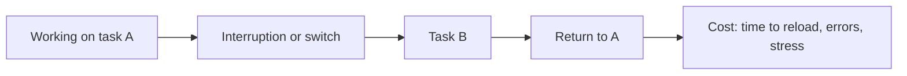

# Attention and multitasking

## Summary

Attention is the limited capacity of the mind to select what to process. Doing two demanding tasks at once is mostly rapid switching between them, and every switch costs time and accuracy. Interruptions have a further cost, because returning to the interrupted task takes minutes. Fear of missing out (FOMO) is a worry that others are having rewarding experiences without you, and it is linked to heavier use of social media. Managing attention means protecting blocks of focus, reducing interruptions and choosing what deserves the limited supply.

*This note is educational.*

## Prerequisites

No prior notes are needed.

## Core concepts

### Definition

Posner and Petersen (1990) described three attention networks: *alerting* (staying ready), *orienting* (selecting a location or a stimulus) and *executive control* (resolving conflict and directing action). *Attention management* is the set of practices that direct these resources to the intended task. It differs from time management in that it treats attention and energy as the scarce resource, and not only hours.

### The cost of switching

Rubinstein, Meyer and Evans (2001) measured the time cost of switching between tasks and found that switching takes time, more for complex tasks and for unfamiliar ones. Mark, Gudith and Klocke (2008) studied interrupted work and found that people compensate by working faster, and pay with more stress, frustration and effort.

### Analogy

Attention is a spotlight on a stage: it lights one area well, and a second area only if the beam is moved. A "double beam" does not exist. The limit of the analogy is that some tasks, such as walking and talking, are so automatic that they use little of the beam.

### States of attention

Practitioners distinguish focused attention (on one task), diffuse attention (mind wandering, useful for creative thought) and fragmented attention (constant switching). A day usually needs the first two and avoids the third.

### FOMO

Przybylski and colleagues (2013) defined fear of missing out as the pervasive apprehension that others might be having rewarding experiences from which one is absent, and built a scale. They found that FOMO was higher in people with lower satisfaction of psychological needs, and was linked to more use of social media. Symptoms include constant checking and difficulty in leaving a conversation or a feed.

### Techniques

| Technique | Idea |
| --- | --- |
| Single-tasking | One task in the focus block |
| Notification control | Turn off alerts, check messages at set times |
| Time boxing | Short, fixed work periods with breaks |
| Environment design | Phone out of sight, one window open |
| Batching | Handle similar small tasks together |
| Planned diffuse time | Walks and breaks for mind wandering |

## Worked example

A person answers messages whenever they arrive, 24 times in 4 hours. If each switch costs a conservative 5 minutes to regain focus (illustrative), the lost time is:

| Pattern | Switches | Lost minutes |
| --- | --- | --- |
| Reply on arrival | 24 | 120 |
| Check 4 times at fixed times | 4 | 20 |

The assumed 5 minutes is an illustration and the real cost varies. The principle is that the number of switches is the lever.

## Trade offs and when to use it

Protecting attention raises the quality of cognitively demanding work. Some jobs require quick replies, so set agreements about response times. Perfect focus is not possible, and breaks are needed.

## Common mistakes

- **Believing that multitasking is free.** Each switch has a cost.
- **Treating checking as work.** It is switching.
- **Ignoring FOMO triggers.** Notifications feed it.

## Practice

1. What are the three attention networks of Posner and Petersen (1990)?
2. What does interrupted work cost, according to Mark and colleagues (2008)?
3. Define FOMO.

### Answers

1. Alerting, orienting and executive control.
2. People work faster to compensate, and pay with more stress, frustration and effort.
3. The pervasive apprehension that others might be having rewarding experiences from which one is absent.

## Further reading

- Posner, M. I. and Petersen, S. E. (1990). The Attention System of the Human Brain. *Annual Review of Neuroscience*, 13(1), 25-42. [DOI](https://doi.org/10.1146/annurev.ne.13.030190.000325). A model of three attention networks in the brain.
- Rubinstein, J. S., Meyer, D. E. and Evans, J. E. (2001). Executive control of cognitive processes in task switching. *Journal of Experimental Psychology: Human Perception and Performance*, 27(4), 763-797. [DOI](https://doi.org/10.1037/0096-1523.27.4.763). Measures the time cost of switching between tasks.
- Mark, G., Gudith, D. and Klocke, U. (2008). The cost of interrupted work. *Proceedings of the SIGCHI Conference on Human Factors in Computing Systems*, 107-110. [DOI](https://doi.org/10.1145/1357054.1357072). Shows the cost of interrupted work.
- Przybylski, A. K., Murayama, K., DeHaan, C. R. et al. (2013). Motivational, emotional, and behavioral correlates of fear of missing out. *Computers in Human Behavior*, 29(4), 1841-1848. [DOI](https://doi.org/10.1016/j.chb.2013.02.014). Defines and measures the fear of missing out.
