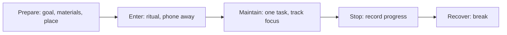

# Deep work and deep dives

## Summary

Deep work is professional activity done in a state of distraction-free concentration that pushes cognitive abilities to their limit. Cal Newport (2016) argues that it is increasingly valuable, since it produces new value and is increasingly rare, and he proposes rules for protecting it. A deep dive is a related practice: an extended, focused study of one topic to reach a working understanding. The idea is a framework from a practitioner book, and its parts rest on research on attention and learning.

*This note is educational.*

## Prerequisites

- [Attention and multitasking](attention-and-multitasking.md).
- [Flow state](flow-state.md).

## Core concepts

### Definition

*Deep work* is distraction-free, cognitively demanding work. *Shallow work* is logistical, low-demand work that can be done while distracted, such as email and scheduling. Newport (2016) holds that deep work builds skill and produces results that are hard to copy, and that shallow work is necessary but should be limited.

### Analogy

Deep work is like a long-distance run, and shallow work is like walking around the office. Both move the body, and only one builds endurance. The limit of the analogy is that shallow work is also needed to keep the organization running.

### Approaches to scheduling

| Approach | Description | Fits |
| --- | --- | --- |
| Monastic | Remove shallow work almost completely | Researchers, writers with control over their time |
| Bimodal | Alternate long deep periods with normal periods | Academics, consultants |
| Rhythmic | A fixed daily deep block | Most knowledge workers |
| Journalistic | Fit deep work into any free gap | Experienced people who switch focus easily |

### Practice

| Phase | Actions |
| --- | --- |
| Prepare | Decide the goal of the session and gather what is needed |
| Enter | Start at a fixed time and place, silence alerts |
| Maintain | Keep a mark for each distraction, return to the task |
| Stop | Write the next step so that the next session can start fast |

### Deep dive

A *deep dive* is a planned period of intense study of a single topic. A workable format: set a question, collect a small number of good sources, read and make notes, explain the topic in your own words, test understanding and record the open questions. It differs from deep work in aim: its output is understanding and the work product is the by-product. The deep dive uses the techniques in [learning techniques](../../learning-techniques.md) and [metacognition](../cognitive/metacognition.md).

### Evidence

The mechanisms Newport relies on are documented: switching costs and interruptions lower performance (see [attention and multitasking](attention-and-multitasking.md)), and focused practice supports skill (see [deliberate practice](../../deliberate-practice.md)). The claims that deep work is becoming rarer and more valuable are arguments and are not tested studies.

## Worked example

A writer wants to produce a report of 5,000 words in two weeks.

| Element | Plan |
| --- | --- |
| Deep block | 9:00 to 11:00, five days a week |
| Environment | Phone in another room, email closed |
| Target | 500 words per block |
| Shallow work | Email at 11:15 and 16:00 |
| Shutdown | Write the first sentence of tomorrow's section |

The plan reserves the most alert hours for the demanding task, and limits the shallow work to two windows.

## Trade offs and when to use it

Deep work suits tasks that need concentration and where output is not instant. It is hard in jobs that need constant availability. Rest is part of the method, since focus cannot be held for a whole day.

## Common mistakes

- **Scheduling deep work in the low-energy part of the day.** Use alert hours.
- **Having no end ritual.** The next session starts cold.
- **Treating all busy time as deep.** Meetings and email are shallow.

## Practice

1. Define deep work and shallow work.
2. Name two scheduling approaches.
3. How does a deep dive differ from deep work?

### Answers

1. Deep work is distraction-free, cognitively demanding work, and shallow work is low-demand logistical work.
2. For example the rhythmic approach (a fixed daily block) and the bimodal approach.
3. Its aim is understanding of a topic, and the work product is a by-product.

## Further reading

- Newport, C. (2016). *Deep Work: Rules for Focused Success in a Distracted World*. Grand Central. Defines deep work and gives rules for protecting it.
- Csikszentmihalyi, M. (1990). *Flow: The Psychology of Optimal Experience*. Harper & Row. The founding account of the flow state.
