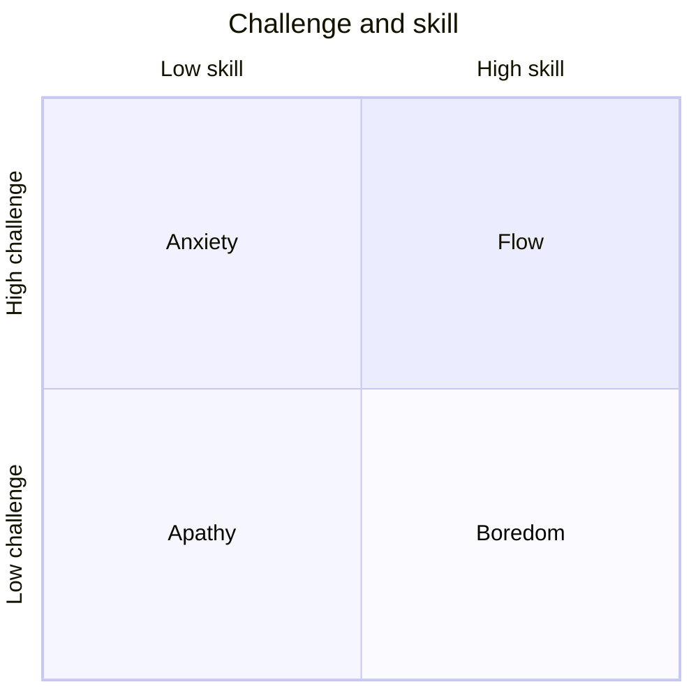

# Flow state

## Summary

Flow is a state of full absorption in an activity, in which action and awareness merge, time seems to change and the work feels effortless and enjoyable. The psychologist Mihaly Csikszentmihalyi described it from interviews and experience sampling studies. Flow tends to occur when the challenge of a task matches the person's skill, goals are clear and feedback is immediate. Flow is rewarding, but it cannot be forced, and the research is mostly based on self-report.

*This note is educational.*

## Prerequisites

- [Attention and multitasking](attention-and-multitasking.md).

## Core concepts

### Definition

*Flow* is an optimal experience in which a person is fully involved in an activity for its own sake (Csikszentmihalyi, 1990). The characteristics reported are: clear goals, immediate feedback, a balance of challenge and skill, a merging of action and awareness, concentration on the task, a sense of control, loss of self-consciousness and a transformed sense of time.

### Analogy

Flow is like the state of a musician in a good performance, where the fingers know the way and the mind follows the music. The limit of the analogy is that the musician has trained for years, and flow needs skill at the task.

### Challenge and skill

When challenge is high and skill is low, the result is anxiety. When skill is high and challenge is low, the result is boredom. When both are low, apathy. When both are high and matched, flow becomes possible. Models differ in details, and most agree on the balance.

### Conditions and practice

| Condition | How to create it |
| --- | --- |
| Clear goal | Define what the next 30 minutes should produce |
| Immediate feedback | Choose tasks where results are visible, such as tests passing or a sentence written |
| Balance | Adjust difficulty: add a constraint if bored, break down the task if anxious |
| No interruptions | Block time, silence alerts |
| Intrinsic interest | Work on something that matters to you |

### Evidence

Most evidence comes from interviews and from experience sampling, in which people report their state at random times. Flow is associated with higher reported enjoyment and performance in many activities, including sports, music and work. Self-report measures make it hard to separate flow from enjoyment and engagement, and causal claims are limited.

## Worked example

A programmer is bored by routine tickets and anxious about a large migration.

| Task | State | Adjustment |
| --- | --- | --- |
| Routine ticket | Boredom | Add a challenge: finish in half the time, or write a test first |
| Large migration | Anxiety | Split into steps with a visible result for each |
| Medium refactor with clear tests | Near flow | Block two hours, no messages |

The adjustment aims at a match between challenge and skill, and the plan protects the conditions.

## Trade offs and when to use it

Flow supports learning and enjoyment, and is worth designing for in work that needs skill. It cannot be forced, and chasing it can interfere with it. Flow can also occur in harmful activities, such as some games and gambling, so goals should be chosen with care.

## Common mistakes

- **Expecting flow in every task.** Many tasks do not allow it.
- **Confusing flow with distraction.** It involves effortful concentration.
- **Ignoring skill.** Flow needs a minimum of skill at the task.

## Practice

1. Name three characteristics of flow.
2. What happens when skill is high and challenge is low?
3. How can a task be adjusted if it causes anxiety?

### Answers

1. For example clear goals, immediate feedback and a balance of challenge and skill.
2. Boredom.
3. Break it into smaller steps with visible results, which lowers the challenge.

## Further reading

- Csikszentmihalyi, M. (1990). *Flow: The Psychology of Optimal Experience*. Harper & Row. The founding account of the flow state.
