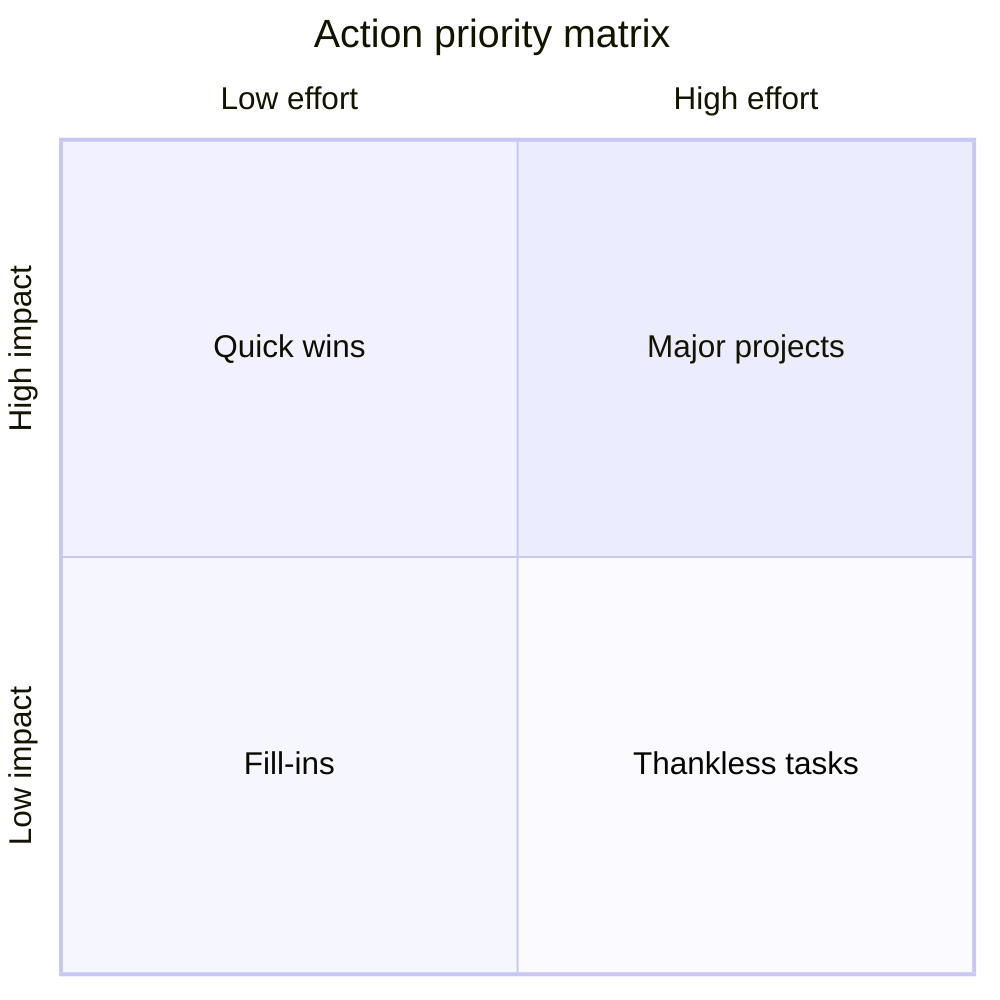

# Prioritization

## Summary

Prioritizing is choosing what to do first, what to do later and what not to do. The usual tools classify tasks on two dimensions: importance and urgency (the Eisenhower matrix popularized by Covey), or impact and effort (the action priority matrix). People tend to work on what is urgent and easy to finish, and not on what is important. Research on the mere urgency effect shows that a short deadline attracts choice even when the reward is smaller.

*This note is educational.*

## Prerequisites

- [Time management](time-management.md).

## Core concepts

### Definition

*Prioritization* is ranking tasks by their value for goals and by their constraints (deadline, effort, dependencies). Two common matrices:

| Matrix | Axes | Categories |
| --- | --- | --- |
| Eisenhower (urgent-important) | Importance and urgency | Do now, schedule, delegate, drop |
| Action priority | Impact and effort | Quick wins, major projects, fill-ins, thankless tasks |

The four Ds (do, defer, delegate, delete) are a short form of the first matrix.

### The mere urgency effect

Zhu, Yang and Hsee (2018) showed that people tend to choose tasks with a short deadline over tasks with a longer deadline and a larger payoff, even when the urgent task is objectively worse. Urgency acts as a cue that draws attention. This explains why inboxes and alerts dominate days.

### Analogy

Prioritizing is like triage in an emergency room: the aim is the greatest benefit with the limited staff, and the loudest patient is not always the sickest. The limit of the analogy is that in an emergency room, the criteria are medical, and for personal goals they are chosen by the person.

### The matrices

Quick wins (high impact, low effort) come first. Major projects (high impact, high effort) need planning and protected time. Fill-ins (low impact, low effort) fit in gaps. Thankless tasks (low impact, high effort) are candidates to drop or delegate.

### Factors that set priority

Deadline, impact on goals, dependencies (what waits for this), effort, risk of delay and who else is affected. A task that others are waiting on usually moves up.

### Moving the needle and the ABCDE method

To "move the needle" means to work on the activities that change the main measure of progress. The ABCDE method labels tasks A (must do) to E (eliminate), and numbers tasks within a category (A1, A2). Both are practitioner methods without a research base of their own, and they apply the same principle: rank by value.

## Worked example

A person has six tasks and scores each on impact and effort (1 to 5, illustrative).

| Task | Impact | Effort | Class |
| --- | --- | --- | --- |
| Reply to a client question | 4 | 1 | Quick win |
| Write the proposal | 5 | 4 | Major project |
| Tidy the shared folder | 1 | 1 | Fill-in |
| Prepare a monthly report nobody reads | 1 | 4 | Thankless |
| Call a supplier | 3 | 1 | Quick win |
| Learn a new tool | 3 | 4 | Major project |

Order: the two quick wins, then block time for the proposal, delegate or drop the report, and use gaps for the folder. The scores are the person's own judgment.

## Trade offs and when to use it

Matrices make hidden choices visible, and cost a few minutes. Ratings are subjective, and a quadrant can hide dependencies. Review weekly, because priorities change.

## Common mistakes

- **Working on what is urgent and easy.** The mere urgency effect.
- **Putting everything in one quadrant.** Rank within it.
- **Ignoring dependencies.** A small task that blocks others is a priority.

## Practice

1. What are the four categories of the action priority matrix?
2. What does the mere urgency effect show?
3. What do the four Ds stand for?

### Answers

1. Quick wins, major projects, fill-ins and thankless tasks.
2. People pick tasks with short deadlines over tasks with a larger payoff and a longer deadline.
3. Do, defer, delegate and delete.

## Further reading

- Covey, S. R. (1989). *The 7 Habits of Highly Effective People*. Free Press. Popularized the urgent-important matrix.
- Zhu, M., Yang, Y. and Hsee, C. K. (2018). The Mere Urgency Effect. Journal of Consumer Research. [DOI](https://doi.org/10.1093/jcr/ucy008). Shows that people prefer urgent tasks with short deadlines over more important ones.
