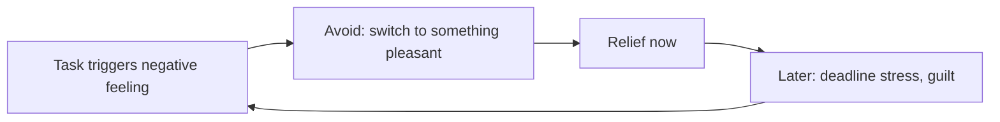

# Procrastination

## Summary

Procrastination is voluntarily delaying an intended action despite expecting to be worse off for the delay. A meta-analysis shows that it is linked to low self-efficacy, impulsiveness, low conscientiousness, and to tasks that are aversive or far from reward. Researchers now treat it mainly as a problem of managing emotions in the short term: people avoid the bad feeling a task brings. Effective responses reduce the aversiveness of the task, make rewards sooner and use commitment.

*This note is educational. It is not mental health advice.*

## Prerequisites

- [Self-regulation, self-control and self-discipline](../../../personal-growth/self-regulation.md).

## Core concepts

### Definition

Steel (2007) defines *procrastination* as the voluntary delay of an intended course of action despite expecting to be worse off. His meta-analysis found that the strongest correlates were low conscientiousness, low self-efficacy and, for the task, aversiveness and delay of reward. The temporal motivation model expresses it as: motivation rises with the expectation of success and the value of the task, and falls with the delay and with the person's sensitivity to delay.

### Analogy

Procrastination is trading a small present comfort for a larger future cost, like skipping a small repair that grows into a large one. The limit of the analogy is that the person usually knows the trade is bad, and does it anyway.

### The emotion view

Sirois and Pychyl (2013) describe procrastination as a short-term mood repair: the person avoids the negative feelings of a task, such as anxiety or boredom, and gets immediate relief at the cost of later stress.

### Types

Popular accounts list types such as the perfectionist, the thrill seeker, the avoider, the crisis maker and the overbooker. They are a practitioner typology and not a research taxonomy. They are useful as prompts for finding the reason in one's own case.

### What helps

| Cause | Response |
| --- | --- |
| Task is vague | Define the first physical action |
| Fear of failure | Lower the bar for a first draft |
| Reward far away | Add an immediate reward or a deadline with someone else |
| Distractions at hand | Change the environment |
| Overwhelm | Break into small steps, start with five minutes |
| "Shiny object" syndrome | Keep a parking list for new ideas, and finish before starting |

## Worked example

A person avoids writing a report.

| Step | Action |
| --- | --- |
| 1 | Name the feeling: anxiety about getting it wrong |
| 2 | Define the first action: write the title and three headings |
| 3 | Time box: 15 minutes, with the phone in another room |
| 4 | Commit: send the outline to a colleague by 4 pm |
| 5 | Reward: a walk after the outline |

Fifteen minutes lowers the threshold, and the colleague adds an external deadline. Most of the difficulty is in starting.

## Trade offs and when to use it

Some delay is useful, for example when waiting for information. Chronic procrastination can signal anxiety, depression or ADHD, and a professional assessment is appropriate when it is severe or harms work and health.

## Common mistakes

- **Treating it as laziness.** It is mostly emotion regulation.
- **Relying on guilt.** It strengthens avoidance.
- **Planning big first steps.** Start small.

## Practice

1. How does Steel (2007) define procrastination?
2. What is the mood repair view?
3. Name two responses that fit a task that feels vague.

### Answers

1. Voluntarily delaying an intended action despite expecting to be worse off.
2. People avoid the negative feelings of a task and get short-term relief at a later cost.
3. Define the first physical action and time box a short start.

## Further reading

- Steel, P. (2007). The nature of procrastination: A meta-analytic and theoretical review of quintessential self-regulatory failure. *Psychological Bulletin*, 133(1), 65-94. [DOI](https://doi.org/10.1037/0033-2909.133.1.65). A meta-analysis of the causes and effects of procrastination.
- Sirois, F. and Pychyl, T. (2013). Procrastination and the Priority of Short‐Term Mood Regulation: Consequences for Future Self. *Social and Personality Psychology Compass*, 7(2), 115-127. [DOI](https://doi.org/10.1111/spc3.12011). Procrastination as short-term mood repair.
