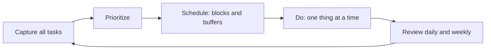

# Time management

## Summary

Time management is the use of planning, prioritizing and scheduling to spend limited time on what matters. A meta-analysis found that time management behaviors are linked to better academic performance, and to better well-being and lower stress, and less so to job performance. The effects come from small, specific habits such as keeping a schedule, setting priorities and protecting blocks of time, and not from elaborate systems. Time itself cannot be managed. Attention and commitments can.

*This note is educational.*

## Prerequisites

No prior notes are needed.

## Core concepts

### Definition

*Time management* is a set of behaviors aimed at using time effectively for goal-directed activities. Aeon, Faber and Panaccio (2021) meta-analyzed 158 samples and found positive links between time management and academic achievement, job performance and well-being, with the strongest link to well-being and a weaker one to job performance.

### Analogy

Time is a budget that cannot be saved or increased: it is spent at the same rate every day. Time management is deciding what to buy with it, and how to avoid impulse spending. The limit of the analogy is that spending cannot be postponed, and unspent hours do not carry over.

### Styles

People differ in how they plan: some work from a detailed calendar, some from a short list, and some from a few daily goals. No style fits everyone. What the research supports is that some planning is better than none, and that perceived control over time matters.

### Techniques

| Technique | How it works |
| --- | --- |
| 3-2-1 method | Three tasks to finish, two to start, one to review, chosen at the day's start |
| Time blocking | Reserve calendar blocks for specific work |
| Buffer time | Leave gaps between tasks for overruns and transitions |
| 20-20-20 rule | Every 20 minutes look at something 20 feet away for 20 seconds, as a break for the eyes |
| Weekly review | Look at the past week and plan the next |
| Say no | Decline requests that do not fit priorities |

The 20-20-20 rule is advice from eye care and is not a time-management method. It is a prompt for regular breaks. The other items are common practitioner methods whose evidence is indirect.

### Buffer time

*Buffer time* is unscheduled time between commitments. It absorbs overruns (see the planning fallacy in [planning and contingency](../cognitive/planning-and-contingency.md)) and gives room for transition. Without it, one delay cascades through the day.

## Worked example

A person has an 8-hour day with 6 hours of meetings and tasks planned back to back.

| Plan | Total planned | Slack | Result |
| --- | --- | --- | --- |
| Back to back | 8 h | 0 | One overrun delays all |
| With buffers | 6.5 h | 1.5 h | Overruns are absorbed |

The second plan has less planned work and more finished work in practice. The numbers are an illustration of the principle.

## Trade offs and when to use it

Planning costs time, and the benefit is largest for people who face many competing demands. Rigid schedules can reduce flexibility, and perfectionism about the system is a form of procrastination. A simple routine, reviewed regularly, is better than a complex one that is dropped.

## Common mistakes

- **Planning every minute.** Leave buffers.
- **Switching systems often.** The habit matters more than the tool.
- **Mistaking busyness for priority.** Check what moves goals.

## Practice

1. Which outcome had the strongest link to time management in Aeon and colleagues (2021)?
2. What is buffer time for?
3. Is the 20-20-20 rule a time-management method?

### Answers

1. Well-being.
2. It absorbs overruns and gives time for transition.
3. No, it is advice from eye care that prompts regular breaks.

## Further reading

- Aeon, B., Faber, A. and Panaccio, A. (2021). Does time management work? A meta-analysis. *PLOS ONE*, 16(1), e0245066. [DOI](https://doi.org/10.1371/journal.pone.0245066). A meta-analysis of time management and its links to performance and well-being.
- Buehler, R., Griffin, D. and Ross, M. (1994). Exploring the "planning fallacy": Why people underestimate their task completion times. *Journal of Personality and Social Psychology*, 67(3), 366-381. [DOI](https://doi.org/10.1037/0022-3514.67.3.366). Shows the planning fallacy.
- Covey, S. R. (1989). *The 7 Habits of Highly Effective People*. Free Press. Popularized the urgent-important matrix.
