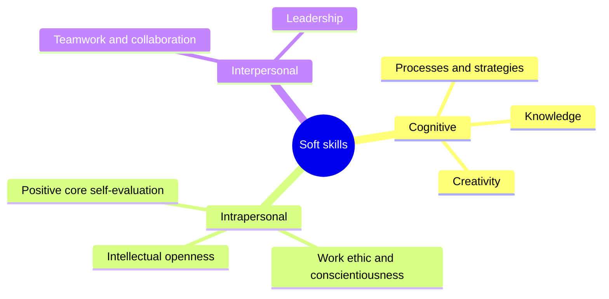
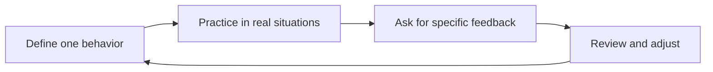

# Soft skills fundamentals

## Summary

Soft skills are transferable skills that govern how a person thinks, manages themselves and works with others: communication, collaboration, self-regulation, problem solving, adaptability. They apply in almost any job, which makes them valuable, and they show only in behavior in context, which makes them hard to measure and easy to overclaim. Research links some of them, especially conscientiousness and social skills, to education, earnings and job performance, though much of the evidence is correlational. They can be developed, but by practicing specific behaviors with feedback, not by reading lists of tips.

## Prerequisites

[What is a skill](../what-is-a-skill.md) for the vocabulary of skills, knowledge and competence.

## Core concepts

### Definition

*Soft skills* are learned, transferable patterns of thinking, feeling and behaving that help a person handle tasks, other people and themselves across many situations. Common synonyms are *transferable skills*, *21st century skills*, *non-cognitive skills*, *socio-emotional skills* and *employability skills*. The names reflect different research traditions:

- Economists such as James Heckman use *non-cognitive skills* or *character skills* for traits not captured by IQ or achievement tests, such as conscientiousness and perseverance.
- The US National Research Council (2012) uses *21st century competencies* and divides them into cognitive, intrapersonal and interpersonal domains.
- The OECD uses *social and emotional skills* and organizes them around the Big Five personality dimensions.

What they share: the skills are not specific to one job, they show in behavior, and they are at least partly learnable.

*Analogy.* If hard skills are the tools in a workshop, soft skills are how the craftsperson works: whether they plan the job, keep the bench in order, ask the customer what they really need, stay calm when a piece breaks and explain the bill. The same tools give very different results in different hands. The analogy breaks because it suggests soft skills are secondary to the tools. In many jobs (sales, management, teaching) the "how" is the main product.

### Origin of the term

The term comes from US Army training research. Training manuals in the late 1960s and a 1972 conference of the Continental Army Command (CONARC) separated "hard skills", tasks involving machines, from "soft skills", job-related skills involving little or no interaction with machines and applied in many settings. The participants already found the labels unsatisfactory. The term spread into business and education from the 1990s.

### Three domains

The National Research Council report *Education for Life and Work* (2012) grouped transferable competencies into three domains with clusters:

| Domain | Clusters | Examples |
| --- | --- | --- |
| Cognitive | Cognitive processes and strategies, knowledge, creativity | Critical thinking, problem solving, reasoning, creativity |
| Intrapersonal | Intellectual openness, work ethic and conscientiousness, positive core self-evaluation | Self-regulation, persistence, adaptability, curiosity |
| Interpersonal | Teamwork and collaboration, leadership | Communication, cooperation, conflict resolution, influence |

This grouping is used in this library to organize planned soft skill notes. Note that the cognitive domain includes skills such as critical thinking that are not "soft" in the everyday sense, which shows how loose the label is.

The three domains and their clusters, as in the table:

### Relation to personality

Many soft skills overlap with personality traits, especially the Big Five (openness, conscientiousness, extraversion, agreeableness, emotional stability). The difference is one of emphasis:

- A *trait* describes how a person typically tends to think, feel and act.
- A *skill* describes what a person can do when the situation requires it.

An introvert (a trait) can be skilled at presenting to a large audience (a skill), although it may cost them more energy. Traits are relatively stable but not fixed: a meta-analysis of 207 studies (Roberts et al., 2017) found that interventions, mostly clinical, produced measurable personality change within an average of 24 weeks, largest for emotional stability. Skills change more readily with practice.

### Evidence of importance

- **Conscientiousness and job performance.** Barrick and Mount (1991), in a meta-analysis across five occupational groups, found that conscientiousness was the Big Five trait most consistently related to job performance across occupational groups.
- **Life outcomes.** Heckman and Kautz (2012), reviewing economic and psychological research, argued that character skills predict schooling, earnings, health and crime about as well as cognitive ability in many studies, and that they can be developed, especially in childhood and adolescence.
- **Social skills in the labor market.** Deming (2017) showed that between 1980 and 2012 jobs requiring high levels of social interaction grew by nearly 12 percentage points as a share of the US labor force, while math-intensive but less social jobs shrank by 3.3 points. Employment and wage growth were strongest in jobs that need both math and social skills, and he argued that social skills are hard to automate.
- **Education programs.** A meta-analysis of 213 school-based social and emotional learning programs (Durlak et al., 2011) found improvements in social and emotional skills, behavior and an average 11 percentile point gain in academic achievement.
- **Employer demand.** Employer surveys such as the World Economic Forum's *Future of Jobs Report 2025* rank analytical thinking, resilience, flexibility and agility, and leadership and social influence among the most important skills. Employer surveys measure stated priorities, not proven effects.

The NRC committee itself noted that most research linking these competencies to outcomes is correlational. Causal evidence exists mainly for early childhood programs and for some school programs.

### Measurement

Soft skills are hard to measure because they show only in behavior in context. Common methods and their limits:

| Method | Strengths | Limits |
| --- | --- | --- |
| Self-report questionnaires | Cheap, many items | Social desirability, faking in selection, reference bias (people compare themselves with different standards) |
| Ratings by others (for example 360 degree feedback) | Several perspectives | Rater bias, halo effects |
| Situational judgment tests | Standardized, job related | Measure knowledge of good behavior more than behavior itself |
| Assessment centers and work simulations | Observe behavior directly | Expensive, need trained assessors |
| Structured behavioral interviews | Evidence from past behavior | Depend on candidate's honesty and interviewer skill (see [job interview](../../career/job-search/job-interview.md)) |

A practical consequence: on a resume, "excellent communication skills" is a claim nobody can check. A described result ("presented the quarterly plan to 40 regional managers and got approval in one meeting") is evidence.

### How soft skills develop

Soft skills develop like other skills, through practice with feedback (see [skill acquisition](../skill-acquisition.md)), with three complications:

1. **The behavior must be defined.** "Better communication" cannot be practiced. "Summarize the decision and next steps in two sentences at the end of every meeting" can.
2. **Practice happens in real situations,** where stakes and emotions are real. Simulations and role play help to prepare.
3. **Feedback is social and often absent.** People rarely tell a colleague that they interrupt too often. Ask for specific feedback (see [feedback and promotion](../../career/growth/feedback-and-promotion.md)).

Coaching is one structured way to develop soft skills at work. A meta-analysis by Theeboom, Beersma and van Vianen (2014) found positive effects of workplace coaching on performance, well-being, coping and goal attainment (see [coaching techniques for career](../../career/methods/coaching-techniques-for-career.md)).

The development loop has the same shape as deliberate practice, but it runs in real situations:

## Worked example

Turning "be a better team player" into a practice plan.

1. **Feedback received:** "In meetings you push your idea and others stop contributing."
2. **Specific behavior to practice:** before arguing for your own proposal, ask at least one other person for their view and summarize it back accurately.
3. **Practice context:** the weekly planning meeting, 6 people, 45 minutes.
4. **Measure:** a trusted colleague counts, for four weeks, how many times you summarize another person's view before your own argument, and how many people speak in the meeting.
5. **Feedback loop:** a five minute conversation with the colleague after each meeting.
6. **Review after four weeks:** compare the counts with the first week and ask the team lead whether the meetings changed.

The result is not "better teamwork" in general, but a measurable change in one behavior that others noticed. Numbers in the example are illustrative.

## Trade offs and when to use it

- **Hard to verify.** Soft skills are easy to claim and hard to prove. Use concrete evidence in resumes and interviews.
- **Context matters.** Assertive communication that works in one culture or team may be read as aggression in another.
- **Overlap with personality.** Expect individual differences in how easy a skill feels. Practice still helps.
- **The label hides variety.** "Soft skills" groups very different things. Treat each skill separately when you plan development.

## Common mistakes

- **Treating soft skills as fixed personality.** Fix: describe the behavior you want and practice it.
- **Listing soft skills without evidence.** Fix: give a situation, an action and a result.
- **Learning from tips instead of practice.** Fix: one behavior, real situations, feedback.
- **Assuming they are less important than hard skills.** Fix: look at what your best colleagues do differently. It is often how they work with people, not what they know.

## Practice

1. Name the three domains of the National Research Council framework and two clusters in each.
2. Explain the difference between a personality trait and a soft skill with an example.
3. Why is a self-report questionnaire a weak measure of soft skills in a hiring context?
4. Pick one soft skill and write a specific behavior, a practice context, a measure and a feedback source for it.

Hints: question 3 concerns faking and reference bias.

## Further reading

- National Research Council (2012). *Education for Life and Work: Developing Transferable Knowledge and Skills in the 21st Century*. National Academies Press. [doi:10.17226/13398](https://doi.org/10.17226/13398). The three domains and the state of the evidence.
- Heckman, J. J., & Kautz, T. (2012). Hard evidence on soft skills. *Labour Economics*, 19(4), 451-464. [doi:10.1016/j.labeco.2012.05.014](https://doi.org/10.1016/j.labeco.2012.05.014). Economic evidence on character skills.
- Deming, D. J. (2017). The growing importance of social skills in the labor market. *Quarterly Journal of Economics*, 132(4), 1593-1640. [doi:10.1093/qje/qjx022](https://doi.org/10.1093/qje/qjx022). Social skills and job growth.
- Barrick, M. R., & Mount, M. K. (1991). The Big Five personality dimensions and job performance: A meta-analysis. *Personnel Psychology*, 44(1), 1-26. [doi:10.1111/j.1744-6570.1991.tb00688.x](https://doi.org/10.1111/j.1744-6570.1991.tb00688.x). Conscientiousness and performance.
- Durlak, J. A., Weissberg, R. P., Dymnicki, A. B., Taylor, R. D., & Schellinger, K. B. (2011). The impact of enhancing students' social and emotional learning: A meta-analysis of school-based universal interventions. *Child Development*, 82(1), 405-432. [doi:10.1111/j.1467-8624.2010.01564.x](https://doi.org/10.1111/j.1467-8624.2010.01564.x). Effects of school programs.
- Roberts, B. W., Luo, J., Briley, D. A., Chow, P. I., Su, R., & Hill, P. L. (2017). A systematic review of personality trait change through intervention. *Psychological Bulletin*, 143(2), 117-141. [doi:10.1037/bul0000088](https://doi.org/10.1037/bul0000088). Traits can change.
- Theeboom, T., Beersma, B., & van Vianen, A. E. M. (2014). Does coaching work? A meta-analysis on the effects of coaching on individual level outcomes in an organizational context. *The Journal of Positive Psychology*, 9(1), 1-18. [doi:10.1080/17439760.2013.837499](https://doi.org/10.1080/17439760.2013.837499). Effects of workplace coaching.
