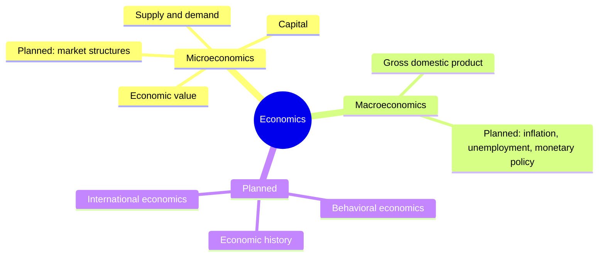

# Economics

How people and societies allocate scarce resources. This field belongs to [Social sciences](../README.md). It follows the standard division of the discipline into microeconomics (the decisions of households and firms and the working of single markets) and macroeconomics (the economy as a whole: output, inflation, employment and public finance). Notes on money, markets and investing are in [finance and investing](../../applied-sciences/finance-and-investing/README.md) under applied sciences.

## Subfields

- [Microeconomics](microeconomics/README.md): value, utility, surplus and markets.
- [Macroeconomics](macroeconomics/README.md): national accounts and the measurement of the economy.

## Map of the field

The map shows the written subfields and the planned ones.

## Planned topics

- Behavioral economics
- Economic history
- International economics
- Public economics

## Navigation

- Back to [Social sciences](../README.md).
