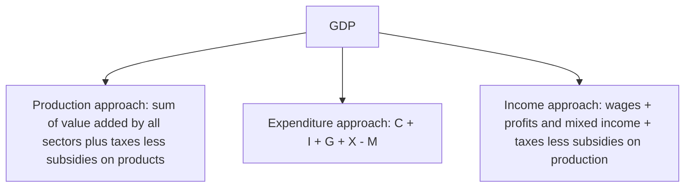
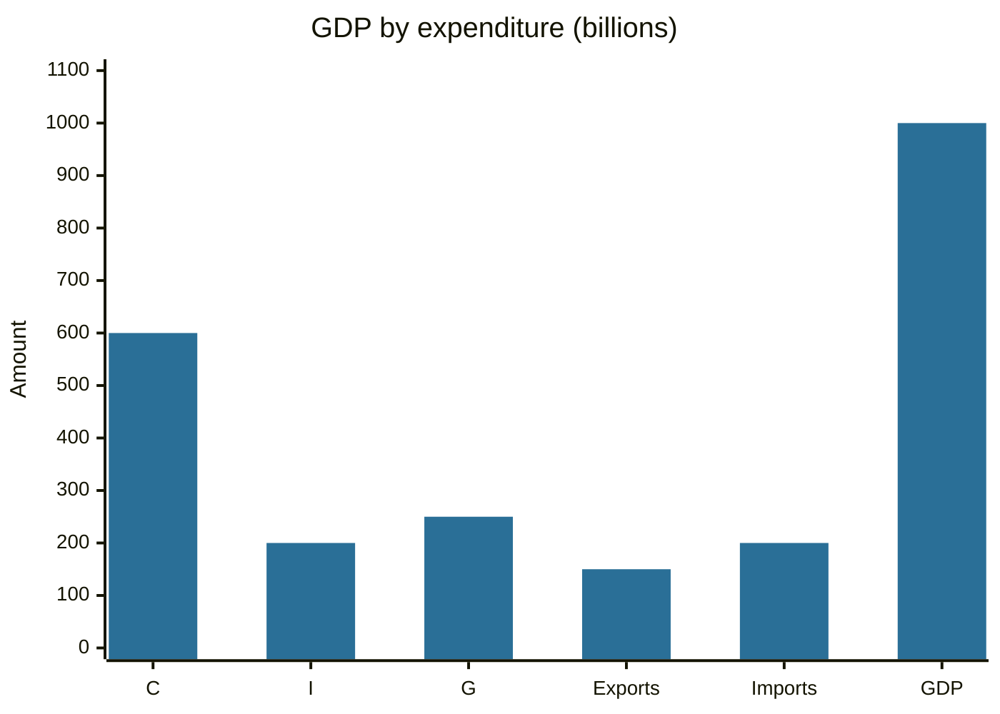

# Gross domestic product

## Summary

Gross domestic product (GDP) is the market value of all final goods and services produced inside a country in a period, usually a quarter or a year. It is the main measure of the size of an economy and of its growth, and it can be calculated in three ways that give the same total: by production (value added), by expenditure (who buys the output) and by income (who earns it). Real GDP removes price changes, and GDP per capita divides by population. GDP leaves out unpaid work, environmental damage and the distribution of income, so it measures output and not well-being.

## Prerequisites

No prior notes are needed.

## Core concepts

### Definition

*GDP* is the sum of the value of final goods and services produced within the borders of a country in a period. *Final* means sold to the end user and not used up as an input to other production, to avoid double counting. The international standard that defines GDP and the other national accounts aggregates is the System of National Accounts 2008 (United Nations and others, 2009).

### Analogy

GDP is the total turnover of the country's shops and workshops over a year, after removing the parts that are bought from each other to make something else. A baker buys flour, and only the bread counts, as it contains the value of the flour. The analogy has limits: it counts only what is produced and sold, so a person caring for a child at home adds nothing, and a clean-up after a storm adds to GDP.

### Three ways to measure



The expenditure approach is the most quoted:

```text
GDP = C + I + G + (X - M)
```

- **C:** household consumption.
- **I:** investment (machines, buildings, stocks of inventory, new housing).
- **G:** government consumption and investment (not transfer payments such as pensions).
- **X - M:** net exports, exports minus imports.

### Related measures

- **Nominal GDP** uses current prices. **Real GDP** uses the prices of a base year and shows the change in volume. The *GDP deflator* = nominal GDP / real GDP × 100 measures the price change.
- **GDP per capita** = GDP / population, a common rough indicator of average income.
- **Gross national income (GNI)** is the income of a country's residents wherever earned, GDP plus income received from abroad minus income paid abroad. Net national income subtracts the consumption of fixed capital (depreciation) from gross national income. The terms GNP and national income appear in older sources.
- **Public debt to GDP** compares the debt of the general government with the annual output and is the most common measure of the debt burden. It is used because a country with larger output can service more debt.

A fall in GDP is read as a sign of recession and a rise as growth. In practice a recession is defined with more than one indicator. The popular rule of two consecutive quarters of falling GDP is a rule of thumb, and some official bodies, for example the National Bureau of Economic Research in the US, date recessions with a wider set of data.

### Limits

GDP excludes unpaid household work and volunteering, the informal economy (partly estimated), the depletion of natural resources and pollution, leisure and the distribution of income. A higher GDP per capita does not mean that everyone has more. Quality improvements are hard to measure, so real growth can be misstated. Other indicators complement GDP: the Human Development Index, measures of inequality and environmental accounts.

## Worked example

An economy has the following expenditure components (in billions).

| Component | Amount |
| --- | --- |
| Consumption C | 600 |
| Investment I | 200 |
| Government G | 250 |
| Exports X | 150 |
| Imports M | 200 |
| Net exports X - M | -50 |
| GDP | 600 + 200 + 250 - 50 = 1,000 |



GDP is C + I + G + exports - imports, which is 600 + 200 + 250 + 150 - 200.

The population is 20 million, so GDP per capita is 1,000 billion / 20 million = 50,000. Public debt is 600 billion, so debt to GDP is 60%.

Next year nominal GDP is 1,080 and the deflator rises by 5%. Real GDP is 1,080 / 1.05 = 1,028.6, so real growth is 2.86%. The nominal growth of 8% hides that most of it is price change.

## Trade offs and when to use it

GDP is comparable across countries and time, and it is available quickly and regularly, which makes it the basis of macroeconomic policy and of ratios such as debt to GDP and the unemployment gap. Its revisions can be large, and comparisons between countries depend on exchange rates or on purchasing power parity adjustments. For well-being, use it with other indicators.

## Common mistakes

- **Comparing nominal figures across years.** Use real GDP.
- **Counting intermediate goods,** which causes double counting.
- **Treating GDP as a measure of welfare.**
- **Including transfers such as pensions in G.** They are not production.
- **Confusing GDP with GNI.** GDP is by location of production, GNI by residence of owners.

## Practice

1. C = 500, I = 150, G = 200, X = 100, M = 120. What is the GDP?
2. Nominal GDP rises from 2,000 to 2,200 and the deflator rises 4%. What is the real growth?
3. Why is only the final good counted?

### Answers

1. 500 + 150 + 200 + 100 - 120 = 830.
2. 2,200 / 1.04 = 2,115.4, so real growth is 5.77%.
3. The value of intermediate goods is already contained in the value of the final good, so adding them would count it twice.

## Further reading

- United Nations, European Commission, IMF et al. (2009). System of National Accounts 2008. United Nations. [Link](https://unstats.un.org/unsd/nationalaccount/docs/SNA2008.pdf). The international standard that defines GDP and the other national accounts aggregates.
- U.S. Bureau of Economic Analysis. What to know about GDP. BEA. [Link](https://www.bea.gov/resources/learning-center/what-to-know-gdp). Official explanation of how GDP is defined and measured.
- Mankiw, N. G. (2021). *Principles of Economics (9th ed.)*. Cengage. An introductory text covering opportunity cost, surplus and GDP.
