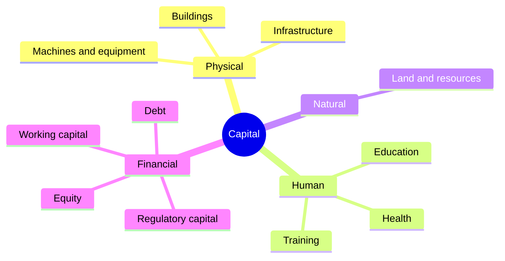
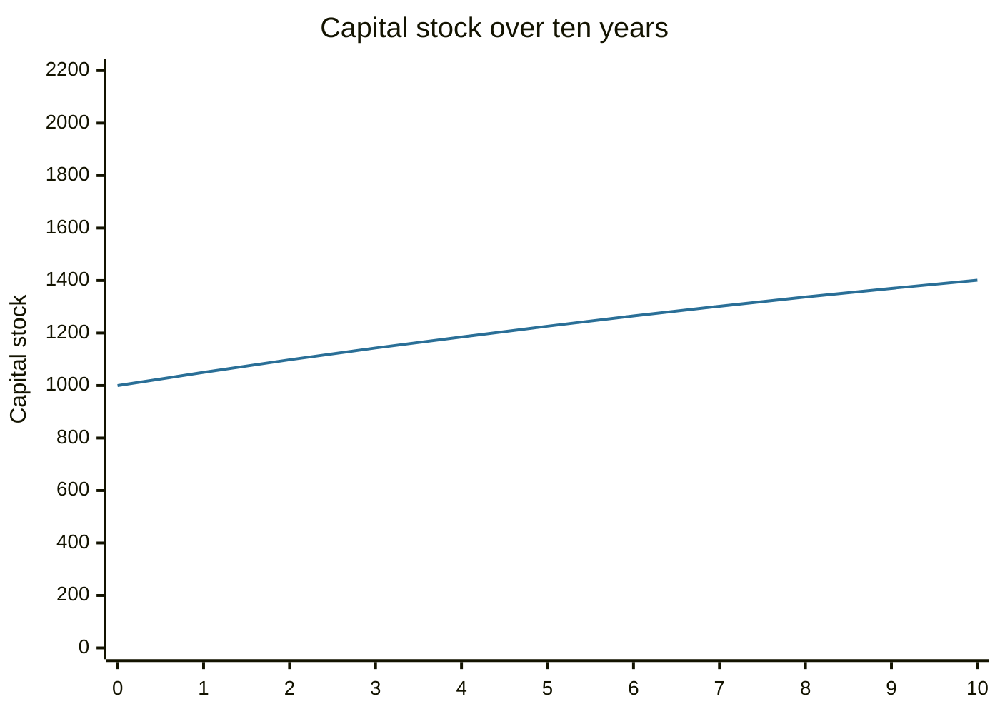

# Capital

## Summary

In economics, capital is one of the factors of production: the man-made goods such as machines, buildings and software that are used to produce other goods. In finance and accounting the word also means the money that funds a business, either from owners (equity) or from lenders (debt), and the short-term resources left to run it (working capital). The meanings are linked: a firm raises financial capital to buy physical capital. Capital accumulates through investment and wears out through depreciation.

## Prerequisites

No prior notes are needed.

## Core concepts

### Definition

Economists list the factors of production as land (natural resources), labor and capital, and often add entrepreneurship. *Capital* here is the produced stock of goods that yields a flow of services over time. It is different from *consumption goods* because it is not used up at once, and different from *land* because it can be produced. Marshall (1890) set out this classical division.

### Analogy

Capital is the workshop's tools. A baker with an oven produces more bread per hour than one with a pan, and the oven stays after the day's work. The oven was paid for by earlier saving: someone did not eat the flour but built the oven. The analogy has a limit: tools wear out and need replacement, so the stock is not permanent.

### Kinds of capital



| Kind | Meaning | Where it appears |
| --- | --- | --- |
| Physical (real) capital | Produced goods used in production | Production functions, fixed assets on the balance sheet |
| Human capital | Knowledge and skills of workers, built by education and training (Becker, 1964) | Wage and growth theory, not on the balance sheet |
| Natural capital | Stock of resources and ecosystems | Environmental economics |
| Financial capital | Money and claims that fund activity | Finance |
| Equity capital | Funds from owners, with a residual claim | Shares and retained profit, see [accounting equation](../../../applied-sciences/finance-and-investing/accounting-basics/accounting-equation.md) |
| Debt capital | Funds from lenders, repaid with interest | Loans and bonds, see [debt](../../../applied-sciences/finance-and-investing/credit-and-debt/debt.md) |
| Working capital | Current assets minus current liabilities | Day-to-day liquidity, see [financial ratios](../../../applied-sciences/finance-and-investing/fundamental-analysis/financial-ratios.md) |
| Regulatory capital | Minimum own funds that banks and insurers must hold | Banking regulation |

The cost of financial capital is the return its providers require, combined in the [weighted average cost of capital](../../../applied-sciences/finance-and-investing/corporate-finance/wacc.md). *Capital markets* are the markets where long-term debt and equity are raised and traded (see [financial markets overview](../../../applied-sciences/finance-and-investing/financial-markets/financial-markets-overview.md)). *Capital expenditure* is spending on long-lived physical assets (see [capital expenditure](../../../applied-sciences/finance-and-investing/corporate-finance/capital-expenditure.md)).

### Accumulation

The capital stock K grows with investment I and shrinks with depreciation at rate d: K(next) = (1 - d) × K + I. When investment equals depreciation, the stock is constant, at I / d. This relation is the core of growth models such as that of Solow (1956), in which capital per worker rises toward a steady state.

## Worked example

A firm has a capital stock of 1,000, depreciation of 5% a year and investment of 100 a year.

```python
# Python 3.12. Capital stock with depreciation: K(next) = (1 - delta) * K + I.
k, delta, invest = 1000.0, 0.05, 100.0
path = [k]
for _ in range(10):
    k = (1 - delta) * k + invest
    path.append(round(k))
print(path)
print("steady state I / delta =", invest / delta)
```

Output:

```text
[1000.0, 1050, 1098, 1143, 1185, 1226, 1265, 1302, 1337, 1370, 1401]
steady state I / delta = 2000.0
```

In the first year, depreciation takes 50 and investment adds 100, so the stock grows by 50. Growth slows as depreciation rises with the stock, and the stock approaches 2,000, where depreciation (100) equals investment. To keep growing, the firm must invest more or raise the productivity of its capital.



## Trade offs and when to use it

The concept explains why investment matters: more capital per worker raises output, up to diminishing returns. The word is ambiguous, so say which meaning is intended. Financial capital is not the same as physical capital: money can be lent, while a machine cannot, and the value of a machine on the balance sheet can differ from its market value.

## Common mistakes

- **Equating capital with money.** Money funds capital but is not itself a production good.
- **Mixing working capital with equity capital.**
- **Ignoring depreciation.** Gross investment is not the same as net growth of the stock.
- **Leaving out human capital** when analyzing growth or wages.

## Practice

1. A firm has current assets of 80 and current liabilities of 50. What is its working capital?
2. Stock 500, depreciation 10%, investment 40. What is next year's stock and the steady state?
3. Name the two kinds of financial capital a company raises.

### Answers

1. 30.
2. 0.9 × 500 + 40 = 490, and the steady state is 40 / 0.10 = 400.
3. Equity (from owners) and debt (from lenders).

## Further reading

- Marshall, A. (1890). *Principles of Economics*. Macmillan. The classic source of the supply and demand diagram and of the idea of equilibrium price.
- Solow, R. M. (1956). A contribution to the theory of economic growth. *The Quarterly Journal of Economics*, 70(1), 65-94. [DOI](https://doi.org/10.2307/1884513). The growth model in which capital accumulates with investment and wears out through depreciation.
- Becker, G. S. (1964). *Human Capital*. National Bureau of Economic Research. The foundational treatment of education and training as investment in human capital.
- Mankiw, N. G. (2021). *Principles of Economics (9th ed.)*. Cengage. An introductory text covering opportunity cost, surplus and GDP.
