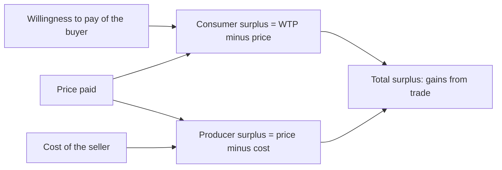
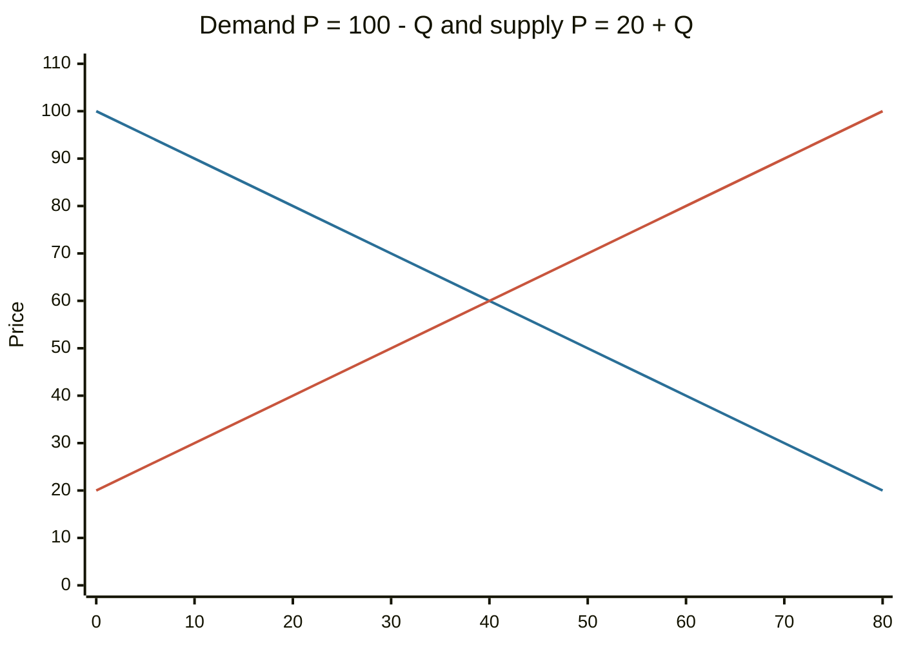

# Economic value

## Summary

Economic value is the benefit that a good, service or asset gives to a person, measured by the most that person would give up to have it, their willingness to pay. It is different from the price paid, which is set by the market, and from cost, which is what the producer gives up. The gap between willingness to pay and price is the consumer surplus, and the gap between price and cost is the producer surplus. Together they measure the gains from trade, and they are the basis for questions about efficiency and for valuing things that have no market price.

## Prerequisites

No prior notes are needed.

## Core concepts

### Definition

*Economic value* (value in use to a person) is the maximum amount of other goods or money a person would be willing to give up to obtain something. In monetary terms it equals the *willingness to pay (WTP)*. It rests on three ideas:

- **Utility:** the satisfaction or benefit that a person gets from consuming something. Economists treat utility as an ordering of preferences, not as a number that can be measured directly.
- **Willingness to pay:** utility expressed in money, limited by income.
- **Opportunity cost:** the value of the best alternative given up. The true cost of a choice is what it displaces, so the economic cost of an hour of work includes the leisure given up (see Mankiw, 2021).

### Analogy

Value is what a glass of water is worth to a thirsty hiker, and price is what the shop charges. The hiker's value is very high and the price is low, and the difference is the hiker's gain. The analogy has a limit: the value of the next glass is much lower, since economic value depends on the quantity already held.

### Economic value and market value

| | Economic value | Market value (price) |
| --- | --- | --- |
| Whose | One person or user | The whole market |
| Set by | Preferences, income, need, alternatives | Supply and demand |
| Observable | Not directly, only through choices | Yes, at transactions |
| Example | A commuter's value of a car that saves two hours a day | The price of the car at the dealer |

In competitive markets the price is the *marginal* value to the buyer who is just willing to buy, and everyone who values the good more gets a gain.

### Surplus

- **Consumer surplus** = willingness to pay minus price.
- **Producer surplus** = price minus the seller's cost (the minimum the seller would accept).
- **Total surplus** = consumer surplus + producer surplus = willingness to pay - cost, for each unit traded. A market is *efficient* when it maximizes total surplus.

### Marginal value

The value of an additional unit falls as more units are consumed (*diminishing marginal utility*). That is why the demand curve slopes downward: the first unit has the highest willingness to pay. The price in a market equals the marginal value of the last unit bought, and the earlier units are worth more, which produces the consumer surplus.

### Kinds of value

| Kind | Meaning | Example |
| --- | --- | --- |
| Use value | Benefit from using the good | A tool, a meal |
| Exchange value | What it can be traded for | A house sold on the market |
| Option value | Value of keeping the possibility of future use | A park you might visit |
| Existence value | Value from knowing something exists, without using it | A rare species |

Option and existence value are *non-use values*, and appear in valuing environmental and public goods with methods such as surveys of willingness to pay. In corporate finance, *economic value added (EVA)* is a company measure: net operating profit after tax minus a charge for the capital used, EVA = NOPAT - WACC × invested capital (see [WACC](../../../applied-sciences/finance-and-investing/corporate-finance/wacc.md)). It is positive only when the company earns more than its cost of capital. In production, the *value added* of a firm is the value of its output minus the inputs bought from others, and the sum of value added in an economy is the basis of GDP (see [gross domestic product](../macroeconomics/gross-domestic-product.md)).

## Worked example

A buyer is willing to pay up to 1,000 for a laptop and pays 700. The seller's cost is 500.

| Item | Amount |
| --- | --- |
| Economic value to the buyer (WTP) | 1,000 |
| Price | 700 |
| Consumer surplus | 300 |
| Producer surplus | 700 - 500 = 200 |
| Total surplus | 500 |

For a whole market, take demand P = 100 - Q and supply P = 20 + Q. They meet where 100 - Q = 20 + Q, so Q = 40 and P = 60.

- Consumer surplus is the triangle between the demand curve and the price: 0.5 × 40 × (100 - 60) = 800.
- Producer surplus is the triangle between the price and the supply curve: 0.5 × 40 × (60 - 20) = 800.
- Total surplus is 1,600. A price control that cuts the quantity traded to 30 would lower the total surplus, because trades worth doing (where WTP is above cost) are lost.

The falling line is demand and the rising line is supply. They cross at a quantity of 40 and a price of 60.

An EVA example: NOPAT is 150, invested capital is 1,000 and WACC is 9%. EVA = 150 - 0.09 × 1,000 = 60, so the firm creates value above the cost of its capital.

## Trade offs and when to use it

Willingness to pay is a useful measure for prices, for cost-benefit analysis of projects and for valuing goods with no market. It has limits. It depends on income, so wealthy people have a higher willingness to pay for the same good, and it ignores fairness. Surveys of WTP for non-market goods are hard to do well. Behavioral research shows that stated values depend on framing and reference points.

## Common mistakes

- **Equating value with price.** Price is what is paid, value is what it is worth to the buyer.
- **Equating value with cost.** Cost is what the producer gives up.
- **Ignoring opportunity cost.** The accounting cost of a choice can understate its economic cost.
- **Counting transfers as value.** A price rise moves surplus between buyers and sellers, and does not create it.

## Practice

1. A buyer would pay 80 and pays 55. What is the consumer surplus?
2. The seller's cost is 30 and the price is 55. What is the producer surplus, and what is the total surplus?
3. What is opportunity cost?

### Answers

1. 25.
2. 25 and 50.
3. The value of the best alternative that is given up by a choice.

## Further reading

- Mankiw, N. G. (2021). *Principles of Economics (9th ed.)*. Cengage. An introductory text covering opportunity cost, surplus and GDP.
- Brealey, R. A., Myers, S. C., Allen, F. et al. (2023). *Principles of Corporate Finance (14th ed.)*. McGraw Hill. Introduces economic value added and the link between value and the cost of capital
- American Economic Association. JEL classification system. American Economic Association. [Link](https://www.aeaweb.org/econlit/jelCodes.php?view=jel). Shows where microeconomics (JEL D) sits among the fields of economics
