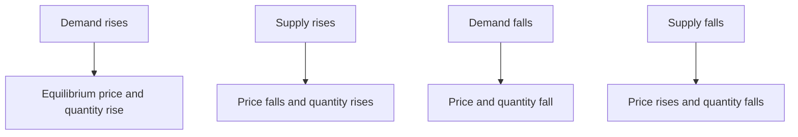
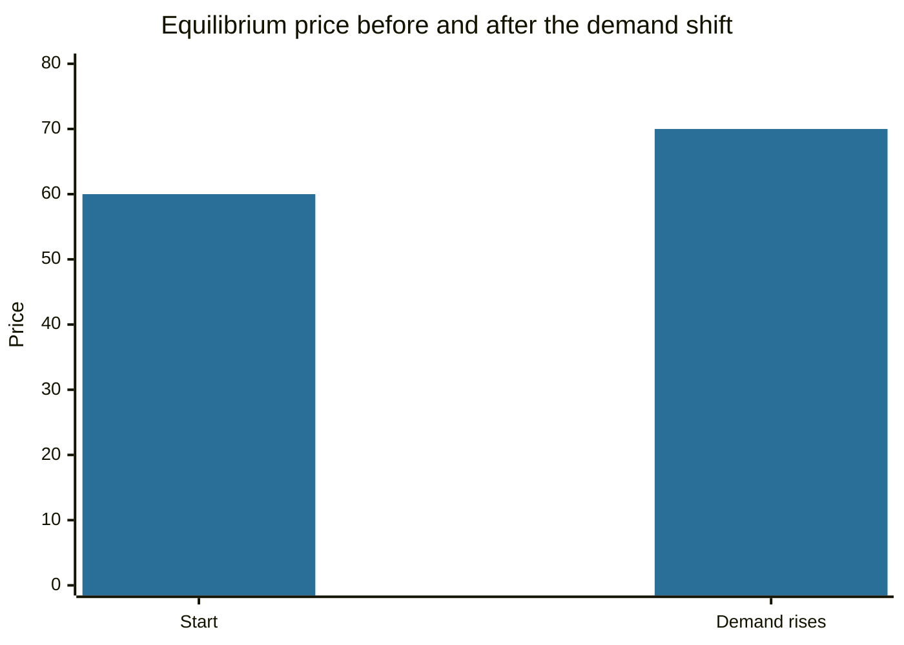

# Supply and demand

## Summary

The law of demand says that, other things equal, a higher price lowers the quantity buyers want, and the law of supply says that a higher price raises the quantity sellers offer. The price at which the two quantities are equal is the equilibrium price, and prices tend to move toward it because a surplus pushes prices down and a shortage pushes them up. A change in price moves along a curve, while a change in income, tastes, costs or technology shifts a curve. Price controls set away from equilibrium create shortages or surpluses.

## Prerequisites

- [Economic value](economic-value.md) for willingness to pay and surplus.

## Core concepts

### Definition

- **Quantity demanded:** the amount buyers are willing and able to buy at a given price in a period.
- **Law of demand:** quantity demanded falls as price rises, holding other factors constant (*ceteris paribus*). The reasons are the substitution effect (cheaper alternatives) and the income effect, together with diminishing marginal value.
- **Quantity supplied:** the amount sellers offer at a given price.
- **Law of supply:** quantity supplied rises with price, because a higher price covers higher marginal costs and attracts producers.
- **Equilibrium:** the price and quantity at which quantity demanded equals quantity supplied (Marshall, 1890).

### Analogy

A market is a seesaw with buyers on one side and sellers on the other. When the price is too low, many want to buy and few to sell, so the buyers' end goes down and bidding pushes the price up. When it is too high, the sellers' end goes down and competition pushes the price down. The seesaw settles where the two sides balance. The analogy fails when sellers or buyers can set prices without competition.

### Shifts and movements

A *movement along* a curve is caused by a change in the good's own price. A *shift* of a curve is caused by something else:

| Curve | Shifts right (more at every price) when | Shifts left when |
| --- | --- | --- |
| Demand | Income rises (for normal goods), the price of a substitute rises, tastes favor the good, the number of buyers grows, buyers expect higher prices | The opposite |
| Supply | Input costs fall, technology improves, more sellers enter, taxes fall | The opposite |



*Price elasticity of demand* measures how strongly quantity responds to price: percent change in quantity divided by percent change in price. Goods with close substitutes have elastic demand, necessities have inelastic demand. Elasticity decides how a shift or a tax is shared between price and quantity.

### Price controls

A *price ceiling* below equilibrium (rent control, for example) causes a shortage, because demand exceeds supply at the capped price. A *price floor* above equilibrium (a minimum wage, a crop support price) causes a surplus. Both reduce the quantity traded below the equilibrium level and so lower total surplus. They can still serve goals such as affordability or income support, and the cost is the lost trades and the need for rationing.

### Limits

The model assumes many buyers and sellers, a standard good and free price adjustment. It breaks down under monopoly, with large externalities, with imperfect information, and for rare cases such as Giffen goods where demand can rise with price. Prices also adjust slowly in some markets, for example labor.

## Worked example

Demand is P = 100 - Q and supply is P = 20 + Q.

```python
# Python 3.12. Linear demand and supply: equilibrium, a demand shift and a price ceiling.
def equilibrium(a, b, c, d):
    # demand: P = a - b*Q, supply: P = c + d*Q
    q = (a - c) / (b + d)
    return q, a - b * q

q, p = equilibrium(100, 1, 20, 1)
print(f"start: quantity {q:.0f}, price {p:.0f}")
q2, p2 = equilibrium(120, 1, 20, 1)           # demand rises by 20 at every quantity
print(f"after the demand shift: quantity {q2:.0f}, price {p2:.0f}")
ceiling = 50                                   # legal maximum price, below the equilibrium of 60
qd = 100 - ceiling                             # quantity demanded at the ceiling
qs = ceiling - 20                              # quantity supplied at the ceiling
print(f"price ceiling {ceiling}: demanded {qd}, supplied {qs}, shortage {qd - qs}")
```

Output:

```text
start: quantity 40, price 60
after the demand shift: quantity 50, price 70
price ceiling 50: demanded 50, supplied 30, shortage 20
```

The market clears at 40 units and a price of 60. A rise in demand raises both price (to 70) and quantity (to 50). A ceiling of 50 on the original market leaves buyers wanting 50 units while sellers offer 30, so 20 units are short, and only 30 units trade instead of 40.



## Trade offs and when to use it

The model is the first tool for reasoning about prices: it explains why prices rise after a shock, why a tax falls on both sides of a market and why controls create queues or surpluses. It describes tendencies in competitive markets, and real markets add frictions, power and information problems. The same logic underlies the pricing of securities, where demand and supply of shares set the price (see [equity markets](../../../applied-sciences/finance-and-investing/financial-markets/equity-markets.md)).

## Common mistakes

- **Confusing a shift with a movement.** A price change moves along the curve, and only other factors shift it.
- **Confusing demand with quantity demanded.**
- **Ignoring ceteris paribus.** Several things usually change at once.
- **Treating a price control as free.** It shifts costs to queues and lost trades.

## Practice

1. Supply falls because of a drought. What happens to price and quantity?
2. In the example, what shortage arises at a ceiling of 40?
3. Name two factors that shift demand.

### Answers

1. Price rises and quantity falls.
2. Demanded 60, supplied 20, shortage 40.
3. Income and the price of a substitute.

## Further reading

- Mankiw, N. G. (2021). *Principles of Economics (9th ed.)*. Cengage. An introductory text covering opportunity cost, surplus and GDP.
- Marshall, A. (1890). *Principles of Economics*. Macmillan. The classic source of the supply and demand diagram and of the idea of equilibrium price.
- American Economic Association. JEL classification system. American Economic Association. [Link](https://www.aeaweb.org/econlit/jelCodes.php?view=jel). The classification of economics and finance that groups topics into fields such as G (financial economics).
