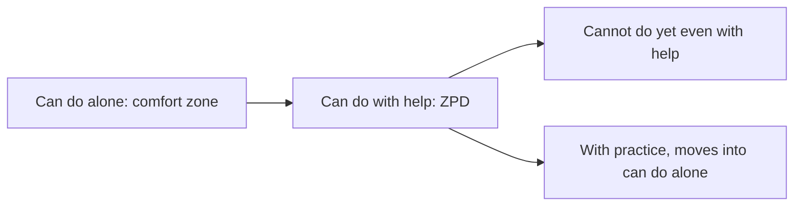

# Zone of proximal development

## Summary

The zone of proximal development (ZPD) is the range of tasks that a learner cannot yet do alone and can do with help. Lev Vygotsky introduced it to argue that instruction works best just ahead of current ability. Wood, Bruner and Ross (1976) described the support given in this zone as scaffolding. The idea guides teaching, coaching and self-study: choose tasks that are challenging and reachable, give support and withdraw it as skill grows.

*This note is educational.*

## Prerequisites

No prior notes are needed.

## Core concepts

### Definition

Vygotsky (1978) defined the *zone of proximal development* as the distance between the actual developmental level, shown by independent problem solving, and the level of potential development, shown by problem solving with an adult or a more capable peer. *Scaffolding* is temporary, adjustable support that lets a learner perform a task beyond their unaided ability (Wood, Bruner and Ross, 1976).

### Analogy

Learning to ride a bicycle with training wheels or a hand on the seat: the task is beyond solo ability, support makes it possible, and the support is removed step by step. The limit of the analogy is that scaffolding also includes questions and hints, not only physical help.

### The three zones

| Zone | Learning effect |
| --- | --- |
| Can do alone | Little new learning, practice and fluency |
| ZPD | Most learning: challenging and supported |
| Beyond reach | Frustration, since help is not enough |

### Scaffolding in practice

| Technique | Example |
| --- | --- |
| Model the task | Show a worked example |
| Break into steps | Give a sequence of subtasks |
| Hints and prompts | Ask a question that points to the next step |
| Gradual fading | Give fewer hints each time |
| Feedback | Say what to adjust |

The idea links to [metacognition](../../personal-development/skills/soft-skills/cognitive/metacognition.md), where learners choose tasks at the edge of ability, and to [deliberate practice](../../personal-development/skills/deliberate-practice.md), which also stresses tasks just beyond current skill with feedback.

## Worked example

A student learns to write a persuasive paragraph.

| Stage | Support | Result |
| --- | --- | --- |
| 1 | The teacher shows a model paragraph and marks the claim, evidence and link | Student sees the structure |
| 2 | Student writes with a template of three sentence starters | Completes with help |
| 3 | Template reduced to one prompt | Mostly alone |
| 4 | No support | Writes alone and receives feedback |

Support fades as competence grows, so the task stays in the zone.

## Trade offs and when to use it

The ZPD is a useful guide for choosing tasks and support. It is hard to measure precisely, since the zone differs by person and topic. The evidence for scaffolding is mostly from classroom and tutoring studies, and the concept itself is a theory and not a test. Too much help removes the challenge.

## Common mistakes

- **Giving answers instead of hints.** Learning is reduced.
- **Keeping support too long.** Fade it.
- **Choosing tasks that are too hard.** Help cannot bridge a large gap.

## Practice

1. Define the zone of proximal development.
2. What is scaffolding?
3. Why should support fade?

### Answers

1. The range of tasks that a learner can do with help and not yet alone.
2. Temporary, adjustable support that lets a learner do a task beyond unaided ability.
3. So that the learner takes over the skill and the task stays challenging.

## Further reading

- Vygotsky, L. S. (1978). *Mind in Society: The Development of Higher Psychological Processes*. Harvard University Press. The source of the zone of proximal development.
- Wood, D., Bruner, J. S. and Ross, G. (1976). THE ROLE OF TUTORING IN PROBLEM SOLVING
                    *. *Journal of Child Psychology and Psychiatry*, 17(2), 89-100. [DOI](https://doi.org/10.1111/j.1469-7610.1976.tb00381.x). The paper that introduced scaffolding in tutoring.
