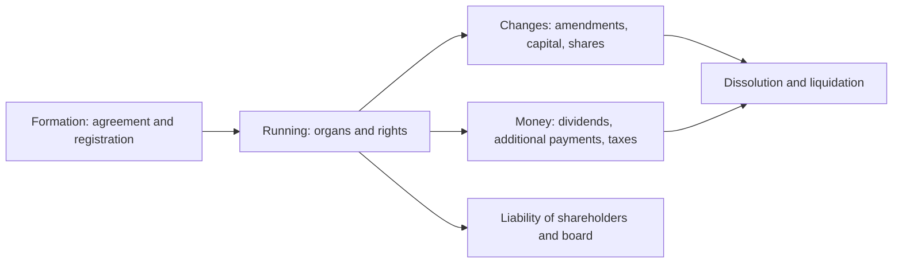

# Company law

The legal rules for forming, running and closing companies. This subfield belongs to [Law](../README.md). It currently covers the Polish limited liability company (*spółka z ograniczoną odpowiedzialnością*, sp. z o.o.), the most common form of company in Poland, governed by the Commercial Companies Code (*Kodeks spółek handlowych*, KSH). Polish legal terms are given in italics after their English translation.

All notes describe the law as checked in October 2026. They are educational and not legal advice.

## Map of the subfield

The notes follow the life of a company, from formation to liquidation.

## Notes in reading order

**Formation**

1. [Polish limited liability company](limited-liability-company.md): what it is, who can form it, share capital and contributions.
2. [Articles of association](articles-of-association.md): mandatory content, name and seat, business activities, notarial deed or S24.
3. [Formation and registration](formation-and-registration.md): the company in organization, KRS registration, the beneficial owners register and costs.

**Organs**

4. [Management board](management-board.md): managing and representing the company, appointment, mandate and contracts.
5. [Shareholders' meeting](shareholders-meeting.md): ordinary and extraordinary meetings, majorities and minutes.
6. [Supervisory board](supervisory-board.md): when it is required, members and powers.

**Shareholders**

7. [Shareholder rights](shareholder-rights.md): voting, control, privileged shares and personal rights.
8. [Dividends](dividends.md): conditions, interim dividends and taxation.
9. [Additional payments](additional-payments.md): extra funding from shareholders and its return.
10. [Transfer of shares](transfer-of-shares.md): restrictions, form, steps and tax.

**Changes and liability**

11. [Amending the articles of association](amending-articles-of-association.md): procedure, capital increase, deadlines and fees.
12. [Shareholder liability](shareholder-liability.md): when shareholders answer for the company.
13. [Management board liability](management-board-liability.md): damage, company debts, tax arrears and fiscal penal liability.

**End and money**

14. [Dissolution and liquidation](dissolution-and-liquidation.md): causes, the company in organization and the three phases of liquidation.
15. [Accounting and taxation](accounting-and-taxation.md): full accounting, CIT, dividend tax and the double taxation question.

## How to use this subfield

Read notes 1 to 3 before forming a company, and notes 4, 5, 12 and 13 before becoming a board member. Check fees and deadlines on the official sites (eKRS, biznes.gov.pl, podatki.gov.pl) before acting, because they change. Business topics are in [business and management](../../../applied-sciences/business-and-management/README.md).

## Navigation

- Back to [Law](../README.md).
