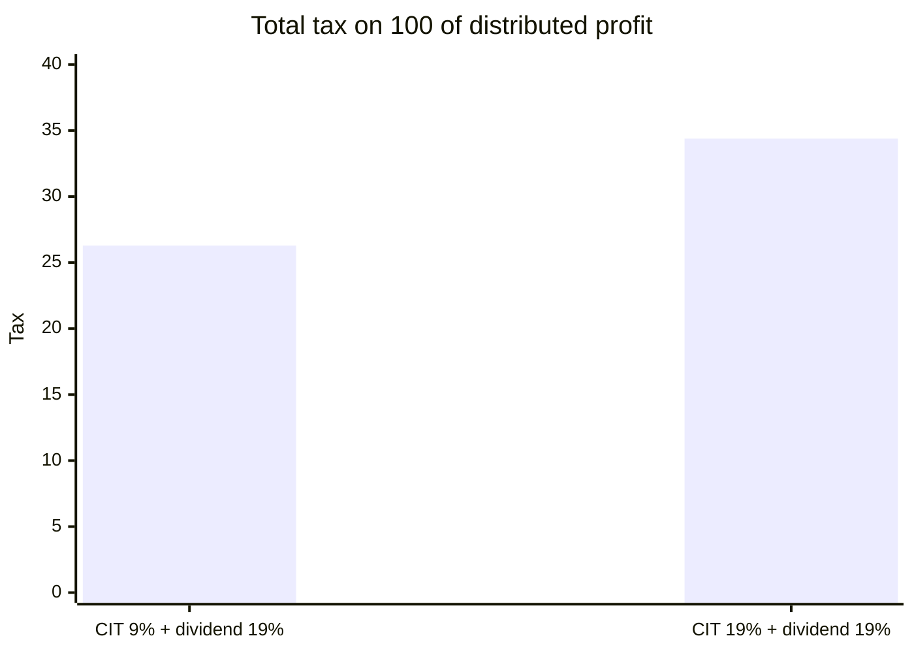

# Accounting and taxation

## Summary

A sp. z o.o. must keep full accounting books under the Accounting Act, prepare annual financial statements and file them in the KRS. It pays corporate income tax (CIT) at 19%, or 9% for small taxpayers and in the first year of activity, on income other than capital gains. When it pays dividends, individual shareholders pay a further 19%, so distributed profit is taxed twice, at about 26% to 34% in total. The Estonian CIT regime, which taxes profit mainly when it is distributed, is a common alternative for eligible companies.

*This note is educational. It describes Polish law in general terms as checked in October 2026 and is not legal or tax advice. Rules and fees change; check the current text of the acts and, for real decisions, ask a lawyer or tax adviser.*

## Prerequisites

- [Dividends](dividends.md)

## Core concepts

### Definition

*Full accounting* (*pełna księgowość*) is the colloquial name for bookkeeping under the Accounting Act: double-entry books, a chart of accounts and annual financial statements, with a high level of detail and formality. The company is a taxpayer of *corporate income tax* (*podatek dochodowy od osób prawnych*, CIT). *Double taxation* (*podwójne opodatkowanie*) describes taxing the same profit first as company income and then, when distributed, as the shareholder's dividend.

### Analogy

Double taxation is like a toll road with two toll gates: the company pays at the first gate when it earns profit, and the shareholder pays at the second when the profit is handed out. Estonian CIT moves most of the toll to the exit: as long as profit stays in the company, the car drives without paying.

### Mechanism

**Accounting obligations.**

- Keep books under the Accounting Act.
- Prepare annual financial statements within three months after the end of the financial year.
- Have them approved by the ordinary shareholders' meeting within six months (see [Shareholders' meeting](shareholders-meeting.md)).
- File them, with the resolution approving them, in the repository of financial documents of the KRS within 15 days of approval.
- Larger companies above statutory thresholds must have the statements audited.
- Since 2026, structured e-invoices through the National e-Invoice System (KSeF) are mandatory in stages, for large companies first; check the dates that apply to your company.

**CIT rates (checked for 2026).**

| Rate | Who | Condition |
| --- | --- | --- |
| 19% | Default | |
| 9% | Small taxpayers and companies in their first tax year | Revenue in the year up to the equivalent of 2 million euros; applies to income other than capital gains |

For 2026, secondary sources report a small taxpayer limit of 8,517,000 zł gross revenue in 2025 and a current-year limit of 8,431,000 zł net revenue; both must be met for the 9% rate. Special higher rates apply to banks.

**Dividend tax.** 19% flat tax on dividends paid to individuals, withheld by the company (art. 30a of the PIT act).

**Estonian CIT** (*ryczałt od dochodów spółek*). An optional regime for companies meeting conditions (among others, only natural persons as shareholders, limited passive income, a minimum number of employees or equivalent). Tax is due mainly when profit is distributed, at 10% for small taxpayers and 20% for others, and shareholders can deduct most of it from their dividend tax. The combined burden is commonly cited at about 20% for small taxpayers and 25% for others. Companies taxed this way cannot use the 9% rate.

The combined tax on 100 of company profit distributed as a dividend:



The values come from the worked example.

## Worked example

```python
# Python 3.12. Double taxation of distributed profit at the two CIT rates.
def total_tax(profit, cit_rate, dividend_rate=0.19):
    cit = profit * cit_rate
    dividend = profit - cit
    div_tax = dividend * dividend_rate
    return round(cit, 2), round(div_tax, 2), round(dividend - div_tax, 2)

for rate in (0.09, 0.19):
    cit, div_tax, net = total_tax(100_000, rate)
    print("CIT {:.0%}: CIT {}, dividend tax {}, net to shareholder {}, effective {:.2%}".format(
        rate, cit, div_tax, net, (cit + div_tax) / 100_000))
```

Output:

```text
CIT 9%: CIT 9000.0, dividend tax 17290.0, net to shareholder 73710.0, effective 26.29%
CIT 19%: CIT 19000.0, dividend tax 15390.0, net to shareholder 65610.0, effective 34.39%
```

Of 100,000 zł of profit, a shareholder receives 73,710 zł at the 9% rate and 65,610 zł at 19%. Profit kept in the company is taxed only once, which is why companies often reinvest rather than distribute.

## Trade offs and when to use it

The sp. z o.o. pays more tax than a sole trader on profit that is distributed, but less on profit kept in the business at 9% or 19%, and it limits personal liability. Owners compare total tax across options (board salary, dividends, Estonian CIT) with an adviser, because rules and limits change every year.

## Common mistakes

- **Comparing only the CIT rate with a sole trader's PIT.** Include dividend tax on distributed profit.
- **Missing filing deadlines for financial statements.** File within 15 days of approval; late filing brings penalties and, in extreme cases, court action.
- **Assuming the 9% rate applies to all income.** It does not apply to capital gains or to companies under Estonian CIT.

## Practice

1. What is the effective tax on 100 of distributed profit at 19% CIT?
2. Within what period must annual financial statements be prepared and approved?
3. What is the main idea of Estonian CIT?

### Answers

1. About 34.39: 19 of CIT plus 15.39 of dividend tax.
2. Prepared within three months and approved within six months after the year end.
3. Tax is due mainly when profit is distributed, not while it stays in the company.

## Further reading

- Sejm RP (1994). *Ustawa z dnia 29 września 1994 r. o rachunkowości (Accounting Act)*. [Link](https://isap.sejm.gov.pl/isap.nsf/DocDetails.xsp?id=WDU19941210591). Full accounting and financial statements.
- Sejm RP (1992). *Ustawa z dnia 15 lutego 1992 r. o podatku dochodowym od osób prawnych (CIT act)*. [Link](https://isap.sejm.gov.pl/isap.nsf/DocDetails.xsp?id=WDU19920210086). CIT rates.
- Sejm RP (1991). *Ustawa z dnia 26 lipca 1991 r. o podatku dochodowym od osób fizycznych (PIT act), art. 30a*. [Link](https://isap.sejm.gov.pl/isap.nsf/DocDetails.xsp?id=WDU19910800350). Dividend tax.
- Akademia LTCA (2026). Preferencyjna stawka CIT w 2026 r.: jakie są limity?. [Link](https://akademialtca.pl/blog/preferencyjna-stawka-cit-w-2026-r-jakie-sa-limity-1). Small taxpayer limits for 2026.
- Ministerstwo Finansów. Krajowy System e-Faktur (KSeF). [Link](https://ksef.podatki.gov.pl/). National e-Invoice System.
