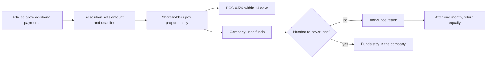

# Additional payments

## Summary

Additional payments (*dopłaty*) are a way for shareholders to fund a sp. z o.o. beyond the share capital, without changing it. The company can use them for investments, current operations, improving its creditworthiness or covering losses. Shareholders can be required to make them only if the articles provide for them, and payments must be made equally in proportion to shares. They can be returned to shareholders if not needed to cover losses. They are subject to 0.5% tax on civil law transactions.

*This note is educational. It describes Polish law in general terms as checked in October 2026 and is not legal or tax advice. Rules and fees change; check the current text of the acts and, for real decisions, ask a lawyer or tax adviser.*

## Prerequisites

- [Polish limited liability company](limited-liability-company.md)

## Core concepts

### Definition

*Additional payments* are cash payments by shareholders to the company, provided for in the articles and determined by shareholders' resolution (art. 177 to 179 KSH). They do not increase share capital and do not give new shares. They differ from a shareholder loan, which must be repaid on agreed terms, and from a capital increase, which requires amending the articles.

### Analogy

Additional payments are like members of a sailing club chipping in for a new sail without changing their membership shares. Everyone pays the same multiple of their share, and if the money is not needed to patch losses, it can be handed back.

### Mechanism

**Basis.** Shareholders can be obliged to make additional payments only if the articles provide for this, setting the maximum amount in relation to shares. If the original articles do not, the shareholders can amend them, but because this increases shareholders' obligations, it requires the consent of all shareholders affected (art. 246 § 3 KSH).

**Equal treatment.** Payments are imposed and made equally in proportion to shares (art. 177 § 2 KSH). The amount is expressed in relation to the nominal value of shares, for example 100 times, three quarters or 50% of the nominal value. Proportionality applies both to the clause in the articles and to the resolution setting the amount and deadlines.

**Return.** Payments may be returned to shareholders if they are not needed to cover a loss shown in the financial statements (art. 179 KSH). Return can take place one month after an announcement of the planned return in the company's official journal, and must be made equally to all shareholders. The decision requires a shareholders' resolution (art. 228 KSH).

**Tax.** Additional payments are subject to the tax on civil law transactions at 0.5%, paid within 14 days of making the payment (with a PCC-3 declaration).

The life of an additional payment:

## Worked example

Mebelki sp. z o.o. has 200 shares of 50 zł. Its articles allow additional payments up to ten times the nominal value of shares. To buy a CNC machine, the shareholders resolve that each shareholder pays 4 times the nominal value per share: 200 zł per share, 20,000 zł each for Waldek and Olek. PCC is 0.5% of 40,000 zł = 200 zł. Two years later, with no losses, the shareholders resolve to return the payments, announce it, and repay 20,000 zł to each after one month.

## Trade offs and when to use it

Additional payments are flexible and do not require amending the articles each time, but they can only be imposed if the articles allow, they must be proportional, and they are less attractive to an individual shareholder than a loan, which earns interest.

## Common mistakes

- **Requiring payments without a clause in the articles.** Add the clause first, with the consent of all affected shareholders.
- **Asking only one shareholder to pay.** Payments must be proportional to shares.
- **Returning payments needed to cover losses.** Only payments not needed to cover a reported loss may be returned.

## Practice

1. What tax applies to additional payments, and by when?
2. Under what condition may additional payments be returned?

### Answers

1. PCC at 0.5%, within 14 days.
2. If they are not needed to cover a loss shown in the financial statements, after a one-month announcement period.

## Further reading

- Sejm RP (2000). *Ustawa z dnia 15 września 2000 r. Kodeks spółek handlowych (Commercial Companies Code), consolidated text*. [Link](https://isap.sejm.gov.pl/isap.nsf/DocDetails.xsp?id=WDU20000941037). Articles 177 to 179 and 246 KSH.
- Sejm RP (2000). *Ustawa z dnia 9 września 2000 r. o podatku od czynności cywilnoprawnych (tax on civil law transactions act)*. [Link](https://isap.sejm.gov.pl/isap.nsf/DocDetails.xsp?id=WDU20000860959). PCC on changes to company agreements.
