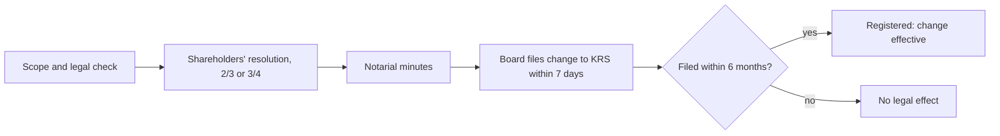

# Amending the articles of association

## Summary

Changing the articles of a sp. z o.o. (for example extending business activities, increasing share capital or moving the seat) requires a shareholders' resolution, usually by a two-thirds majority, recorded by a notary, and registration in the KRS. The amendment takes effect only on registration, and if it is not filed within six months of the resolution, it does not take effect at all. A capital increase can avoid amending the articles if the articles already allow it up to a set amount and date.

*This note is educational. It describes Polish law in general terms as checked in October 2026 and is not legal or tax advice. Rules and fees change; check the current text of the acts and, for real decisions, ask a lawyer or tax adviser.*

## Prerequisites

- [Shareholders' meeting](shareholders-meeting.md)

## Core concepts

### Definition

An *amendment of the articles* (*zmiana umowy spółki*) is any change to their text. It requires a resolution of the shareholders (not of the board), in the form of minutes drawn up by a notary (art. 255 § 3 KSH), and becomes effective only when entered in the register (art. 255 § 1 KSH).

### Analogy

Amending the articles is like changing a club's statute: a qualified majority votes, a notary records it, and the change counts only after the register publishes it, like a law that applies only after it appears in the official journal.

### Mechanism

**Four stages.**

1. **Scope and legal analysis:** decide what to change and check that it complies with the law.
2. **Shareholders' meeting:** adopt the resolution. It need not be a meeting called only for this purpose. If the amendment was not on the announced agenda, all shareholders must be present and none may object.
3. **KRS registration:** the board files the change electronically through the Court Registers Portal, or through S24 if the articles were made and changed in S24. Changing the articles in S24 is not the same as filing the change with the KRS.
4. **Publicity:** until 28 November 2025, changes were also announced in the Court and Economic Monitor (MSiG). Since 29 November 2025, KRS entries are no longer announced there.

**Majorities.** Two thirds of votes, or three quarters for a significant change of business activities (art. 246 § 1 KSH). Changes that increase shareholders' obligations or reduce their individual rights need the consent of all shareholders concerned (art. 246 § 3).

**Notary.** The minutes in notarial form must contain the text of the resolution, the voting results and the attendance list. Smaller businesses often forget this and file only an ordinary resolution, which the court will reject.

**Deadlines.** The board should file the change within 7 days (art. 22 of the KRS act), and the change must be filed within six months of the resolution, otherwise it has no legal effect (art. 256 § 3 in connection with art. 169 KSH; Supreme Court resolution III CZP 75/22 of 2022).

**Documents.** The application to change entry data (formerly form KRS-W3, now the electronic form), the notarial resolution, the consolidated text of the articles (usually adopted in the same notarial deed), proof of payment of the fee, and other annexes depending on the change (formerly for example KRS-ZM for a change of business activities).

**Capital increase without amending the articles.** Possible only if the articles allow it (art. 257 KSH), for example: "An increase of share capital up to 1,000,000 PLN by 31 December 2050 by a resolution of the shareholders' meeting does not constitute an amendment of the articles." Even then, the increase must be registered.

**Fees.**

| Item | Notarial route | S24 |
| --- | --- | --- |
| Court fee for registering changes | 250 zł | lower in S24 (200 zł reported, check) |
| MSiG announcement fee | 100 zł until 28 November 2025; no longer charged for KRS entries since 29 November 2025 | same |
| PCC on capital increase | 0.5% of the increase | 0.5% of the increase |
| Notary fee | Depends on the act | not applicable for S24 changes |

Be wary of letters, emails or calls offering paid publication of changes in other registers: they are not required by law.

The amendment procedure and its deadlines:

## Worked example

Mebelki sp. z o.o. wants to add "retail sale of furniture" to its activities and increase capital from 10,000 zł to 50,000 zł. On 10 June the shareholders adopt both resolutions before a notary (two thirds needed for the capital increase; adding a related activity is not judged a significant change). The board files the change through the Court Registers Portal on 14 June with the consolidated text and pays the 250 zł fee. PCC on the increase is 0.5% of 40,000 zł = 200 zł. The changes take effect on registration on 2 July. Had the board forgotten to file until 11 December, the amendment would have had no effect.

## Trade offs and when to use it

The formal procedure protects shareholders and creditors but costs time and money. Building flexibility into the original articles (authorized capital increase, broad but realistic activities) reduces the need for later amendments.

## Common mistakes

- **Filing a resolution without notarial minutes.** Amendments require notarial minutes; the court will reject a simple resolution.
- **Missing the six-month window.** File immediately; after six months the amendment has no effect.
- **Assuming an S24 change is automatically registered.** Changing the articles in S24 is not the same as filing with the KRS.

## Practice

1. What majority is needed for a significant change of business activities?
2. What happens if an amendment is not filed within six months?
3. When can share capital be increased without amending the articles?

### Answers

1. Three quarters of votes.
2. It does not take legal effect.
3. When the articles already allow an increase up to a set amount by a set date.

## Further reading

- Sejm RP (2000). *Ustawa z dnia 15 września 2000 r. Kodeks spółek handlowych (Commercial Companies Code), consolidated text*. [Link](https://isap.sejm.gov.pl/isap.nsf/DocDetails.xsp?id=WDU20000941037). Articles 246 and 255 to 257 KSH.
- Sejm RP (1997). *Ustawa z dnia 20 sierpnia 1997 r. o Krajowym Rejestrze Sądowym (National Court Register Act)*. [Link](https://isap.sejm.gov.pl/isap.nsf/DocDetails.xsp?id=WDU19971210769). Seven-day filing duty.
- Sąd Najwyższy (2022). *Uchwała Sądu Najwyższego z dnia 29 kwietnia 2022 r., III CZP 75/22 (resolution on unregistered amendments)*. Effect of missing the six-month deadline.
- Rzeczpospolita (2025). Czy spółki nadal muszą publikować ogłoszenia w MSiG?. [Link](https://pro.rp.pl/biznes/art43605401-czy-spolki-nadal-musza-publikowac-ogloszenia-w-msig). End of MSiG announcements of KRS entries.
