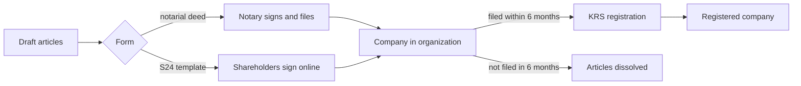

# Articles of association

## Summary

The articles of association (*umowa spółki*) are the founding contract of a sp. z o.o. They must state the company's name and seat, its business activities, the share capital, the number and value of each shareholder's shares, whether a shareholder may hold more than one share, and the duration if limited. They are signed either as a notarial deed or online through the S24 system using a template. Signing them creates a company in organization that can already act; it becomes a full company on registration.

*This note is educational. It describes Polish law in general terms as checked in October 2026 and is not legal or tax advice. Rules and fees change; check the current text of the acts and, for real decisions, ask a lawyer or tax adviser.*

## Prerequisites

- [Polish limited liability company](limited-liability-company.md)

## Core concepts

### Definition

The *articles of association* (*umowa spółki*; in a single-member company, the *akt założycielski*) are the contract that creates the company and sets its internal rules. Mandatory content (art. 157 § 1 KSH):

- the **name** (*firma*) and **seat** (*siedziba*) of the company,
- the **business activities** (*przedmiot działalności*),
- the amount of **share capital**,
- whether a shareholder may hold **more than one share**,
- the **number and nominal value of shares** taken up by each shareholder,
- the **duration** of the company, if it is limited.

The articles can add much more: privileged shares, restrictions on transfer, obligations to make additional payments, a supervisory board, board terms and representation rules.

### Analogy

The articles are the company's constitution and rulebook in one. A football club's statute says what the club is called, where it plays, who owns it and how decisions are made; changing it needs a special vote. The analogy breaks because the articles are also a contract between the shareholders, enforceable in court.

### Mechanism

**Name (*firma*).** It can be chosen freely but must include "spółka z ograniczoną odpowiedzialnością"; in business the abbreviation "spółka z o.o." or "sp. z o.o." may be used. Examples for Waldek and Olek's furniture company: "Waldek & Olek Meble sp. z o.o." or "Mebelki sp. z o.o.". The name must be distinguishable from others in the same town; check the KRS search.

**Seat (*siedziba*).** The town where the management board is based, for example Warszawa. The seat is not the same as the address: the address is filed in the register separately and can change without amending the articles.

**Business activities.** In principle free, but they should match what the company will actually do. They are described with codes of the Polish Classification of Activities (PKD), for example "manufacture of other furniture" (PKD 31.09). A new PKD 2025 classification has been introduced; check which version the register requires when you file.

**Form: notarial deed or S24.**

| | Notarial deed | S24 online template |
| --- | --- | --- |
| Content | No restrictions | Only the template's options (for example only a calendar financial year) |
| Contributions | Cash and in kind | Cash only, paid within 7 days of registration |
| Accounts and signatures | Not needed for signing | eKRS account and a trusted profile or qualified electronic signature for each person |
| Cost | Notary fee plus court fee 500 zł | No notary; court fee 250 zł |
| Speed | Usually slower registration | Usually faster registration |

**Company in organization.** From signing the articles, a *company in organization* (*spółka z o.o. w organizacji*) exists (art. 161 KSH). It can already sign contracts, acquire rights and take on obligations. It is a transitional stage: the company must be filed for registration within six months, or the articles are dissolved (art. 169 KSH; see [Formation and registration](formation-and-registration.md)).

From articles to registered company:

## Worked example

Waldek and Olek compare the two routes. Olek wants to contribute his saw and planer, and they want a financial year from 1 July to 30 June to match the furniture season. Both needs exclude S24 (cash only, calendar year), so they sign the articles before a notary. Their articles include, besides the mandatory content: a two-person board representing the company jointly, a right of first refusal if either sells shares, and an obligation to make additional payments up to ten times the nominal value of shares.

## Trade offs and when to use it

S24 is cheaper and faster for simple companies with cash capital. A notarial deed costs more but allows tailored rules (transfer restrictions, privileged shares, financial year, in-kind contributions) that prevent disputes later. Changing articles later always requires a notarial deed (see [Amending the articles of association](amending-articles-of-association.md)).

## Common mistakes

- **Confusing the seat with the address.** The seat is the town; the address is a separate registered detail.
- **Choosing PKD codes that do not match the real activity.** List the activities you will actually perform; add more later by amendment if needed.
- **Using S24 when in-kind contributions or a non-calendar financial year are needed.** Use a notarial deed.
- **Delaying the KRS filing.** The company in organization is temporary; file well within six months.

## Practice

1. List the six mandatory elements of the articles.
2. Name two restrictions of the S24 template.
3. When does a company in organization arise?

### Answers

1. Name and seat, business activities, share capital, whether a shareholder may hold more than one share, number and nominal value of each shareholder's shares, duration if limited.
2. Only cash contributions and only a calendar financial year (and only the template's options).
3. When the articles of association are signed.

## Further reading

- Sejm RP (2000). *Ustawa z dnia 15 września 2000 r. Kodeks spółek handlowych (Commercial Companies Code), consolidated text*. [Link](https://isap.sejm.gov.pl/isap.nsf/DocDetails.xsp?id=WDU20000941037). Articles 157 to 161 KSH.
- Ministerstwo Sprawiedliwości. eKRS: Portal Rejestrów Sądowych, S24 and KRS search. [Link](https://ekrs.ms.gov.pl/). S24 and KRS search.
- biznes.gov.pl. Tabela kodów PKD (Polish Classification of Activities). [Link](https://www.biznes.gov.pl/pl/tabela-pkd). PKD code table.
