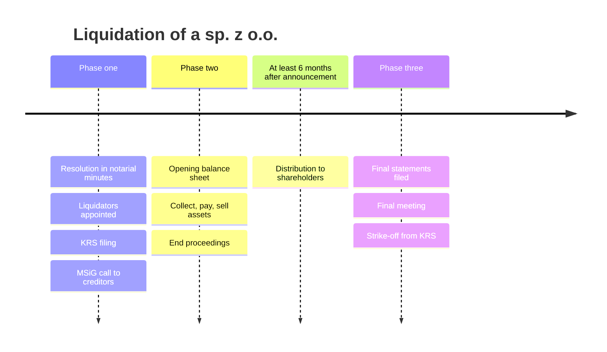

# Dissolution and liquidation

## Summary

A sp. z o.o. ends in two legal steps: a cause of dissolution occurs (a reason in the articles, a shareholders' resolution, bankruptcy or another legal cause), and then the company is liquidated: its business is wound up, its assets sold, creditors paid and the remainder distributed to shareholders, after which it is struck off the register. Liquidation runs in three phases and takes at least six months because creditors must be given time to report claims. A company in organization that is never registered is dissolved by a simplified or a full procedure.

*This note is educational. It describes Polish law in general terms as checked in October 2026 and is not legal or tax advice. Rules and fees change; check the current text of the acts and, for real decisions, ask a lawyer or tax adviser.*

## Prerequisites

- [Shareholders' meeting](shareholders-meeting.md)

## Core concepts

### Definition

*Dissolution* (*rozwiązanie*) is the legal end of the company, which occurs when it is struck off the register after liquidation (art. 272 KSH). *Liquidation* (*likwidacja*) is the procedure that precedes it. *Causes of dissolution* (art. 270 KSH) include:

- causes set out in the articles,
- a shareholders' resolution to dissolve the company or to move its seat abroad, recorded by a notary,
- the declaration of the company's bankruptcy,
- other causes provided by law.

### Analogy

Liquidation is like closing a shop properly: put up a "closing down" sign, stop new business, sell the stock, pay the suppliers and the landlord, and only then split what is left among the owners and hand back the keys. Skipping a step leaves debts that come back.

### Mechanism

**Duration.** Most articles provide that the company exists for an indefinite period, so it lasts until dissolved.

**Dissolution of the articles before registration.** If the company has not been filed for registration within six months of signing the articles, or a court refusal to register becomes final, the articles are dissolved (art. 169 KSH). The company in organization that existed since signing must then also be wound up:

- **Simplified model:** if all contributions can be returned immediately and all obligations of the company in organization can be paid, no liquidation proceeding is needed.
- **Full model:** if contributions cannot be returned immediately or debts cannot be paid, a liquidation proceeding is required.

**Resolution to dissolve.** It must be recorded in notarial minutes; an ordinary written resolution is not enough. If the board's balance sheet shows a loss exceeding the reserve capitals plus half of the share capital, the board must convene a meeting to decide on the company's continued existence (art. 233 KSH); the shareholders may decide to dissolve it.

**Liquidation in three phases.**

*Phase one: opening.*

1. **Opening liquidation:** a resolution in notarial minutes, at a meeting convened with notice (at least two weeks by registered letter), with an attendance list, signatures of the chair and secretary and voting results. From then on the name includes "w likwidacji" (in liquidation).
2. **Appointing liquidators:** only natural persons with full legal capacity who have not been finally convicted of the offences listed in art. 18 § 2 KSH; another company cannot be a liquidator. By default, board members become liquidators (art. 276 KSH), which does not require amending the articles.
3. **Filing with the KRS:** the liquidators file the opening of liquidation electronically through the Court Registers Portal (the only route since July 2021), attaching the CREWAN number of the notarial deed with the resolution, the liquidators' consent and their addresses for service.
4. **Announcement in MSiG:** the liquidators publish a notice in the Court and Economic Monitor calling on creditors to report claims within three months. The fee is charged per character (about 0.70 zł per character with a minimum, according to secondary sources in 2026; it was 0.80 zł in earlier years).

*Phase two: winding up.*

1. **Liquidation opening balance sheet:** assets valued at realizable market prices (real estate, machines, electronics), equity presented as one amount. It matters for satisfying creditors and, if there are no debts, for dividing assets.
2. **Ending current business and converting assets to cash:** collect receivables, pay obligations, end administrative, court and enforcement proceedings (otherwise the strike-off application will be rejected as premature), and sell fixed assets.

*Phase three: closing.*

- Prepare financial statements for the period before liquidation, the liquidation financial statements (as at the day before distribution of assets) and the statements for the liquidation period, and file them in the repository of financial documents of the KRS.
- Assets may be distributed to shareholders no earlier than six months after the announcement to creditors (art. 286 KSH).
- Convene the final shareholders' meeting to adopt the required resolutions, and file the application to strike the company off the register.

Matters of the liquidation of a company in organization are decided by the registry court competent for the company's seat.

The liquidation timeline:

## Worked example

Two shareholders decide to close their consulting sp. z o.o. On 5 February they adopt a resolution opening liquidation before a notary and appoint the two board members as liquidators. They file with the KRS on 8 February and publish the call to creditors in MSiG on 20 February. They collect 18,000 zł of receivables, pay a 4,000 zł supplier invoice, sell two laptops and close the office lease. On 21 August, after six months from the announcement, they distribute 61,000 zł to the shareholders, file the final statements, hold the final meeting and apply for strike-off.

## Trade offs and when to use it

Formal liquidation is slow and costs fees, accounting and at least six months, but it closes the company cleanly and protects shareholders and liquidators. Simply abandoning a company leaves obligations, and the court can strike off inactive companies in a separate procedure with consequences for those responsible.

## Common mistakes

- **Distributing assets to shareholders before six months have passed.** Wait at least six months after the creditor announcement.
- **Applying for strike-off with open court or enforcement proceedings.** End all proceedings first; otherwise the application will be rejected.
- **Passing the dissolution resolution without a notary.** Use notarial minutes.

## Practice

1. Name three causes of dissolution.
2. Who becomes liquidator by default?
3. How soon after the creditor announcement may assets be distributed?

### Answers

1. Causes in the articles, a notarial shareholders' resolution, bankruptcy, or other legal causes.
2. The members of the management board.
3. Not earlier than six months.

## Further reading

- Sejm RP (2000). *Ustawa z dnia 15 września 2000 r. Kodeks spółek handlowych (Commercial Companies Code), consolidated text*. [Link](https://isap.sejm.gov.pl/isap.nsf/DocDetails.xsp?id=WDU20000941037). Articles 169, 233 and 270 to 288 KSH.
- Ministerstwo Sprawiedliwości. eKRS: Portal Rejestrów Sądowych, S24 and KRS search. [Link](https://ekrs.ms.gov.pl/). Electronic filing and the repository of financial documents.
