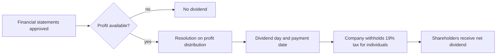

# Dividends

## Summary

A dividend is the shareholders' share in the company's profit. In a sp. z o.o., shareholders are entitled to the profit shown in the approved annual financial statements and allocated for distribution by a shareholders' resolution, in proportion to their shares unless the articles provide otherwise. The articles may allow interim dividends during the year under strict conditions. Dividends paid to individuals are taxed at a flat 19%, on top of the company's corporate income tax, which is why the sp. z o.o. is said to involve double taxation.

*This note is educational. It describes Polish law in general terms as checked in October 2026 and is not legal or tax advice. Rules and fees change; check the current text of the acts and, for real decisions, ask a lawyer or tax adviser.*

## Prerequisites

- [Shareholder rights](shareholder-rights.md)

## Core concepts

### Definition

A *dividend* (*dywidenda*) is the part of the company's net profit distributed to shareholders. The *right to dividend* is a shareholder's right to a share in the profit shown in the financial statements, examined by an auditor where required, and allocated for distribution by a resolution of the shareholders' meeting (art. 191 § 1 KSH).

### Analogy

A dividend is like a harvest share in a farming cooperative: after the season's accounts are approved, members vote how much of the surplus to share out and how much to keep for seed. Members cannot demand their share before the accounts are closed, except as an advance if the rules allow it and the season is going well.

### Mechanism

**Conditions.**

1. The financial statements for the financial year have been approved by the ordinary meeting.
2. They show a profit available for distribution (after covering losses and mandatory transfers).
3. The shareholders' meeting adopts a resolution on distributing profit, unless the articles exclude this from its powers.

**Allocation.** By default in proportion to shares (art. 191 § 2 KSH). The articles can provide otherwise, including privileged shares, within the limit of art. 196 KSH, which restricts how much higher a preferred dividend may be.

**Restrictions.** Amounts distributed may not exceed the profit for the last financial year plus undistributed profit from previous years and amounts transferred from reserve capitals created from profit, less uncovered losses, own shares and amounts that must be kept in reserve capitals under the code or the articles (art. 192 KSH). Payments violating the code must be returned (art. 198 KSH).

**Dividend day.** Shareholders entitled to the dividend for a financial year are those who held shares on the dividend day set by the resolution (art. 193 KSH).

**Interim dividends** (*zaliczka na poczet dywidendy*, art. 195 KSH). The articles may authorize the board to pay an advance on the expected dividend at the end of the financial year if the company has sufficient funds. Conditions include that the approved financial statements for the previous year show a profit; the advance may be at most half of the profit earned since the end of the previous financial year (with adjustments for reserve capitals and losses). If the year ends with a loss or a smaller profit, shareholders must return the advances in whole or in the excess.

**Taxation.** Dividends paid to individuals are subject to a flat 19% income tax (art. 30a of the PIT act), withheld by the company. See [Accounting and taxation](accounting-and-taxation.md) for the combined effect with corporate income tax.

From profit to dividend:



## Worked example

```python
# Python 3.12. Dividend split, withholding tax and an interim dividend limit.
profit_for_distribution = 40_000
shares = {"Waldek": 0.5, "Olek": 0.5}
for name, s in shares.items():
    gross = profit_for_distribution * s
    tax = round(gross * 0.19)
    print(name, gross, "tax", tax, "net", gross - tax)

# interim: at most half of profit earned since the end of the previous year
profit_since_year_end = 30_000
print("max interim dividend:", profit_since_year_end / 2)
```

Output:

```text
Waldek 20000.0 tax 3800 net 16200.0
Olek 20000.0 tax 3800 net 16200.0
max interim dividend: 15000.0
```

The company transfers the withheld 7,600 zł to the tax office. The interim limit shown is simplified; the code adjusts it for reserve capitals, uncovered losses and own shares.

## Trade offs and when to use it

Dividends return profit to owners in a transparent way, but they are taxed twice (company and shareholder). Owners often combine dividends with board remuneration or choose the Estonian CIT regime, where tax is due mainly on distribution (see [Accounting and taxation](accounting-and-taxation.md)).

## Common mistakes

- **Paying a dividend before the statements are approved.** Approve the statements first, or use a properly authorized interim dividend.
- **Distributing more than the code allows.** Check the limit of art. 192; unlawful payments must be returned.
- **Forgetting to withhold tax.** The company withholds 19% for individual shareholders and pays it to the tax office.

## Practice

1. Name three conditions for paying a dividend.
2. What is the tax rate on dividends for individuals in Poland?
3. What happens if interim dividends exceed the year's final profit?

### Answers

1. Approved financial statements, a profit available for distribution and a shareholders' resolution.
2. A flat 19%.
3. Shareholders must return the excess, or the whole advance if there is a loss.

## Further reading

- Sejm RP (2000). *Ustawa z dnia 15 września 2000 r. Kodeks spółek handlowych (Commercial Companies Code), consolidated text*. [Link](https://isap.sejm.gov.pl/isap.nsf/DocDetails.xsp?id=WDU20000941037). Articles 191 to 198 KSH.
- Sejm RP (1991). *Ustawa z dnia 26 lipca 1991 r. o podatku dochodowym od osób fizycznych (PIT act), art. 30a*. [Link](https://isap.sejm.gov.pl/isap.nsf/DocDetails.xsp?id=WDU19910800350). Flat tax on dividends.
