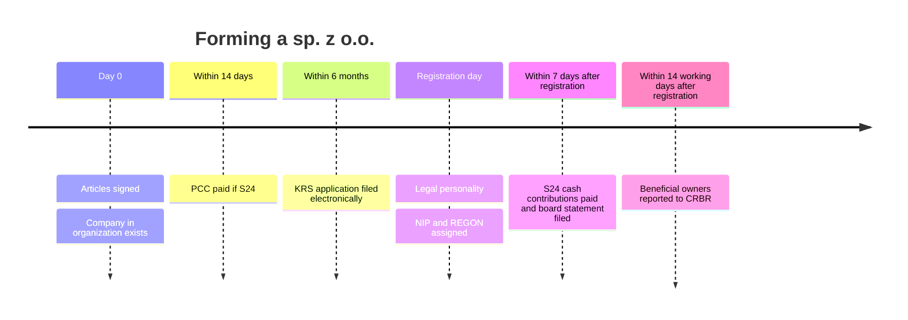

# Formation and registration

## Summary

After the articles are signed, the management board must register the company in the National Court Register (KRS), which today is done only electronically through the Court Registers Portal or the S24 system. Registration makes the company a full legal person. Within 14 working days of registration, the company must also report its beneficial owners to the Central Register of Beneficial Owners (CRBR). The main costs are the court fee (500 zł, or 250 zł in S24), the tax on civil law transactions (0.5% of share capital) and, for the notarial route, the notary's fee.

*This note is educational. It describes Polish law in general terms as checked in October 2026 and is not legal or tax advice. Rules and fees change; check the current text of the acts and, for real decisions, ask a lawyer or tax adviser.*

## Prerequisites

- [Articles of association](articles-of-association.md)

## Core concepts

### Definition

*Registration* (*wpis do KRS*) is the entry of the company in the register of entrepreneurs of the *National Court Register* (*Krajowy Rejestr Sądowy*). It is *constitutive*: the company acquires legal personality on entry. The *Central Register of Beneficial Owners* (*Centralny Rejestr Beneficjentów Rzeczywistych*, CRBR) records the natural persons who ultimately control the company, under the anti-money-laundering act.

### Analogy

Registration is like a birth certificate for the company: the child exists before the paperwork, but rights depend on the certificate. The CRBR entry is like listing the legal guardians, so that anyone can see who is really behind the company.

### Mechanism

**Filing with the KRS.** Since 1 July 2021, applications to the register of entrepreneurs are filed only electronically, through the *Portal Rejestrów Sądowych* (PRS) or, for S24 companies, through S24, signed with a qualified electronic signature or a trusted profile. Paper applications are not processed. Notarial deeds are attached by their number in the central repository of notarial deeds (CREWAN). The application, historically on the KRS-W3 form with annexes KRS-WE (company data), KRS-WK (organs) and KRS-WM (business activities), is now an interactive electronic form with the same content.

**Documents attached.**

- the articles of association (notarial deed or S24 document),
- the management board's statement that contributions to share capital have been made in full,
- documents appointing the members of the organs,
- the list of shareholders,
- the list of board members with names and addresses for service,
- the board members' consent to appointment and addresses for service,
- proof of payment of fees.

After registration, the company appears in the public KRS search. A tax identification number (NIP) and statistical number (REGON) are assigned automatically. VAT registration, if needed, is a separate step.

**CRBR.** The company reports:

- its identifying data: name, legal form, seat, KRS and NIP numbers,
- data of each beneficial owner and of the board members or shareholders authorized to represent it: name, citizenship, country of residence, PESEL number or date of birth, and the size and nature of their interest or rights.

A *beneficial owner* is the natural person who ultimately controls the company, directly or indirectly. The report is filed electronically, free of charge, within 14 working days of the KRS entry, and changes must be reported within the same period. Penalties for failing to report can reach 1,000,000 zł.

**Costs.**

| Item | Notarial deed | S24 |
| --- | --- | --- |
| Notary's fee | Depends on capital and scope | None |
| Court fee for registration | 500 zł | 250 zł |
| Fee for announcement in the Court and Economic Monitor (MSiG) | 100 zł until 28 November 2025; since 29 November 2025 KRS entries are no longer announced in MSiG | same |
| Tax on civil law transactions (PCC) | 0.5% of share capital | 0.5% of share capital |

With a notarial deed, the notary collects the PCC and pays it to the tax office. In S24, the company must calculate the tax, file the PCC-3 declaration and pay it within 14 days of signing the articles.

The formation sequence with its deadlines:

## Worked example

Waldek and Olek sign their articles before a notary on 3 March with a share capital of 10,000 zł. The notary collects PCC of 50 zł (0.5% of 10,000 zł). Their board files the KRS application through PRS on 6 March, attaching the CREWAN number and paying the 500 zł court fee. The company is registered on 20 March. By 9 April (14 working days later, ignoring holidays), the board reports Waldek and Olek, each holding 50%, as beneficial owners in CRBR.

## Trade offs and when to use it

Electronic filing is faster and cheaper than the old paper procedure, but it requires electronic signatures for all signatories and careful completion: the court can reject an application for errors, and in extreme cases false statements can lead to civil or criminal liability.

## Common mistakes

- **Filing paper forms.** Since July 2021 only electronic filings are processed.
- **Forgetting the CRBR report.** File within 14 working days of registration and update it after changes.
- **Paying for "registration" in private registers.** Offers by letter, email or phone to publish entries in other registers for a fee are not required by law. Check carefully before paying.
- **Assuming PCC is paid automatically in S24.** In S24 the company files PCC-3 and pays within 14 days.

## Practice

1. What is the court fee for registration via notarial deed and via S24?
2. Within what time must beneficial owners be reported to CRBR?
3. Who pays PCC in the S24 route, and by when?

### Answers

1. 500 zł and 250 zł.
2. 14 working days from the KRS entry.
3. The company itself, within 14 days of signing the articles.

## Further reading

- Sejm RP (1997). *Ustawa z dnia 20 sierpnia 1997 r. o Krajowym Rejestrze Sądowym (National Court Register Act)*. [Link](https://isap.sejm.gov.pl/isap.nsf/DocDetails.xsp?id=WDU19971210769). National Court Register Act.
- Sejm RP (2018). *Ustawa z dnia 1 marca 2018 r. o przeciwdziałaniu praniu pieniędzy oraz finansowaniu terroryzmu (AML act, CRBR rules)*. [Link](https://isap.sejm.gov.pl/isap.nsf/DocDetails.xsp?id=WDU20180000723). CRBR obligations.
- Ministerstwo Finansów. Centralny Rejestr Beneficjentów Rzeczywistych. [Link](https://www.podatki.gov.pl/crbr/). CRBR filing portal.
- Sejm RP (2000). *Ustawa z dnia 9 września 2000 r. o podatku od czynności cywilnoprawnych (tax on civil law transactions act)*. [Link](https://isap.sejm.gov.pl/isap.nsf/DocDetails.xsp?id=WDU20000860959). Tax on civil law transactions.
- Poradnik Przedsiębiorcy (2026). Opłaty sądowe w postępowaniu rejestrowym 2026. [Link](https://poradnikprzedsiebiorcy.pl/-oplaty-sadowe-w-postepowaniu-rejestrowym). Court fees in 2026.
- Rzeczpospolita (2025). Czy spółki nadal muszą publikować ogłoszenia w MSiG?. [Link](https://pro.rp.pl/biznes/art43605401-czy-spolki-nadal-musza-publikowac-ogloszenia-w-msig). End of MSiG announcements of KRS entries.
- Sejm RP (2005). *Ustawa z dnia 28 lipca 2005 r. o kosztach sądowych w sprawach cywilnych (court fees act)*. [Link](https://isap.sejm.gov.pl/isap.nsf/DocDetails.xsp?id=WDU20051671398). Court fees act.
