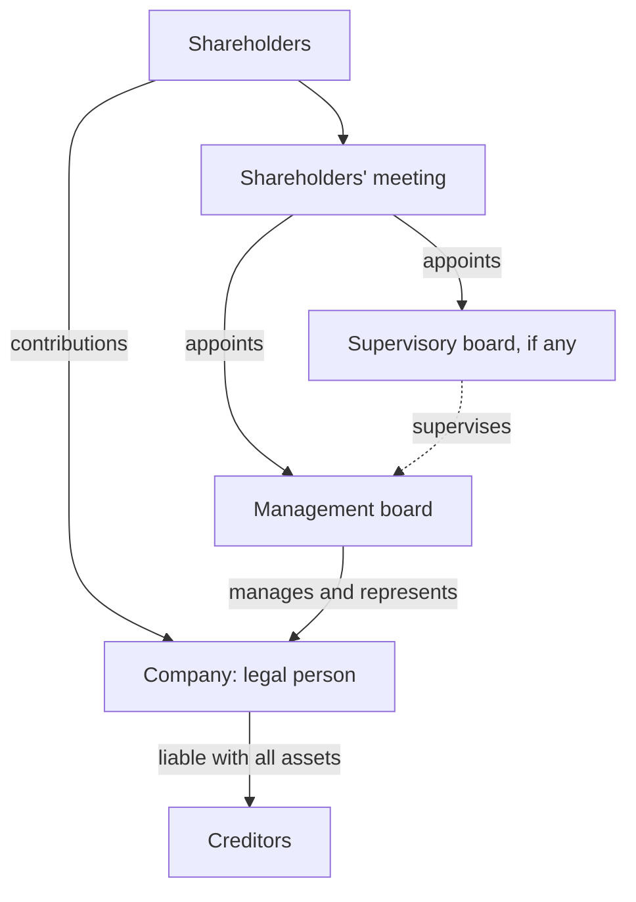

# Polish limited liability company

## Summary

The limited liability company (*spółka z ograniczoną odpowiedzialnością*, sp. z o.o.) is a capital company regulated in detail by the Polish Commercial Companies Code. It has legal personality: it can own property, take on obligations, sue and be sued in its own name. Its shareholders do not answer for its debts; they risk only what they contributed. It needs a share capital of at least 5,000 zł divided into shares of at least 50 zł each, and it can be formed by one or more persons or entities.

*This note is educational. It describes Polish law in general terms as checked in October 2026 and is not legal or tax advice. Rules and fees change; check the current text of the acts and, for real decisions, ask a lawyer or tax adviser.*

## Prerequisites

No prior notes are needed.

## Core concepts

### Definition

A *spółka z o.o.* is a *capital company* (*spółka kapitałowa*): a separate legal person whose existence does not depend on who its shareholders are. Because it has *legal personality* (*osobowość prawna*), it can in its own name:

- become the owner of property, including real estate,
- take on obligations (become a debtor),
- sue and be sued.

It differs from a *partnership* (*spółka osobowa*, such as *spółka jawna*), where partners are personally liable for debts, and from a sole trader (*jednoosobowa działalność gospodarcza*, JDG), where the owner and the business are the same person. The other capital companies in Poland are the joint-stock company (*spółka akcyjna*, S.A.) and the simple joint-stock company (*prosta spółka akcyjna*, PSA, since 2021).

### Analogy

A sp. z o.o. is like a sealed container for a business. The shareholders put money in and own the container, but creditors can only reach what is inside, not the shareholders' houses. The analogy breaks in several places: shareholders are liable in specific cases (unpaid contributions, acting for the company before registration), and board members can be personally liable for company debts if they fail to file for bankruptcy in time (see [Management board liability](management-board-liability.md)).

### Mechanism

**Who can form it.**

- natural persons,
- organizational units without legal personality that have legal capacity (for example a general partnership, *spółka jawna*),
- legal persons (for example a joint-stock company).

One person can form it (*jednoosobowa spółka z o.o.*), but a single-member sp. z o.o. cannot be formed solely by another single-member sp. z o.o. (art. 151 § 2 KSH).

**Share capital.** The minimum share capital (*kapitał zakładowy*) is 5,000 zł. It is divided into *shares* (*udziały*) of equal or unequal nominal value, each at least 50 zł (art. 154 KSH). The articles say whether a shareholder may hold more than one share.

**Contributions.** Shares are paid for with *contributions* (*wkłady*):

- **cash** (*pieniężne*), or
- **in kind** (*niepieniężne*, aporty): real estate, a car, computers, rights.

A contribution cannot be a non-transferable right or the shareholder's work or services (art. 14 § 1 KSH). Cash contributions must normally be paid in full before registration; when the company is formed through the S24 online system, they must be paid within 7 days of registration (art. 158 § 1¹ KSH).

**Organs.** A company acts through organs: the *management board* (*zarząd*, mandatory), the *shareholders' meeting* (*zgromadzenie wspólników*, mandatory) and, in some cases, a *supervisory board* (*rada nadzorcza*) or audit committee.

**Liability.** The company answers for its debts with all its assets. Shareholders do not answer for the company's debts (art. 151 § 4 KSH); they carry only the economic risk of losing their investment.

The structure of a sp. z o.o.:

### Choosing the form

| Form | Liability of owners | Minimum capital | Taxation | Typical use |
| --- | --- | --- | --- | --- |
| Sole trader (JDG) | Unlimited, personal | None | PIT (scale, flat 19% or lump sum) | Freelancers, small trades |
| General partnership (sp. j.) | Unlimited, joint | None | PIT for partners | Small family firms |
| Limited liability company (sp. z o.o.) | Limited to contributions (board members can be liable) | 5,000 zł | CIT plus tax on dividends | Most small and medium companies |
| Simple joint-stock company (PSA) | Limited | 1 zł | CIT plus tax on dividends | Startups, flexible equity |
| Joint-stock company (S.A.) | Limited | 100,000 zł | CIT plus tax on dividends | Large firms, listed companies |

Taxation of the sp. z o.o. is covered in [Accounting and taxation](accounting-and-taxation.md).

## Worked example

Waldek and Olek want to make furniture together. As a sole trader each would answer with his private assets for the workshop's debts. They form a sp. z o.o. with a share capital of 10,000 zł: 200 shares of 50 zł, 100 each. Waldek pays 5,000 zł in cash; Olek contributes a saw and a planer valued at 5,000 zł. If a large order goes wrong and the company owes a supplier 80,000 zł, the supplier can claim against the company's assets, not against Waldek's flat, unless a special basis of personal liability applies.

## Trade offs and when to use it

The sp. z o.o. limits personal risk and is familiar to banks and partners. Its costs are higher than a sole trader's: full accounting, formal resolutions, registration filings and, in principle, two levels of income tax on distributed profit. Board members carry real personal risk in insolvency.

## Common mistakes

- **Believing a sp. z o.o. makes everyone immune from its debts.** Board members can be liable for unpaid debts and tax arrears, and shareholders for unpaid contributions.
- **Planning to contribute work as the shareholder's contribution.** Work and services cannot be contributed; use cash or transferable assets.
- **Forming a single-member company owned only by another single-member sp. z o.o.** This is prohibited; add a shareholder or choose another structure.

## Practice

1. What does legal personality allow a company to do?
2. What are the minimum share capital and minimum share value?
3. Who cannot be the sole founder of a single-member sp. z o.o.?

### Answers

1. Own property, take on obligations, and sue and be sued in its own name.
2. 5,000 zł and 50 zł per share.
3. Another single-member sp. z o.o.

## Further reading

- Sejm RP (2000). *Ustawa z dnia 15 września 2000 r. Kodeks spółek handlowych (Commercial Companies Code), consolidated text*. [Link](https://isap.sejm.gov.pl/isap.nsf/DocDetails.xsp?id=WDU20000941037). The Commercial Companies Code.
- biznes.gov.pl. Założenie spółki z ograniczoną odpowiedzialnością. [Link](https://www.biznes.gov.pl/pl/portal/00186). Official guide to forming the company.
