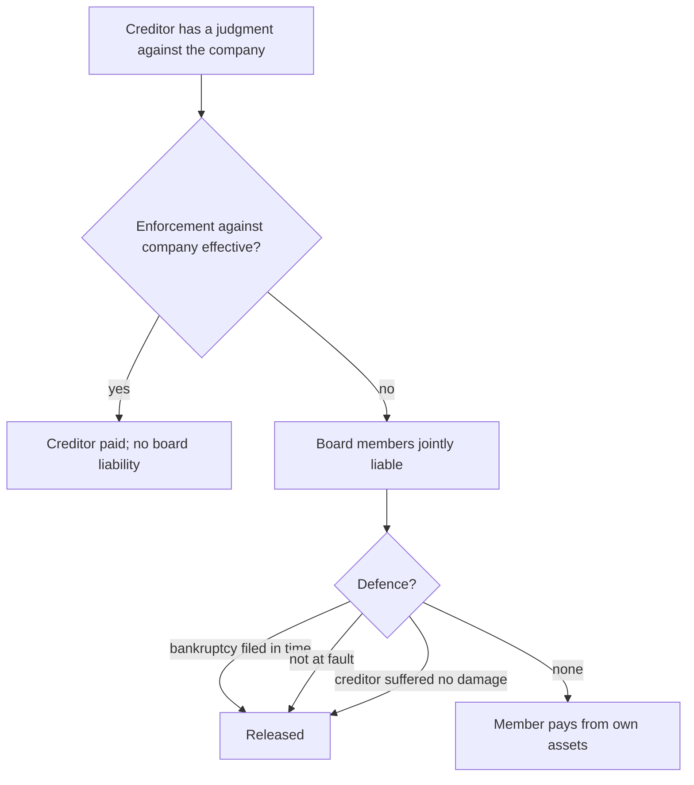

# Management board liability

## Summary

Members of the management board of a sp. z o.o. can be personally liable in four ways: for damage they cause the company, for the company's debts when enforcement against it fails, for its tax arrears, and under the Fiscal Penal Code for tax offences. Liability for company debts and taxes is subsidiary: it arises only if enforcement against the company is ineffective. A member can avoid it mainly by showing that a bankruptcy petition was filed in time. Not knowing the company's finances is no defence.

*This note is educational. It describes Polish law in general terms as checked in October 2026 and is not legal or tax advice. Rules and fees change; check the current text of the acts and, for real decisions, ask a lawyer or tax adviser.*

## Prerequisites

- [Management board](management-board.md)

## Core concepts

### Definition

*Management board liability* (*odpowiedzialność członków zarządu*) arises under the Commercial Companies Code, the Tax Ordinance, the Fiscal Penal Code and other acts. The main types:

- liability for **damage caused to the company** (art. 293 KSH),
- liability for the **company's obligations** (art. 299 KSH),
- **tax liability** for the company's tax arrears (art. 116 of the Tax Ordinance),
- **fiscal penal liability** for tax offences and petty offences (Fiscal Penal Code).

### Analogy

Board members are like the captains of a ship whose owners are protected by limited liability. If the ship is sinking, the captains must call for rescue (file for bankruptcy) in time; if they keep sailing and passengers lose their money, the captains can be made to pay from their own pockets.

### Mechanism

**Damage to the company** (art. 293 KSH). A member is liable to the company for damage caused by an act or omission contrary to the law or the articles, if there is a causal link between the breach and the damage, and the member was at fault.

**Company debts** (art. 299 KSH). If enforcement against the company proves ineffective, board members are jointly and severally liable for its obligations. Liability is *subsidiary*: it arises only after a creditor's enforcement against the company's assets failed. A member is released if they show that:

- a bankruptcy petition was filed at the right time, or in that period a restructuring proceeding was opened or an arrangement approved, or
- failure to file was not their fault, or
- despite no petition, the creditor suffered no damage.

Under the Bankruptcy Law, the board must file a petition within 30 days of the date when the grounds for bankruptcy (insolvency) arose. Lack of knowledge about the company's finances does not release a member.

**Tax arrears** (art. 116 of the Tax Ordinance). Board members are liable with all their private assets, jointly and severally, for the company's tax arrears arising during their term, including unpaid CIT, VAT and PIT withheld for employees, unpaid tax advances, and tax refunds paid wrongly or in excess.

Positive conditions (that the tax authority must show):

- enforcement against the company's assets proved ineffective in whole or in part (this requires enforcement to have actually been started and conducted; without it there is no liability),
- the arrears relate to obligations whose payment date fell during the member's term.

Negative conditions (that release the member):

- a bankruptcy petition was filed in time, or a restructuring proceeding was opened or an arrangement approved in that period, or failure to file was not their fault,
- the member indicates company assets from which enforcement will satisfy the arrears to a significant extent.

The decision on liability must state that the member held office when the tax obligation arose and that enforcement against the company was ineffective. A member who paid can claim contribution from the other members (recourse).

**Fiscal penal liability.** If the company, as a taxpayer, commits a fiscal offence or petty offence defined in the Fiscal Penal Code, the board members responsible for its tax affairs can be prosecuted personally (art. 9 § 3 of the code). Whether a breach of tax law has penal consequences must be checked against the code.

Board members' liability is broad and can also follow from other specific acts, such as social security and labor law.

Liability for company debts under art. 299 KSH:

## Worked example

A construction sp. z o.o. stopped paying its suppliers in March 2025 and became insolvent. The board filed for bankruptcy only in November 2025. A supplier with an unpaid invoice of 120,000 zł from June 2025 obtains a judgment, but enforcement against the company recovers nothing. The supplier sues the board members under art. 299. Because the petition was filed months after the 30-day deadline and the members cannot show lack of fault or lack of damage, they are jointly liable for 120,000 zł. The tax office separately pursues them under art. 116 for VAT due in May 2025.

## Trade offs and when to use it

Personal liability gives creditors a safeguard against directors who run an insolvent company at others' expense. For board members it means that taking the role requires monitoring solvency and acting quickly. Directors' and officers' (D&O) insurance can cover some civil liability, but not taxes or fines.

## Common mistakes

- **Waiting too long to file for bankruptcy.** File within 30 days of insolvency or start restructuring.
- **Believing ignorance of finances is a defence.** Each member must monitor the company's financial situation.
- **Resigning without settling tax issues.** Liability covers arrears due during the term, even after resignation.

## Practice

1. What does "subsidiary" mean for liability under art. 299?
2. How can a board member avoid liability under art. 299?
3. What two conditions must the tax authority show under art. 116?

### Answers

1. It arises only after enforcement against the company has proved ineffective.
2. By showing a timely bankruptcy petition or restructuring, lack of fault, or that the creditor suffered no damage.
3. Ineffective enforcement against the company and arrears due during the member's term.

## Further reading

- Sejm RP (2000). *Ustawa z dnia 15 września 2000 r. Kodeks spółek handlowych (Commercial Companies Code), consolidated text*. [Link](https://isap.sejm.gov.pl/isap.nsf/DocDetails.xsp?id=WDU20000941037). Articles 293 and 299 KSH.
- Sejm RP (1997). *Ustawa z dnia 29 sierpnia 1997 r. Ordynacja podatkowa (Tax Ordinance), art. 116*. [Link](https://isap.sejm.gov.pl/isap.nsf/DocDetails.xsp?id=WDU19971370926). Article 116 of the Tax Ordinance.
- Sejm RP (1999). *Ustawa z dnia 10 września 1999 r. Kodeks karny skarbowy (Fiscal Penal Code)*. [Link](https://isap.sejm.gov.pl/isap.nsf/DocDetails.xsp?id=WDU19990830930). Fiscal Penal Code.
- Sejm RP (2003). *Ustawa z dnia 28 lutego 2003 r. Prawo upadłościowe (Bankruptcy Law), art. 21*. [Link](https://isap.sejm.gov.pl/isap.nsf/DocDetails.xsp?id=WDU20030600535). Thirty-day deadline to file.
