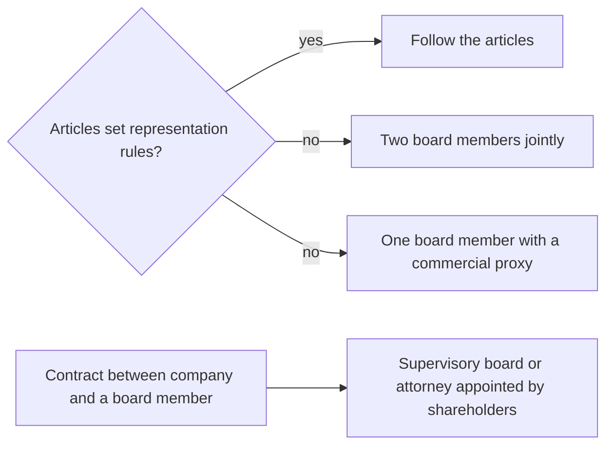

# Management board

## Summary

The management board (*zarząd*) is the mandatory organ that runs a sp. z o.o.'s affairs and represents it externally: it signs contracts, hires staff and acts before courts and tax authorities. It can have one or more members, who need not be shareholders. Unless the articles say otherwise, members are appointed and removed by shareholders' resolution and their mandate expires after the meeting approving the accounts for their first full financial year. Without other rules, a multi-person board represents the company by two members jointly or one member with a commercial proxy.

*This note is educational. It describes Polish law in general terms as checked in October 2026 and is not legal or tax advice. Rules and fees change; check the current text of the acts and, for real decisions, ask a lawyer or tax adviser.*

## Prerequisites

- [Polish limited liability company](limited-liability-company.md)

## Core concepts

### Definition

The *management board* is the executive organ of the company. It has two roles:

- **managing the company's affairs** (*prowadzenie spraw spółki*): factual actions such as meeting business partners, and economic, personnel and organizational decisions inside the company;
- **representing the company** (*reprezentacja*): concluding contracts, employing staff, signing court and out-of-court documents, and acting before public authorities such as tax offices.

Members can be titled president (*prezes zarządu*), vice-president (*wiceprezes*) and member (*członek zarządu*).

### Analogy

The board is like the captain and officers of a ship owned by investors. The owners (shareholders) appoint them and set the destination, but the officers steer and speak for the ship. If they ignore warning lights, they can be held personally responsible.

### Mechanism

**Composition.** One or more persons, as the articles specify. A shareholder can be a board member, and so can a non-shareholder.

**Appointment and removal.** By shareholders' resolution, unless the articles give this power to the supervisory board or provide otherwise. A member can be removed at any time. A mandate ends on death, resignation, removal, or loss of the right to hold the office (for example a conviction for certain offences under art. 18 § 2 KSH).

**Term.** Unless the articles provide otherwise, the mandate expires on the day of the shareholders' meeting that approves the financial statements for the first full financial year in office (art. 202 KSH). Many articles extend this to avoid losing the mandate every year. A member acts from the date of appointment; the KRS entry is declaratory (informational).

**Remuneration.** Membership can be paid or unpaid. Pay is set by shareholders' resolution or by a contract between the company and the member. Common configurations: appointment resolution only; appointment plus an employment contract; appointment plus a management contract.

**Representation.** If the board has several members and the articles say nothing, the company is represented by two members acting jointly or by one member acting with a *commercial proxy* (*prokurent*) (art. 205 § 1 KSH).

**Contracts with board members.** When the company signs a contract with a board member (for example renting the member's property), it is represented by the supervisory board or by an attorney appointed by shareholders' resolution (art. 210 KSH), to avoid a conflict of interest.

Default representation of a multi-person board:

## Worked example

Mebelki sp. z o.o. has a two-person board, Waldek (president) and an outside manager. The articles say nothing about representation. A large supply contract signed only by Waldek is not validly concluded by the company until the second member or a commercial proxy also signs, or the contract is ratified. When the company wants to rent Waldek's workshop, the shareholders adopt a resolution appointing Olek as the company's attorney for that lease.

## Trade offs and when to use it

A one-person board decides quickly; a multi-person board with joint representation adds control but slows routine work. Many companies give single members authority up to an amount and require joint signatures above it.

## Common mistakes

- **Forgetting the default one-year mandate.** Set a longer term in the articles or re-appoint in time.
- **Signing a contract with oneself on behalf of the company.** Use the supervisory board or an attorney appointed by resolution.
- **Ignoring joint representation rules.** Check the KRS entry before relying on one signature.

## Practice

1. What are the two roles of the board?
2. With no rule in the articles, how does a multi-person board represent the company?
3. When does a board member's mandate expire by default?

### Answers

1. Managing the company's affairs and representing it.
2. Two members jointly, or one member with a commercial proxy.
3. On the day of the meeting approving the financial statements for the first full financial year in office.

## Further reading

- Sejm RP (2000). *Ustawa z dnia 15 września 2000 r. Kodeks spółek handlowych (Commercial Companies Code), consolidated text*. [Link](https://isap.sejm.gov.pl/isap.nsf/DocDetails.xsp?id=WDU20000941037). Articles 201 to 211 KSH.
