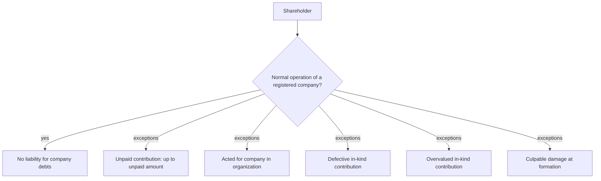

# Shareholder liability

## Summary

Shareholders of a sp. z o.o. are not liable for its debts; they carry only the economic risk of losing what they invested. The company answers for its debts with all its assets. There are exceptions: a shareholder is liable up to the unpaid part of a contribution for debts of the company in organization, for debts incurred while acting for the company in organization, for defective or overvalued in-kind contributions, and for culpably harming the company at its formation in breach of the law.

*This note is educational. It describes Polish law in general terms as checked in October 2026 and is not legal or tax advice. Rules and fees change; check the current text of the acts and, for real decisions, ask a lawyer or tax adviser.*

## Prerequisites

- [Polish limited liability company](limited-liability-company.md)

## Core concepts

### Definition

*Shareholder liability* means the cases in which a shareholder must pay from their own assets for the company's obligations or must compensate the company. The general rule is the reverse: shareholders are not liable for the company's obligations (art. 151 § 4 KSH).

### Analogy

A shareholder is like an investor who bought a ticket for a ship's voyage with a promise to pay part of the fare later. If the ship sinks, the investor loses the ticket but not their house, unless they never paid the promised part, pretended a broken engine was working, or steered the ship before it was registered.

### Mechanism

**Cases of liability.**

1. **Unpaid contribution.** For debts of the company in organization, a shareholder is liable up to the amount of the contribution they have not made, jointly and severally with the company and the persons acting on its behalf (art. 13 § 1 KSH). If a shareholder promised 10,000 zł and paid 5,000 zł, they answer with their own assets up to 5,000 zł. *Joint and several* liability means a creditor can demand the whole or part of the claim from all of them together, from some, or from each one separately; payment by any of them releases the others.
2. **Acting for the company in organization.** Between signing and registration, the company in organization is represented by the board or by an attorney appointed by unanimous shareholders' resolution. A shareholder who acts as such an attorney is liable jointly with the company, with their personal assets, for obligations incurred in that period. This liability ends when the shareholders' meeting approves their actions after registration.
3. **Defective in-kind contribution.** A shareholder who contributed an asset with defects, physical (a car that does not work) or legal (a car owned by someone else), must pay the company the difference between the value stated in the articles and the asset's realizable value (the price it could be sold for, considering the defects).
4. **Overvalued in-kind contribution.** If an in-kind contribution was significantly overvalued, the shareholder is liable to the company for the difference jointly with the board members who knew of the overvaluation (art. 175 KSH). The shareholder is liable regardless of whether they knew; board members only if they knew.
5. **Culpable damage at formation.** A shareholder who, in breach of the law, culpably caused damage to the company during its formation must compensate it (art. 291 KSH).

**No liability for company debts.** Outside these cases, shareholders are not liable for the company's obligations. The company itself is liable without limit, with all its assets.

When a shareholder can be liable:

## Worked example

Olek contributed a planer valued in the articles at 5,000 zł. A year later it turns out the planer was stolen property, and its rightful owner reclaims it (a legal defect). Olek must pay the company 5,000 zł. Separately, before registration Waldek signed a 12,000 zł lease for the workshop as the company in organization's attorney; he answers for it jointly with the company until the shareholders approve his actions after registration.

## Trade offs and when to use it

Limited liability is the main reason to choose a sp. z o.o. It is real but conditional: paying contributions fully, valuing in-kind contributions honestly and approving pre-registration acts promptly keep shareholders safe.

## Common mistakes

- **Delaying payment of the capital.** Pay contributions in full; until then you are exposed up to the unpaid amount.
- **Inflating the value of an in-kind contribution.** Use an honest valuation; you are liable for the difference even without knowledge.
- **Not approving acts done for the company in organization.** Have the shareholders' meeting approve them after registration.

## Practice

1. Is a shareholder liable for the company's debts?
2. A shareholder promised 10,000 zł and paid 5,000 zł. Up to what amount are they liable?
3. When are board members liable for an overvalued in-kind contribution?

### Answers

1. As a rule no; only in specific cases such as unpaid contributions.
2. 5,000 zł, for debts of the company in organization.
3. Only if they knew of the overvaluation.

## Further reading

- Sejm RP (2000). *Ustawa z dnia 15 września 2000 r. Kodeks spółek handlowych (Commercial Companies Code), consolidated text*. [Link](https://isap.sejm.gov.pl/isap.nsf/DocDetails.xsp?id=WDU20000941037). Articles 13, 151, 175 and 291 KSH.
- Sejm RP (1964). *Ustawa z dnia 23 kwietnia 1964 r. Kodeks cywilny (Civil Code)*. [Link](https://isap.sejm.gov.pl/isap.nsf/DocDetails.xsp?id=WDU19640160093). Joint and several liability.
