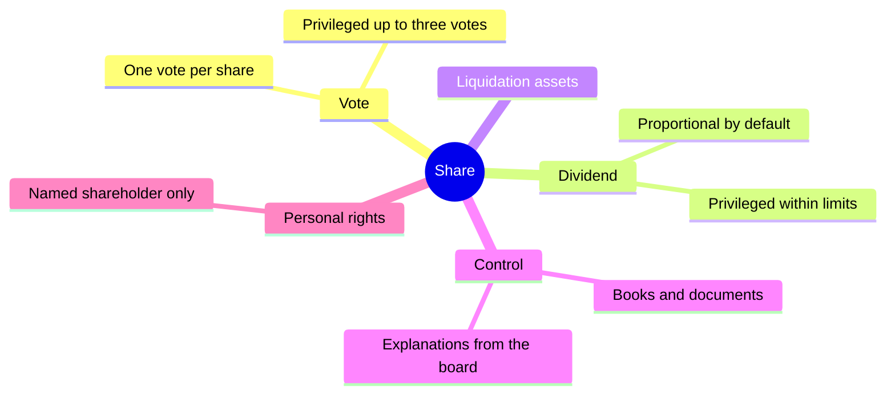

# Shareholder rights

## Summary

A shareholder in a sp. z o.o. has rights that include voting at the shareholders' meeting, a share in profit (dividend), a share in the assets left after liquidation, and the right to inspect the company's books and documents. As a rule, shareholders have equal rights and one share carries one vote. The articles can create privileged shares (more votes, a higher dividend, a better share in liquidation) and personal rights for named shareholders, within limits set by the code.

*This note is educational. It describes Polish law in general terms as checked in October 2026 and is not legal or tax advice. Rules and fees change; check the current text of the acts and, for real decisions, ask a lawyer or tax adviser.*

## Prerequisites

- [Polish limited liability company](limited-liability-company.md)

## Core concepts

### Definition

*Shareholder rights* (*prawa wspólników*) are the rights attached to shares and to the position of shareholder, among others:

- the **right to vote** (*prawo głosu*): to take part in decisions at the shareholders' meeting,
- the **right to dividend** (*prawo do dywidendy*): see [Dividends](dividends.md),
- the **right to a share in liquidation assets** (*prawo do udziału w majątku likwidacyjnym*),
- the **right of control** (*prawo kontroli*).

Shareholders have, in principle, equal rights and obligations in proportion to their shares (art. 174 § 1 KSH).

### Analogy

Shares are like keys to a building with several rooms: one room for voting, one for profit, one for the final distribution if the building is sold, and a window to look into the office. Privileged shares are keys that open some rooms wider.

### Mechanism

**Voting.** As a rule, each share carries one vote, so a shareholder with more shares has more say. The articles can change this within the limits of the code.

**Privileged shares** (*udziały uprzywilejowane*, art. 174 KSH). The articles may give certain shares preference, in particular as to:

- **votes:** at most three votes per share, and only for shares of equal nominal value,
- **dividend:** within the limits of art. 196 KSH,
- **share in liquidation assets.**

The articles can make special rights depend on additional contributions to the company, the passage of time or a condition.

**Personal rights** (art. 159 KSH). The articles can grant a named shareholder personal rights, such as the right to appoint a board member.

**Right of control** (art. 212 KSH). A shareholder, alone or with an authorized person, may at any time review the company's books and documents, prepare a balance sheet for their own use, or request explanations from the board.

**Refusing control.** The board may refuse explanations and access to books and documents for important reasons, mainly a justified concern that the shareholder will use the information against the company's interest and cause it significant damage. The shareholder can then ask for a shareholders' resolution on the matter and, ultimately, apply to the registry court.

The rights attached to a share:

## Worked example

Mebelki sp. z o.o. admits an investor, Anna, who buys 40% of the shares. Waldek and Olek want to keep control of decisions, so the articles are amended (two-thirds majority, notarial deed) to give their shares two votes each. Anna negotiates a dividend preference in return. With 60% of shares at two votes and 40% at one vote, the founders hold 120 of 160 votes, 75% of the total.

## Trade offs and when to use it

Privileges let founders keep control while raising capital, but they make the company less attractive to some investors and can cause conflict. The right of control protects minority shareholders, but its abuse can expose the company to competitors; hence the board's right to refuse for important reasons.

## Common mistakes

- **Granting four votes per share.** The maximum is three votes per share.
- **Refusing a shareholder access without an important reason.** Refusal must be justified by a risk of significant damage; otherwise the court can order access.

## Practice

1. What is the maximum voting privilege per share?
2. What can a shareholder do if the board refuses access to documents?

### Answers

1. Three votes per share.
2. Ask for a shareholders' resolution and then apply to the registry court.

## Further reading

- Sejm RP (2000). *Ustawa z dnia 15 września 2000 r. Kodeks spółek handlowych (Commercial Companies Code), consolidated text*. [Link](https://isap.sejm.gov.pl/isap.nsf/DocDetails.xsp?id=WDU20000941037). Articles 159, 174 and 212 KSH.
