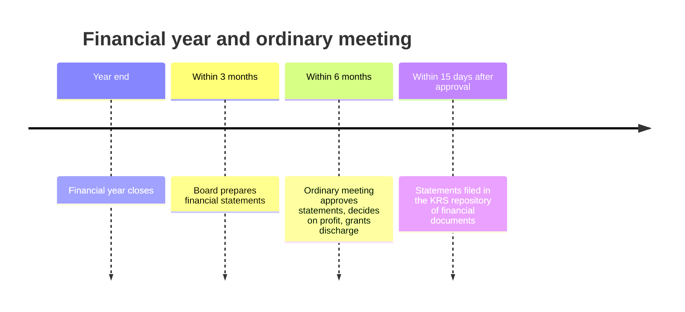

# Shareholders' meeting

## Summary

The shareholders' meeting (*zgromadzenie wspólników*) is the mandatory organ of all shareholders that takes the company's most important decisions. The ordinary meeting must be held within six months after each financial year to approve the financial statements, decide on profit or loss and grant discharge. Other matters, such as selling the enterprise or buying real estate, need resolutions that can be taken at an extraordinary meeting. Resolutions pass by absolute majority unless the code or the articles require more: two thirds for amending the articles, three quarters for a significant change of business activities.

*This note is educational. It describes Polish law in general terms as checked in October 2026 and is not legal or tax advice. Rules and fees change; check the current text of the acts and, for real decisions, ask a lawyer or tax adviser.*

## Prerequisites

- [Polish limited liability company](limited-liability-company.md)

## Core concepts

### Definition

The *shareholders' meeting* is the organ made up of all shareholders. Attending is a right, not a duty, and shareholders can act through proxies. Meetings are *ordinary* (*zwyczajne*, annual) or *extraordinary* (*nadzwyczajne*, as needed). Shareholders can also adopt resolutions in writing without a meeting if all agree to the written vote or to the resolution (art. 227 § 2 KSH).

### Analogy

The meeting is the owners' assembly of a housing community: once a year it approves the accounts and the manager's work, and in between it meets when a big decision is needed, such as selling the building or taking a large loan.

### Mechanism

**Ordinary meeting.** Held within six months after the end of each financial year (art. 231 KSH); the articles may set a shorter but not a longer period. A financial year is a calendar year or another period of 12 consecutive full months. It is convened by the board (or a liquidator); if the board fails to do so, the supervisory board or audit committee may convene it. Its minimum agenda:

- examining and approving the management report and the financial statements for the previous year,
- a resolution on distributing profit or covering loss (unless the articles exclude this from the meeting's powers, art. 191 § 2 KSH),
- granting discharge (*absolutorium*) to members of the company's organs.

**Matters requiring a resolution** (art. 228 KSH, unless the articles provide otherwise), often handled at an extraordinary meeting:

- selling or leasing the enterprise or an organized part of it, and establishing a limited property right on them,
- returning additional payments,
- continuing the company if the balance sheet shows losses exceeding the reserve capitals plus half of share capital (art. 233 KSH),
- disposing of a right or incurring an obligation worth more than twice the share capital,
- acquiring or disposing of real estate, perpetual usufruct or a share in real estate (the articles may provide otherwise).

The source list sometimes adds the resignation of a board member that leaves no member in office; in that case the meeting must be convened to appoint a new board.

**Convening.** The board convenes meetings, by registered letter or courier at least two weeks in advance, or by email to shareholders who agreed in writing (art. 238 KSH). A 2026 amendment proposal allows electronic notices with consent given in documentary form and proxies in documentary form; check whether it has entered into force. A meeting can be held without formal convening if all share capital is represented and nobody objects to holding it or to the agenda (art. 240 KSH).

**Place.** The seat of the company, another place in Poland named in the articles, another place in Poland to which all shareholders agree in writing, or with electronic participation if allowed under art. 234¹ KSH, as decided by the person convening the meeting.

**Majorities.**

| Majority | Required for |
| --- | --- |
| Absolute (more than half of votes cast) | Default for all resolutions (art. 245 KSH) |
| Two thirds | Amending the articles, dissolving the company, selling the enterprise or an organized part (art. 246 § 1) |
| Three quarters | A significant change of business activities (art. 246 § 1); merger, division or transformation (representing at least half of share capital) |
| Unanimity | Appointing an attorney to represent the company in organization (art. 161 § 2) |
| Consent of the shareholders affected | Increasing their obligations or reducing their individual rights (art. 246 § 3) |

Some commentaries list further unanimity cases; check the current code. A proxy may not be a board member or an employee of the company (art. 243 § 3 KSH).

**Minutes.** Resolutions are entered in the book of minutes and signed by those present, or at least by the chair and the person taking the minutes. The minutes state that the meeting was properly convened and able to adopt resolutions, list the resolutions, the votes for each and any objections, and include the attendance list with signatures. If a notary prepared the minutes (required for amendments of the articles), the board enters an extract in the book of minutes.

The annual cycle around the ordinary meeting:

## Worked example

Mebelki sp. z o.o. closes its financial year on 31 December 2025. The board prepares the statements by 31 March 2026 and convenes the ordinary meeting for 20 May 2026 by registered letters sent on 4 May. Waldek and Olek (50% each) approve the statements, decide to pay 40,000 zł of the 100,000 zł profit as dividends and keep the rest, and grant discharge to the board. A decision to buy a warehouse is also taken at the same meeting, because the articles do not waive the requirement of a resolution for acquiring real estate.

## Trade offs and when to use it

Formal meetings protect minority shareholders and create a clear record. They are slow for small companies; written resolutions and meetings without formal convening (when all shareholders agree) reduce the burden.

## Common mistakes

- **Missing the six-month deadline.** Schedule the ordinary meeting early; late approval delays dividends and filings.
- **Adopting an amendment of the articles without a notary.** Amendments need minutes in the form of a notarial deed.
- **Appointing a board member as a proxy for a shareholder.** Not allowed; choose another proxy.

## Practice

1. Name the three items of the ordinary meeting's minimum agenda.
2. What majority is needed to amend the articles?
3. What must happen when the balance sheet shows a loss above reserve capitals plus half of share capital?

### Answers

1. Approving the management report and financial statements, deciding on profit or loss, and granting discharge.
2. Two thirds of votes.
3. The board must convene a meeting to decide on the company's continued existence (art. 233 KSH).

## Further reading

- Sejm RP (2000). *Ustawa z dnia 15 września 2000 r. Kodeks spółek handlowych (Commercial Companies Code), consolidated text*. [Link](https://isap.sejm.gov.pl/isap.nsf/DocDetails.xsp?id=WDU20000941037). Articles 227 to 251 KSH.
- adviser.law (2026). Projekt zmiany KSH w 2026 r.: nowe zasady zwoływania zgromadzeń wspólników i udzielania pełnomocnictw. [Link](https://adviser.law/prawo-spolek-handlowych-projekt-zmiany-k-s-h-w-2026-r-nowe-zasady-zwolywania-zgromadzen-wspolnikow-i-udzielania-pelnomocnictw). Proposed 2026 changes to convening meetings.
