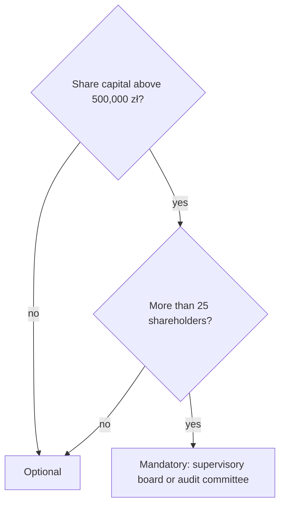

# Supervisory board

## Summary

The supervisory board (*rada nadzorcza*) is the organ that permanently supervises the company's activity in all areas: it reviews the financial statements and management report, examines the board's proposals on profit, reports to the shareholders and, if the articles say so, appoints and removes board members or approves selected transactions. In a sp. z o.o. it is optional, unless the share capital exceeds 500,000 zł and the company has more than 25 shareholders. It has at least three members, who cannot be board members or certain employees.

*This note is educational. It describes Polish law in general terms as checked in October 2026 and is not legal or tax advice. Rules and fees change; check the current text of the acts and, for real decisions, ask a lawyer or tax adviser.*

## Prerequisites

- [Management board](management-board.md)

## Core concepts

### Definition

The *supervisory board* is a collegial organ for permanent oversight of the company. In a sp. z o.o. the articles may establish a supervisory board, an *audit committee* (*komisja rewizyjna*), or both. Shareholders may also exercise control directly (see [Shareholder rights](shareholder-rights.md)).

It is mandatory when two conditions are met at the same time (art. 213 § 2 KSH): share capital above 500,000 zł and more than 25 shareholders.

### Analogy

The supervisory board is like a referee team in a match: it does not play, but it watches every move, checks the score sheet and reports to the league. In some leagues the referees can also send players off (remove board members) if the rules give them that power.

### Mechanism

**Tasks.**

- permanent supervision of the company's activity in all areas,
- assessing the management report and financial statements for consistency with the books, documents and facts,
- assessing the board's proposals on distributing profit or covering loss,
- reporting the results of these assessments to the shareholders' meeting,
- adopting resolutions.

**Powers that the articles may add.** Appointing, removing and suspending board members; delegating its members to temporarily replace board members; approving the company's plans; requiring its consent for specified board actions (for example acquiring or disposing of shares or real estate); choosing the external auditor. Unless the articles provide otherwise, each member may exercise supervision individually. After the 2022 reform of the code, the board can also, for example, demand documents and explanations and, within limits, engage an adviser.

**Members.** At least three. Appointed and removed by shareholders' resolution unless the articles provide otherwise. Cannot be members: board members, commercial proxies, liquidators, branch or plant managers, and the company's employed chief accountant, legal adviser or attorney (art. 214 KSH).

**Term.** Unless the articles provide otherwise, a member's mandate expires on the day of the meeting approving the financial statements for the first full financial year in office (art. 218 KSH); a longer term can be set in full financial years. A mandate also ends on death, resignation or removal. Members are entered in the KRS; the entry is declaratory.

**Meetings and pay.** The board adopts resolutions at meetings attended by at least half of its members, all of whom must have been invited. Members are usually paid; pay is set by shareholders' resolution or the articles.

When a supervisory board is required:

## Worked example

A regional bakery chain sp. z o.o. has a share capital of 800,000 zł and 31 shareholders, mostly family members. It must have a supervisory board or audit committee. It forms a three-member supervisory board and gives it, in the articles, the power to appoint the board and to approve any loan above 1,000,000 zł.

## Trade offs and when to use it

A supervisory board strengthens oversight and protects passive shareholders, but adds cost and slows decisions. In small companies, direct shareholder control is usually enough.

## Common mistakes

- **Appointing the chief accountant to the supervisory board.** Not allowed; choose an independent person.
- **Assuming the board is required whenever capital exceeds 500,000 zł.** Both conditions must be met: capital above 500,000 zł and more than 25 shareholders.

## Practice

1. When is a supervisory board mandatory in a sp. z o.o.?
2. Name three persons who cannot sit on the supervisory board.
3. What quorum does the supervisory board need?

### Answers

1. When share capital exceeds 500,000 zł and there are more than 25 shareholders.
2. Any three of: board member, commercial proxy, liquidator, branch manager, employed chief accountant, legal adviser or attorney.
3. At least half of its members present, with all members invited.

## Further reading

- Sejm RP (2000). *Ustawa z dnia 15 września 2000 r. Kodeks spółek handlowych (Commercial Companies Code), consolidated text*. [Link](https://isap.sejm.gov.pl/isap.nsf/DocDetails.xsp?id=WDU20000941037). Articles 213 to 222 KSH.
