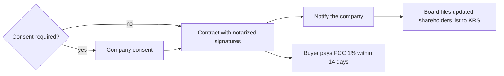

# Transfer of shares

## Summary

Shares in a sp. z o.o. are transferable as a rule. The articles may restrict, but not completely exclude, their sale, most often by requiring the company's consent or giving other shareholders a right of first refusal. A sale requires a written contract with notarized signatures, notice to the company, an update of the shareholders' list in the KRS and payment by the buyer of 1% tax on civil law transactions. The buyer becomes a shareholder on acquiring the shares; the KRS entry is informational.

*This note is educational. It describes Polish law in general terms as checked in October 2026 and is not legal or tax advice. Rules and fees change; check the current text of the acts and, for real decisions, ask a lawyer or tax adviser.*

## Prerequisites

- [Shareholder rights](shareholder-rights.md)

## Core concepts

### Definition

*Transfer of shares* (*zbycie udziałów*) is the sale, gift or other disposal of shares. The code allows the articles to make transfer dependent on the company's consent or to limit it in other ways (art. 182 KSH), but not to exclude it entirely.

### Analogy

Selling shares is like selling a seat in a closed club: the seat is yours to sell, but the club rules can require the board's approval or give existing members the first chance to buy it.

### Mechanism

**Common restrictions.**

- the company's consent to the sale (the most common; usually given by the board, sometimes by shareholders),
- a right of first refusal (*prawo pierwszeństwa*) for other shareholders,
- requirements for the buyer (for example education or profession).

**Steps.**

1. **Consent of the company**, if required by the articles.
2. **Contract** in writing with notarized signatures (art. 180 § 1 KSH): not a notarial deed, but signatures certified by a notary.
3. **Notice to the company** of the transfer, with proof of the transaction (art. 187 KSH).
4. **KRS update:** the board files an updated list of shareholders electronically through the Court Registers Portal, with the sale contract and the court fee. (Under the former paper procedure this was form KRS-Z3 with annex KRS-ZE.)
5. **Tax:** the buyer pays PCC at 1% of the market value of the shares within 14 days, with a PCC-3 declaration (unless an exemption applies).

**When the buyer becomes a shareholder.** On acquiring the shares under the contract. The KRS entry is declaratory; towards the company, the transfer is effective from the moment it receives notice with proof.

The steps of a share sale:

## Worked example

Olek sells his 100 shares to Anna for 60,000 zł. The articles require the board's consent and give Waldek a right of first refusal, which he declines in writing. Olek and Anna sign the contract before a notary, who certifies the signatures. Anna notifies the company the same day and pays PCC of 600 zł (1% of 60,000 zł) within 14 days. The board files the updated list of shareholders to the KRS.

## Trade offs and when to use it

Transfer restrictions protect a small company from unwanted partners but make shares harder to sell and can lower their value. A shareholders' agreement can add tag-along and drag-along clauses common in investment deals.

## Common mistakes

- **Signing an ordinary written contract without notarized signatures.** The form with notarized signatures is required.
- **Forgetting to notify the company.** The transfer is effective towards the company only after notice with proof.
- **Expecting the seller to pay PCC.** The buyer pays 1% within 14 days.

## Practice

1. What form must a share sale contract have?
2. Who pays PCC on a share sale, at what rate?
3. Can the articles completely forbid the sale of shares?

### Answers

1. Written form with notarized signatures.
2. The buyer, 1% of market value.
3. No; they can only restrict it.

## Further reading

- Sejm RP (2000). *Ustawa z dnia 15 września 2000 r. Kodeks spółek handlowych (Commercial Companies Code), consolidated text*. [Link](https://isap.sejm.gov.pl/isap.nsf/DocDetails.xsp?id=WDU20000941037). Articles 180 to 188 KSH.
- Sejm RP (2000). *Ustawa z dnia 9 września 2000 r. o podatku od czynności cywilnoprawnych (tax on civil law transactions act)*. [Link](https://isap.sejm.gov.pl/isap.nsf/DocDetails.xsp?id=WDU20000860959). PCC on the sale of property rights.
