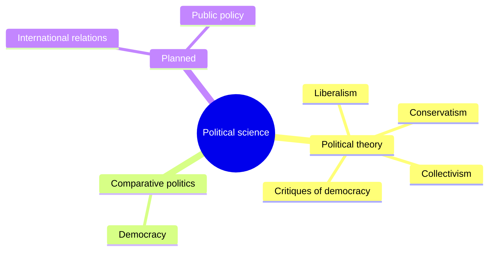

# Political science

Power, government and public policy. This field belongs to [Social sciences](../README.md). It follows the standard divisions of the discipline: political theory (the ideas and arguments about how society should be governed) and comparative politics (how real regimes and institutions work and differ). International relations and public policy are planned.

## Map of the field

## Subfields

1. [Political theory](political-theory/README.md): the main ideologies and the arguments about democracy.
2. [Comparative politics](comparative-politics/README.md): what democracy is and how regimes are classified.

## Planned topics

- International relations
- Public policy
