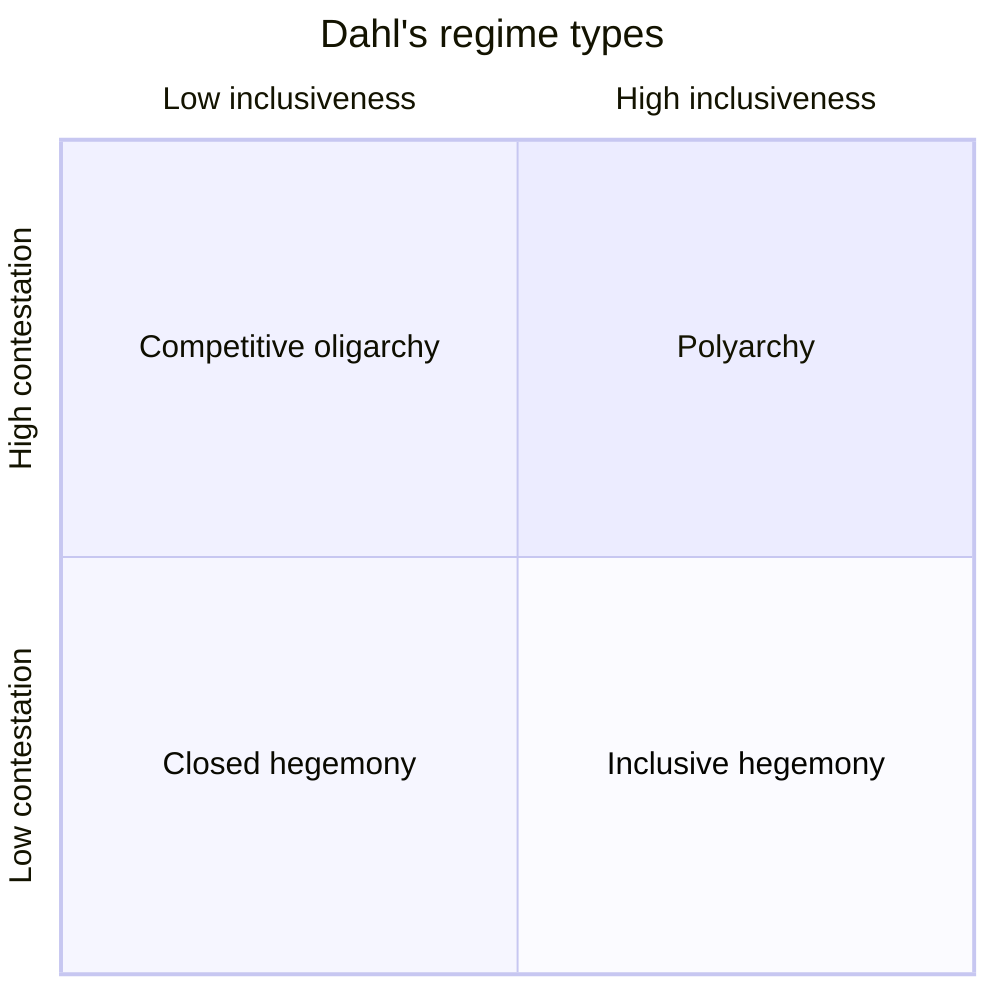

# Democracy

## Summary

Democracy is a form of government in which citizens take part in exercising power, directly or through elected representatives. The word comes from the Greek *demos* (people) and *kratos* (power). Modern democracies are mostly representative, and the most common type is liberal democracy, in which free and fair elections are combined with constitutional protection of rights and of minorities. Scholars measure democracy along two main dimensions: how open competition for power is, and how many people may take part.

*This note is educational. It describes political systems and takes no side in current party politics.*

## Prerequisites

- [Liberalism](../political-theory/liberalism.md), for the ideas behind liberal democracy.

## Core concepts

### Definition

*Democracy* is a type of political regime in which the source of political authority is the citizens, who take part in decisions or choose those who make them. It contrasts with *autocracy*, where power is held by one person or a small group that does not answer to the citizens. The idea began in ancient Greece, in particular Athens, where citizens decided matters directly. Rome and later European institutions contributed ideas about representation and the separation of powers.

### Analogy

A democracy is like a company that hires its managers for a fixed term. Shareholders cannot run the firm every day, so they choose managers, can dismiss them at the next vote and expect to see their accounts. The limit of the analogy is that the people in a state cannot sell their shares and leave, and they include people who were not part of the original agreement, such as children and future generations.

### Direct and representative democracy

| Type | How citizens act | Examples |
| --- | --- | --- |
| Direct democracy | Citizens vote on decisions themselves | Athenian assembly, referendums and initiatives |
| Representative democracy | Citizens elect representatives who decide | National parliaments and presidents |

Most modern states are representative. A *parliamentary* system elects a legislature, and the government depends on its confidence. A *presidential* system elects the head of government separately from the legislature. Written constitutions are the usual guarantee of the rules.

### What counts as democracy

Definitions range from narrow to broad.

- **Minimalist.** Schumpeter (1942) defined democracy as a method in which people gain power through competition for votes. The citizens' role is to choose rulers in elections.
- **Procedural and institutional.** Dahl (1971) defined the regime by two dimensions: *public contestation* (the right to oppose the government and compete for office) and *inclusiveness* (the share of adults allowed to take part). Regimes high on both are what he called *polyarchies*.
- **Liberal.** A liberal democracy adds constitutional limits: protected rights, an independent judiciary and respect for minorities. Decisions of the majority cannot violate the rights of minorities.

### Dahl's two dimensions



The chart shows the four regime types in Dahl's scheme. A closed hegemony allows little opposition and few participants. A competitive oligarchy has open competition among a small group of voters. An inclusive hegemony lets everyone vote but permits no real opposition. A polyarchy has both.

### Liberal democracy

A liberal democracy is characterized by free and fair elections, political pluralism (several parties and organized groups) and a constitution that protects rights. Examples often given are the member states of the European Union and the United States, although each has its own variations in institutions and in the quality of democracy.

### Measurement

Researchers measure democracy with indexes. V-Dem (Varieties of Democracy) provides an open dataset on many dimensions of democracy for most countries, and Freedom House publishes annual ratings of political rights and civil liberties. Indexes differ in definitions and methods, so rankings differ, and a country's score depends on the index used.

## Worked example

Four invented countries are scored from 0 to 10 on contestation and inclusiveness, with a cut-off of 5 on each.

```python
# Python 3.12. Classify invented countries on Dahl's two dimensions (scores are illustrative).
def regime(contestation, inclusiveness, cut=5):
    if contestation >= cut and inclusiveness >= cut:
        return "polyarchy"
    if contestation >= cut:
        return "competitive oligarchy"
    if inclusiveness >= cut:
        return "inclusive hegemony"
    return "closed hegemony"

for name, c, i in [("A", 8, 9), ("B", 7, 3), ("C", 2, 9), ("D", 1, 2)]:
    print(name, c, i, regime(c, i))
```

Output:

```text
A 8 9 polyarchy
B 7 3 competitive oligarchy
C 2 9 inclusive hegemony
D 1 2 closed hegemony
```

Country A has open competition and nearly universal voting. Country B has open competition but only a small share of adults can vote, as in some 19th-century parliaments. Country C holds elections with universal voting but no real opposition. Country D has neither. The scores and the cut-off of 5 are set for the example, and real indexes use many indicators. The example shows why "does the country hold elections?" is not enough to call it a democracy.

## Trade offs and when to use it

Democratic systems offer peaceful change of rulers, accountability and a way to settle disputes without force. Their costs are slow decisions, the risk of short-term policy and the possibility that majorities override minorities, which constitutional limits are meant to prevent. Debates about democracy include the arguments set out in [critiques of democracy](../political-theory/critiques-of-democracy.md). In practice, regimes also lie between the poles, with elections that are held but not fair, and this is why the distinction between a regime's form and its quality matters.

## Common mistakes

- **Equating democracy with elections alone.** Elections without contestation or rights are not enough in Dahl's or the liberal sense.
- **Equating democracy with majority rule.** Liberal democracy limits the majority.
- **Using "democracy" and "liberal democracy" as synonyms.** The second adds constitutional protections.
- **Treating one index as the truth.** Indexes differ in method.

## Practice

1. What are Dahl's two dimensions?
2. How does a liberal democracy differ from a minimalist one?
3. What is the difference between a parliamentary and a presidential system?

### Answers

1. Public contestation and inclusiveness.
2. A liberal democracy adds constitutional limits that protect rights and minorities. The minimalist definition counts competitive elections only.
3. In a parliamentary system the government depends on the legislature's confidence. In a presidential system the head of government is elected separately.

## Further reading

- Christiano, T. and Bajaj, S. (2024). Democracy. Stanford Encyclopedia of Philosophy. [Link](https://plato.stanford.edu/entries/democracy/). Covers definitions, justifications of democracy and arguments against it, including epistocracy.
- Dahl, R. A. (1971). *Polyarchy: Participation and Opposition*. Yale University Press. Defines democracy by public contestation and inclusiveness.
- Schumpeter, J. A. (1942). *Capitalism, Socialism and Democracy*. Harper & Brothers. Defines democracy as competition between elites for votes.
- V-Dem: Varieties of Democracy. V-Dem Institute, University of Gothenburg. [Link](https://v-dem.net/). An open dataset that measures many aspects of democracy for most countries.
- Freedom in the World. Freedom House. [Link](https://freedomhouse.org/). Annual country ratings of political rights and civil liberties.
