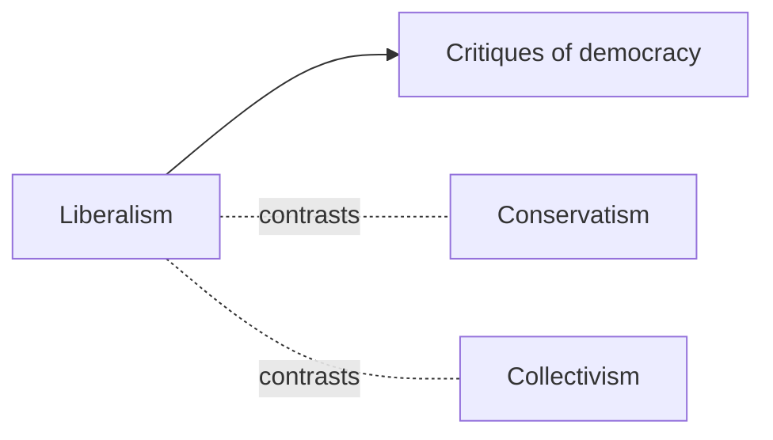

# Political theory

The ideas, ideologies and arguments about how society should be governed. This subfield belongs to [Political science](../README.md). Notes describe traditions and arguments and take no side in current party politics.

## Map of the subfield

The map shows the three ideological families and the critical discussion of democracy that links them.

## Notes in reading order

1. [Liberalism](liberalism.md): liberty, rights and limited government, with the classical and social strands.
2. [Conservatism](conservatism.md): tradition, order and gradual change.
3. [Collectivism](collectivism.md): group-first ideas, from cooperatives to central planning.
4. [Critiques of democracy](critiques-of-democracy.md): arguments against democratic rule and the replies.

## Planned topics

- Socialism and communism
- Nationalism
- Political philosophy of justice
