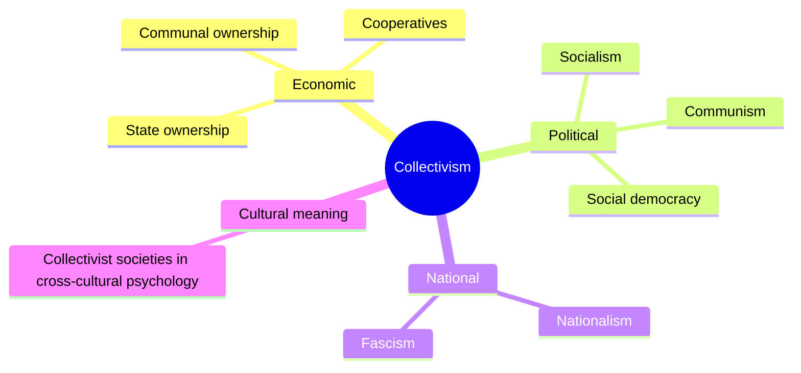

# Collectivism

## Summary

Collectivism is the view that the group, and not the individual, is the basic unit of social and political life, and that group goals can outrank individual ones. It is the opposite pole to individualism. The word covers very different political systems: socialist and communist ideas of common ownership of the means of production, voluntary cooperatives, and also nationalist and fascist ideas that place the nation above the person. A separate meaning exists in cultural psychology, where collectivism is a dimension of national culture. This note is about the political and economic meaning.

*This note is educational. It describes a family of political ideas and takes no side in current party politics.*

## Prerequisites

- [Liberalism](liberalism.md), the main individualist tradition that collectivism is defined against.

## Core concepts

### Definition

*Collectivism* is a doctrine that gives priority to communities, groups and collectives as basic social units, and holds that they have claims that individuals must respect. In economics it means an arrangement in which the means of production (land, factories, machines) are owned and managed in common, whether by the state, by a local community or by the workers. The opposite term is *individualism*, which treats the person as the basic unit.

### Analogy

Consider a sports team. In a team, a player's goals are judged by their contribution to the team's result, and an individual sacrifice for the team is praised. In a group of independent runners at the same race, each person is judged by their own time. Collectivism takes the first picture as the model of society and individualism takes the second. The limit of the analogy is that a team is joined by choice and has an agreed goal, while a society's members are born into it and disagree about aims, and this is why the question of who defines the group goal is central to criticism of collectivism.

### Forms

The map shows that the word names several different things. The cultural meaning is shown for completeness and is outside this note.

| Form | Idea | Who decides |
| --- | --- | --- |
| Central planning (state socialism) | The state owns the main means of production and plans output | The state |
| Cooperatives | Workers or members own and run the firm together | The members, by vote |
| Communal ownership | A community holds land or resources in common | The community |
| Nationalist collectivism | The nation is the supreme value, and individuals serve it | The state or a leader |
| Welfare state (social democracy) | Private ownership remains, but the state redistributes and provides services | Elected governments |

The forms are not all the same ideology. The Stanford Encyclopedia of Philosophy entry on socialism explains the ideas about common ownership and the models of socialism (Gilabert and O'Neill).

### Arguments for

- Cooperation can produce results that no individual can, such as public goods and shared defense.
- Some goods, such as an environment or a legal system, belong to the group.
- Supporters argue that market outcomes are unequal and that common ownership or strong redistribution can correct this.

### Arguments against

- Information and incentives: critics argue that planners cannot know what individuals want, and that individuals have weak incentives when the gains are shared. This is a central argument of economists who criticized central planning.
- Rights: when the group's goal outranks the individual, minorities and dissenters can be harmed.
- Power: concentrated control of the economy by a state or a party also concentrates political power.

These arguments are debated, and the evidence differs by form: cooperatives and welfare states operate alongside markets in many countries, while central planning has been tried at national scale in a smaller number of cases.

### The other meaning

In cross-cultural psychology, *individualism-collectivism* is a dimension on which cultures are compared, from the weight placed on personal goals to the weight placed on group loyalty (Hofstede, 1980). It describes attitudes and norms of a society and does not describe its political system. A culture high in collectivism does not necessarily have a collectivist economy.

## Worked example

The same small factory under three arrangements:

| Question | Private firm | Worker cooperative | State-owned firm |
| --- | --- | --- | --- |
| Who owns it? | Shareholders | The workers | The state |
| Who gets the profit? | Owners | Workers, by agreed rule | The treasury |
| Who sets pay and output? | Management | Members' vote | Ministry or plan |
| Main risk | Low pay for workers | Slow decisions, limited capital | Weak incentives, political direction |

Only the last two are collectivist forms in the economic sense, and they work very differently. The table shows why "collectivism" alone does not tell what a system looks like: the answer to "who decides" has to be added. The example is hypothetical.

## Trade offs and when to use it

The concept is useful for naming a contrast between group-first and person-first thinking, and for sorting the many arrangements of ownership. It is a poor label for a particular country or party, because the forms differ in how far they respect rights and markets. In debate, say which form is meant.

## Common mistakes

- **Treating collectivism as one ideology.** It spans voluntary cooperatives and coercive states.
- **Equating it with socialism alone.** Nationalist forms put the nation above the individual without common ownership.
- **Mixing the political and cultural meanings.** They describe different things.
- **Equating the welfare state with central planning.** A welfare state keeps private ownership.

## Practice

1. What is the opposite of collectivism?
2. Name two economic forms of collectivism.
3. How does the cultural meaning of the word differ?

### Answers

1. Individualism, which treats the person as the basic unit.
2. For example central planning with state ownership, and worker cooperatives.
3. It describes a dimension of culture, the weight on group over personal goals, and not a political or economic system.

## Further reading

- Gilabert, P. and O'Neill, M. (2024). Socialism. Stanford Encyclopedia of Philosophy. [Link](https://plato.stanford.edu/entries/socialism/). Explains socialist ideas about common ownership and the main models.
- Heywood, A. (2021). *Political Ideologies: An Introduction*. Red Globe Press. A standard university introduction to liberalism, conservatism, socialism and other ideologies.
- Hofstede, G. (1980). *Culture's Consequences*. Sage. Introduces individualism-collectivism as a dimension of national culture.
