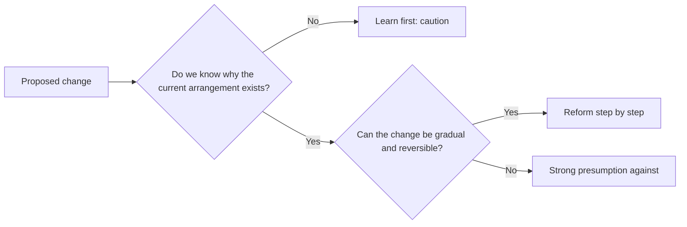

# Conservatism

## Summary

Conservatism is a political tradition that values social order, inherited institutions and gradual change. It took shape as a response to the French Revolution, with Edmund Burke as its main early thinker. Conservatives are skeptical of plans that remake society from abstract principles, and they defend tradition, authority and the institutions that have survived the test of time, such as family, religion and the nation. They accept reform, as long as it is slow and builds on what exists.

*This note is educational. It describes a political tradition and takes no side in current party politics.*

## Prerequisites

No prior notes are needed. [Liberalism](liberalism.md) is the main tradition it argued against and later merged with in several countries.

## Core concepts

### Definition

*Conservatism* is a family of doctrines that defend an existing social order and the value of tradition, and that prefer evolutionary to revolutionary change. The name comes from the Latin *conservare*, to preserve. The term in its political sense is believed to have been coined by the French writer Chateaubriand in his writing for *Le Conservateur* (Hamilton, Stanford Encyclopedia of Philosophy). Conservatism is more a disposition and a set of arguments than a fixed program, and what it conserves differs by country and period.

### Analogy

A conservative treats society like an old building that many people have lived in. Before removing a wall, one asks why it was built, since the builders may have known something that the new owner does not. The limit of the analogy is that a building has plans that can be consulted, while the reasons for many social institutions are not written down and are in dispute.

### Origins

Conservatism took shape after the French Revolution. In *Reflections on the Revolution in France* (1790), Edmund Burke warned that a revolution based on abstract ideas of human perfectibility would destroy institutions that carry accumulated experience, and he predicted the Terror of 1793. He defended gradual reform, and he valued what he called educated prejudice: habits and beliefs that work without being derived from first principles. Earlier roots and other national traditions exist, and modern thinkers such as Oakeshott and Scruton developed the case in the 20th century.

### Main ideas

| Idea | Meaning |
| --- | --- |
| Tradition | Inherited practices carry knowledge that individuals cannot easily rebuild |
| Skepticism about planning | Society is too complex to be redesigned by theory, so reform should be gradual |
| Order and authority | Stable institutions and legitimate authority are conditions of freedom |
| Organic society | Society is a web of long-lived bonds, such as family, religion, local community and nation, more than a contract between individuals |
| Imperfection of human nature | People are limited, so institutions should restrain as well as enable |

The flow diagram shows the typical reasoning pattern. It is a model of the style of argument and not a formal test.

### Varieties

Conservatism takes different forms: traditionalist and religious, national, liberal-conservative (which accepts markets and constitutional government), and fiscal conservatism (which stresses restraint in public spending). The Stanford Encyclopedia of Philosophy notes that some thinkers, such as Hayek, are described as conservative while advocating free markets on the conservative ground that markets realize organic institutions. The term therefore does not map neatly to a single economic position.

### Critiques

Critics from the left argue that conservatism defends hierarchy and existing privilege. Liberals argue that tradition is not a reason in itself, since some traditions are unjust. Communitarians ask which tradition is meant, when societies have several. These are the standard lines of debate in the literature.

## Worked example

A town is asked to remove a rarely used rule that requires every new building on the main street to keep the original facade. Apply the reasoning pattern from the diagram.

| Step | Question | Possible answer |
| --- | --- | --- |
| 1 | Why does the rule exist? | It was passed to keep the street's character after earlier demolitions |
| 2 | Is the reason still present? | Tourism and local identity depend on it |
| 3 | Can the change be gradual and reversible? | A trial exemption for one block is possible |
| 4 | Result | Keep the rule, pilot an exemption and review in three years |

A progressive or a market-oriented participant could reach a different result by weighing housing needs more. The example shows the structure of the conservative argument and not the single correct answer. It is a hypothetical case.

## Trade offs and when to use it

The conservative style of argument is useful as a check on change: ask why the current arrangement exists, and prefer reversible steps. Its weakness is that it can defend injustice because it is old, and it gives little guidance when the status quo is itself the problem. Both the strength and the weakness explain why the tradition holds its place in political debate.

## Common mistakes

- **Equating conservatism with opposition to all change.** It accepts gradual reform.
- **Equating it with a free-market position.** Some conservatives are skeptical of markets, and some are not.
- **Treating it as one worldwide program.** What is conserved depends on the country.
- **Reducing it to a party label.** Parties called conservative differ in policy.

## Practice

1. Who is regarded as the main early thinker of modern conservatism?
2. What does conservatism say about plans to redesign society from theory?
3. Name two varieties of conservatism.

### Answers

1. Edmund Burke.
2. It is skeptical: society is too complex for such plans, so reform should be gradual.
3. For example traditionalist and liberal-conservative.

## Further reading

- Hamilton, A. (2025). Conservatism. Stanford Encyclopedia of Philosophy. [Link](https://plato.stanford.edu/entries/conservatism/). Covers the origin of the term, Burkean conservatism and the main critiques.
- Burke, E. (1790). *Reflections on the Revolution in France*. J. Dodsley. The founding text of modern conservative thought.
- Heywood, A. (2021). *Political Ideologies: An Introduction*. Red Globe Press. A standard university introduction to liberalism, conservatism, socialism and other ideologies.
