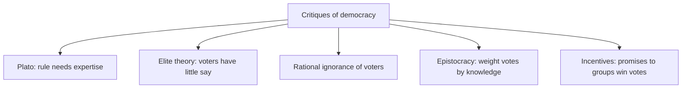
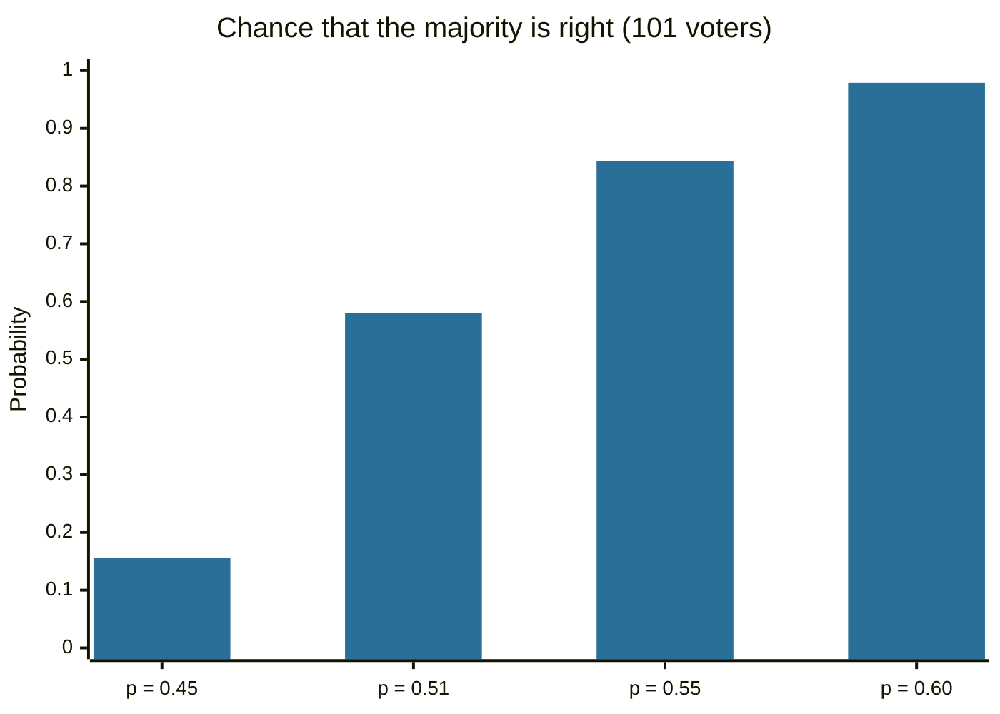

# Critiques of democracy

## Summary

Anti-democratic thought is the position that democracy is a poor or inferior way to govern. The arguments are old: Plato held that rule by the many undermines expertise, and later writers questioned whether ordinary voters know enough to decide complex questions. Modern versions include elite theories of democracy and the case for epistocracy, rule by the knowledgeable. The critics make claims that can be examined, and the defenders of democracy have answers to each. The note presents the arguments and the replies, and does not endorse either side.

*This note is educational. It describes arguments in political theory and does not advocate any political system.*

## Prerequisites

- [Democracy](../comparative-politics/democracy.md), for what is being criticized.
- [Liberalism](liberalism.md), because liberal thinkers were often the first to worry about majority power.

## Core concepts

### Definition

*Anti-democratism* (here, *critiques of democracy*) is a family of views that reject democracy as a form of government or doubt its claims. Two kinds of argument should be kept apart. *Instrumental* arguments say that democracy produces worse outcomes than some alternative. *Intrinsic* arguments say that democracy lacks some value it is claimed to have, such as equality or legitimacy. Most critics in the modern literature use instrumental arguments.

### Analogy

The classic image is Plato's ship of state. A ship's passengers vote on who should steer, and the winner is the person who flatters the crowd best, not the one who knows navigation. The critic concludes that steering should go to the navigator. The limit of the analogy is that navigation has an agreed goal and a clear test (the ship arrives), while in politics the aims themselves are disputed, and there is no neutral way to say who is the expert.

### Main arguments



| Argument | Claim | Main reply |
| --- | --- | --- |
| Expertise (Plato, *Republic*) | Governing is a skill, and most people lack it | There is no agreed test of political expertise, and experts have interests of their own |
| Elite theory (Schumpeter, 1942) | Citizens know little, so democracy is competition among elites for votes and not rule by the people | The competition still lets citizens remove rulers who fail badly |
| Rational ignorance | One vote rarely changes a result, so voters have little reason to become informed | Information shortcuts such as party labels and the opinions of trusted people may be enough |
| Epistocracy (Mill's plural voting; Brennan, 2016) | Give more weight to the votes of the better informed | Hard to design without bias, and it risks excluding groups whose interests differ |
| Incentives | Parties win by promising benefits to organized groups | Competition also exposes and punishes bad policy, and this problem exists under other systems too |

Christiano and Bajaj (Stanford Encyclopedia of Philosophy) discuss instrumental arguments for and against democracy and the epistemic case, with Plato's and Mill's positions as examples.

### The epistemic reply

The strongest formal defense of democratic decisions by many voters is the Condorcet jury theorem: if each voter is more likely right than wrong and votes independently, the chance that the majority is right rises toward 1 as the group grows. The same theorem warns that if voters are on average more likely wrong than right, the majority is almost certainly wrong. Both depend on strong assumptions, mainly independence, which is rarely true when voters share the same media and influences.

## Worked example

The code computes the chance that a majority of n independent voters is right, when each voter is right with probability p.

```python
# Python 3.12. Condorcet jury theorem: chance that a majority of n independent voters is right.
from math import comb

def majority_correct(n, p):
    """n odd; each voter is right with probability p, independently."""
    return sum(comb(n, k) * p**k * (1 - p)**(n - k) for k in range(n // 2 + 1, n + 1))

for p in (0.45, 0.51, 0.55, 0.60):
    row = [majority_correct(n, p) for n in (1, 11, 101, 1001)]
    print(p, [round(x, 3) for x in row])
```

Output:

```text
0.45 [0.45, 0.367, 0.156, 0.001]
0.51 [0.51, 0.527, 0.58, 0.737]
0.55 [0.55, 0.633, 0.844, 0.999]
0.6 [0.6, 0.753, 0.979, 1.0]
```

Each row is a voter accuracy p, and the columns are group sizes 1, 11, 101 and 1001. With p = 0.55, a group of 1001 is right 99.9% of the time. With p = 0.45, the same group is right 0.1% of the time. This is why defenders and critics both use the theorem: it supports the wisdom of large groups when voters are competent and independent, and it is a warning when they are not.



The chart shows one column of the table. A small change in average voter accuracy changes the result a great deal, which is the quantitative core of the dispute over how competent voters are.

## Trade offs and when to use it

Critiques of democracy are useful for understanding where democratic institutions need safeguards: independent courts, free media, civic education, limits on majorities. They are weak as a case for replacing democracy, because the proposed alternatives need someone to choose the experts, and rulers who answer to nobody have their own failures. The critique of democracy is also a historical argument used by authoritarian movements, so it should be read with attention to who benefits from the proposed change.

## Common mistakes

- **Treating the critique as one position.** Elite theory, epistocracy and monarchism are different views.
- **Reading elite theory as hostile to democracy.** Schumpeter used it to describe how democracy works.
- **Quoting the jury theorem without its assumptions.** It needs independence and average competence above one half.
- **Assuming that education alone defines expertise.** There is no agreed test.

## Practice

1. What is the difference between an instrumental and an intrinsic argument against democracy?
2. What does the Condorcet jury theorem say?
3. Why does the theorem also support the critics?

### Answers

1. An instrumental argument says democracy gives worse results than an alternative. An intrinsic one says it lacks a value it claims.
2. If voters are independent and each more likely right than wrong, a larger group is more likely to have a correct majority.
3. If voters are more likely wrong than right, a larger group is more likely to have a wrong majority, so competence matters.

## Further reading

- Christiano, T. and Bajaj, S. (2024). Democracy. Stanford Encyclopedia of Philosophy. [Link](https://plato.stanford.edu/entries/democracy/). Covers definitions, justifications of democracy and arguments against it, including epistocracy.
- Plato. *Republic*. Many editions; written about 375 BCE. The earliest major critique of democratic rule by the many.
- Schumpeter, J. A. (1942). *Capitalism, Socialism and Democracy*. Harper & Brothers. Defines democracy as competition between elites for votes.
- Brennan, J. (2016). *Against Democracy*. Princeton University Press. A modern defense of epistocracy, rule by the knowledgeable.
