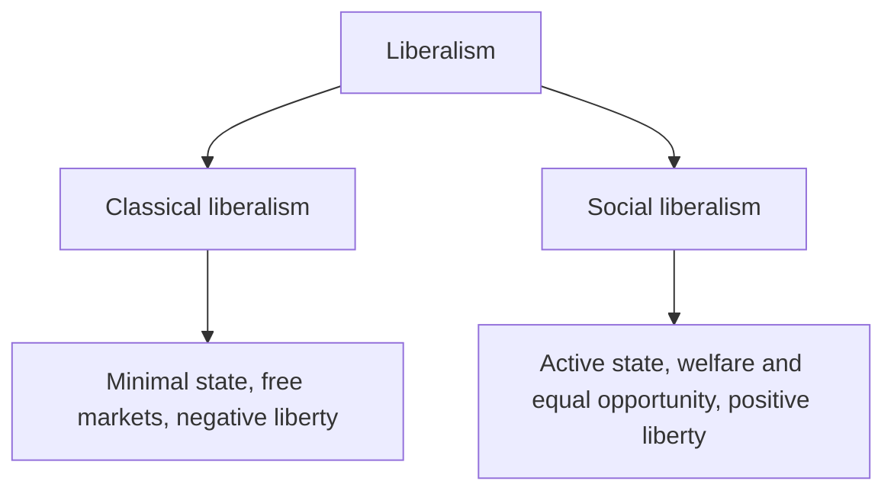

# Liberalism

## Summary

Liberalism is a political tradition that puts individual liberty first and asks that state power be limited and justified. It grew out of the Enlightenment as a reaction to absolutism and feudal privilege. Its core commitments are civil and political rights, the rule of law, consent of the governed and, in most versions, private property and markets. The main internal division is between classical liberals, who stress a small state and economic freedom, and social liberals, who accept a larger state to secure the conditions of real freedom.

*This note is educational. It describes a political tradition and takes no side in current party politics.*

## Prerequisites

No prior notes are needed.

## Core concepts

### Definition

*Liberalism* is a family of political doctrines that treat the individual as the basic unit of moral concern and hold that freedom is the central political value. The word comes from the Latin *liber*, free. It is an ideology (a set of related beliefs about how society should be organized) and a movement. In the United States, "liberal" is often used for the political left, while elsewhere the term more often keeps its older meaning, so the context matters.

### Analogy

Liberalism treats the state like a referee in a game. The referee makes and enforces rules so that players can pursue their own aims fairly, but the referee does not choose the aims. The limit of the analogy is that a referee has no view on who deserves to win, while liberal thinkers disagree about how far the state should correct unfair starting positions, and that disagreement is the main dividing line within liberalism.

### Origins

Liberalism formed in the 17th and 18th centuries, in the thought of Locke and in the Enlightenment, as a challenge to absolute monarchy, established churches and feudal institutions. Early liberals were often skeptical of democracy, because they feared the power of majorities over property and minorities. In the 19th century liberals gradually accepted universal suffrage, and the combination became *liberal democracy*: majority rule limited by rights.

### Main ideas

| Idea | Meaning |
| --- | --- |
| Individual rights | Each person holds basic rights, such as freedom of speech, religion and association, that the state may not violate |
| Rule of law | Everyone, including officials, is bound by known and general laws |
| Consent | Political authority is legitimate when it rests on the agreement of the governed |
| Limited government | Power is divided and checked |
| Toleration and pluralism | People with different views of the good life can live together under common rules |
| Private property and markets | Present in most liberal thought, with disagreement about the limits |

Mill's harm principle gives a well-known rule for limits: society may interfere with a person's liberty against their will only to prevent harm to others (Mill, 1859). Berlin (1958) separated *negative liberty* (freedom from interference) from *positive liberty* (freedom to act on one's own purposes, which may require resources and capacities).

### Classical and social liberalism

The diagram shows the main split. The table gives the contrasts.

| Aspect | Classical liberalism | Social liberalism |
| --- | --- | --- |
| State role | Protect rights and property, provide a few public goods | Also correct market failures and provide welfare, education and health |
| Concept of liberty | Mainly negative | Adds positive liberty |
| Markets | Strong presumption in favor | Accepted but regulated |
| Typical source | Locke, Adam Smith, Mill (in part) | Later Mill, T. H. Green, Rawls (1971) |

Both strands share the commitment to rights and the rule of law, and many real positions fall between them. The Stanford Encyclopedia of Philosophy entry on liberalism covers the history and the debate in detail (Courtland, Gaus and Schmidtz).

## Worked example

A city proposes to ban a legal but harmful product, such as a high-sugar drink, in public schools and, separately, for all adults. The harm principle gives a test for each case.

| Question | Schools | All adults |
| --- | --- | --- |
| Is the choice mainly self-regarding? | Pupils are children, and the school stands in for a guardian | Yes, for most adult consumption |
| Does it harm others? | Limited | Limited, though public costs of illness are argued |
| What do the strands say? | Both may accept it | Classical liberals likely oppose; social liberals may accept limited measures such as labeling or taxes |

The example does not decide the policy. It shows that the same principle gives different answers when people disagree about what counts as harm to others and about the weight of public costs, which is where the classical and social strands differ.

## Trade offs and when to use it

Liberalism gives a clear way to think about rights, legitimacy and limits on power, and it underlies most constitutional democracies. Its critics argue that it underrates community and tradition (conservatives and communitarians), that it tolerates inequality (the left) and that its picture of the individual ignores social ties. Use the term with care in conversation: it names a philosophical tradition, an American political label and the name of parties with different programs.

## Common mistakes

- **Equating liberalism with the left.** In the US sense it often means that, but the tradition includes market-oriented classical liberals.
- **Equating liberalism with the free market alone.** Social liberalism accepts a large role for the state.
- **Assuming liberals always supported democracy.** Many early liberals did not.
- **Confusing liberalism with libertarianism.** Libertarianism takes the classical strand to a minimal state.

## Practice

1. What is the harm principle?
2. How do negative and positive liberty differ?
3. Name the two main strands of liberalism.

### Answers

1. Society may restrict a person's liberty against their will only to prevent harm to others.
2. Negative liberty is freedom from interference. Positive liberty is the capacity to act on one's own purposes.
3. Classical liberalism and social liberalism.

## Further reading

- Courtland, S. D., Gaus, G. and Schmidtz, D. (2022). Liberalism. Stanford Encyclopedia of Philosophy. [Link](https://plato.stanford.edu/entries/liberalism/). A scholarly entry on the history of liberalism and on the classical and social strands.
- Mill, J. S. (1859). *On Liberty*. John W. Parker and Son. The classic statement of the harm principle.
- Berlin, I. (1958). *Two Concepts of Liberty*. Clarendon Press. The lecture that separates negative from positive liberty.
- Rawls, J. (1971). *A Theory of Justice*. Harvard University Press. The main work of social liberal political philosophy.
- Heywood, A. (2021). *Political Ideologies: An Introduction*. Red Globe Press. A standard university introduction to liberalism, conservatism, socialism and other ideologies.
