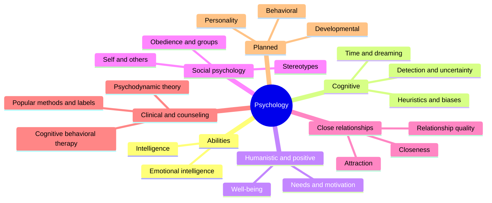

# Psychology

Mind and behavior. This field belongs to [Social sciences](../README.md). It follows the common divisions of the discipline: abilities and individual differences, cognitive psychology, humanistic and positive psychology, social psychology, close relationships and clinical and counseling psychology. Several notes mark the strength of the evidence behind a theory, because psychology contains both well-replicated findings and popular ideas that research does not support. Notes are educational and are not psychological or medical advice.

## Map of the field

The map shows the written subfields and the planned ones.

## Subfields

1. [Intelligence](intelligence/README.md): theories of intelligence and emotional intelligence.
2. [Cognitive psychology](cognitive-psychology/README.md): heuristics and biases, signal detection, time perception and lucid dreaming.
3. [Humanistic and positive psychology](humanistic-and-positive/README.md): needs, motivation and well-being.
4. [Social psychology](social-psychology/README.md): self, others, groups, authority and stereotypes.
5. [Close relationships](close-relationships/README.md): attraction, closeness and the quality of romantic relationships.
6. [Clinical and counseling psychology](clinical-and-counseling/README.md): theories and methods of psychotherapy, with the evidence for each.

## Planned topics

- Developmental psychology
- Personality
- Behavioral psychology
