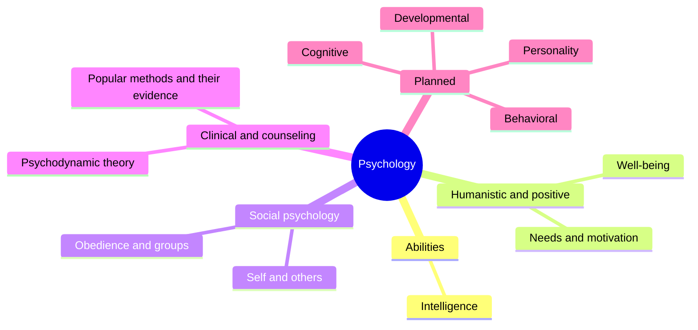

# Psychology

Mind and behavior. This field belongs to [Social sciences](../README.md). It follows the common divisions of the discipline: the study of abilities and individual differences, humanistic and positive psychology, social psychology and clinical and counseling psychology. Several notes mark the strength of the evidence behind a theory, because psychology contains both well-replicated findings and popular ideas that research does not support. Notes are educational and are not psychological or medical advice.

## Map of the field

The map shows the written subfields and the planned ones.

## Subfields

1. [Intelligence](intelligence/README.md): theories of intelligence, with the theory of multiple intelligences and its evidence.
2. [Humanistic and positive psychology](humanistic-and-positive/README.md): needs, motivation and well-being.
3. [Social psychology](social-psychology/README.md): how people see themselves and behave in groups and under authority.
4. [Clinical and counseling psychology](clinical-and-counseling/README.md): psychodynamic theory and the evidence on popular methods.

## Planned topics

- Cognitive psychology
- Developmental psychology
- Personality
- Behavioral psychology
