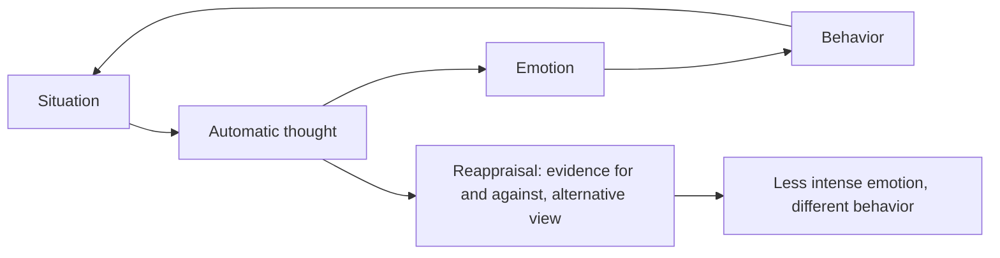

# Cognitive behavioral therapy and cognitive distortions

## Summary

Cognitive behavioral therapy (CBT) is a structured, time-limited psychotherapy based on the idea that the way people interpret events affects how they feel and act. It teaches people to notice automatic thoughts, test them against evidence and change behavior. A review of 106 meta-analyses found it effective for many conditions, especially anxiety disorders and depression. Cognitive distortions are the thinking patterns that CBT targets, such as all-or-nothing thinking and catastrophizing.

*This note is educational. It is not a treatment guide. Therapy should be delivered by a qualified clinician.*

## Prerequisites

No prior notes are needed.

## Core concepts

### Definition

CBT grew from the cognitive model of Aaron Beck (1976). The model says that situations do not directly cause emotions: the interpretation of the situation (an *automatic thought*) does. Patterns in interpretation that are inaccurate or unhelpful are *cognitive distortions*. CBT combines cognitive techniques (examining thoughts) and behavioral ones (exposure, activity scheduling, skills training).

### Analogy

A thought is like a news headline. It describes an event in a way that shapes how readers feel. CBT teaches the reader to ask what the evidence is and whether another headline fits the facts. The limit of the analogy is that the headline is written by the person who then believes it.

### Common distortions

| Distortion | Pattern | Example |
| --- | --- | --- |
| All-or-nothing thinking | Seeing only extremes | "If it is not perfect, it is a failure" |
| Catastrophizing | Expecting the worst | "One mistake will end my career" |
| Overgeneralization | One event becomes a rule | "I failed once, so I always fail" |
| Mental filter | Focusing on one negative detail | Dwelling on one critical comment |
| Mind reading | Assuming what others think | "She thinks I am boring" |
| Emotional reasoning | Treating a feeling as proof | "I feel useless, so I am useless" |
| Should statements | Rigid rules for self and others | "I must never make a mistake" |
| Personalization | Taking blame for events that are not one's fault | "The meeting went badly because of me" |

### The CBT loop

### Evidence

Hofmann and colleagues (2012) reviewed 106 meta-analyses and found large effects of CBT for anxiety disorders, somatoform disorders, bulimia, anger control and general stress, and moderate effects in other areas. Quality varied between studies, and several areas have few high-quality trials.

## Worked example

A thought record, a basic CBT tool, applied to a common situation.

| Column | Entry |
| --- | --- |
| Situation | A colleague did not answer my message for two days |
| Automatic thought | "She is angry with me" |
| Emotion and strength | Anxiety, 7 out of 10 |
| Distortion | Mind reading, catastrophizing |
| Evidence for | She was short in the last meeting |
| Evidence against | She is traveling, and she replies slowly to everyone |
| Balanced thought | "She is probably busy, and I can ask in a neutral way" |
| Emotion after | Anxiety, 3 out of 10 |

The tool does not aim to think positively. It aims to produce a thought that fits the evidence.

## Trade offs and when to use it

CBT has strong evidence for several conditions and is a first-line treatment in many guidelines. Limits: it needs effort between sessions, the evidence is weaker for some conditions, and techniques used without training for serious problems can do little or harm. Self-help CBT books and apps can help with mild difficulties.

## Common mistakes

- **Replacing negative thoughts with forced positive ones.** The aim is accuracy.
- **Treating the distortion list as a diagnosis.** Everyone has these thoughts sometimes.
- **Using CBT techniques as a substitute for treatment of severe conditions.** Seek professional help.

## Practice

1. What does the cognitive model say about emotions?
2. Name three cognitive distortions.
3. What is the aim of a thought record?

### Answers

1. Emotions depend on how a situation is interpreted, and not only on the situation.
2. For example catastrophizing, mind reading and all-or-nothing thinking.
3. To test an automatic thought against evidence and reach a balanced thought.

## Further reading

- Beck, A. T. (1976). *Cognitive Therapy and the Emotional Disorders*. International Universities Press. The founding text of cognitive therapy, including cognitive distortions.
- Hofmann, S. G., Asnaani, A., Vonk, I. J. J. et al. (2012). The Efficacy of Cognitive Behavioral Therapy: A Review of Meta-analyses. *Cognitive Therapy and Research*, 36(5), 427-440. [DOI](https://doi.org/10.1007/s10608-012-9476-1). A review of 106 meta-analyses on the efficacy of cognitive behavioral therapy.
