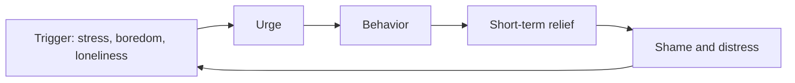

# Compulsive sexual behavior and problematic pornography use

## Summary

Some people lose control over sexual thoughts, urges or behavior, such as heavy pornography use, in a way that causes distress or harms their work, relationships or health. The World Health Organization's ICD-11 lists a diagnosis called compulsive sexual behaviour disorder, classified as an impulse control disorder and not as an addiction. Scientific debate continues about the best model. Frequent use alone is not a disorder: the criteria are loss of control and impairment. Evidence-based help exists, mostly from cognitive behavioral and acceptance-based approaches.

*This note is educational. It is not medical advice. A clinician can assess whether a pattern is a problem.*

## Prerequisites

- [Cognitive behavioral therapy and cognitive distortions](cognitive-behavioral-therapy.md).

## Core concepts

### Definition

Kraus and colleagues (2018) describe the ICD-11 diagnosis: a persistent pattern of failure to control intense, repetitive sexual impulses or urges, resulting in repetitive sexual behavior, over a long period (six months or more is given as an indication), with marked distress or significant impairment. Distress that arises only from moral judgments about sexual behavior does not meet the criteria. The authors discuss why the diagnosis was placed with impulse control disorders: the evidence for a behavioral addiction model was judged to be insufficient at the time.

### Analogy

The behavior is like a habit loop that has become stronger than the person's goals: the person wants to stop, tries, and returns. The limit of the analogy is that a habit loop does not capture shame, trauma, mood disorders or the role of a partner, which clinicians assess.

### What is and is not a problem

| Feature | Suggests a problem | Does not alone indicate a problem |
| --- | --- | --- |
| Frequency | Not the key factor | High frequency by itself |
| Control | Repeated failed attempts to cut down | Choosing to use more or less freely |
| Impact | Distress, harm to relationships or work | Disapproval by others |
| Moral conflict | Distress about use that follows one's own values is common, and is not enough alone | |

### A cycle and ways to interrupt it

Approaches with some evidence include identifying triggers, planning alternative responses, treating co-occurring depression or anxiety, and acceptance-based skills for urges. Self-help communities exist, and quality varies. Claims that abstaining from ejaculation gives special benefits, popular in online communities, are not supported by good evidence.

## Worked example

A person notices that late-night use is linked to stress after work and leaves them tired and ashamed.

| Step | Action |
| --- | --- |
| 1 | Record triggers for two weeks: time, place, mood |
| 2 | Find the main pattern: stress and phone in bed |
| 3 | Change the environment: charge the phone outside the bedroom |
| 4 | Plan an alternative for the trigger: a short walk or a call |
| 5 | If control does not improve, talk to a clinician, and consider screening for depression and anxiety |

The steps follow standard behavior change methods and are an illustration and not a treatment plan.

## Trade offs and when to use it

The concept gives a name and a path to help for people whose behavior causes distress. Its limits: the diagnosis is recent, debated and sensitive to cultural and moral judgments, so clinicians try not to pathologize behavior that is only disapproved of. Use it as a reason to seek assessment when control is lost and harm is present.

## Common mistakes

- **Treating high frequency as a diagnosis.** Control and harm are the criteria.
- **Equating the problem with moral failure.** It is a health and behavior question.
- **Relying on unproven claims.** Abstinence claims in online groups lack evidence.

## Practice

1. Where does ICD-11 place compulsive sexual behaviour disorder?
2. Why is high frequency alone not a disorder?
3. Name one evidence-based step.

### Answers

1. Among impulse control disorders, and not among addictions.
2. The criteria are loss of control and impairment or distress, not the amount.
3. Identify triggers and plan alternative responses, or seek a clinician for cognitive behavioral help.

## Further reading

- Kraus, S. W., Krueger, R. B., Briken, P. et al. (2018). Compulsive sexual behaviour disorder in the ICD‐11. *World Psychiatry*, 17(1), 109-110. [DOI](https://doi.org/10.1002/wps.20499). Explains the ICD-11 diagnosis of compulsive sexual behaviour disorder.
