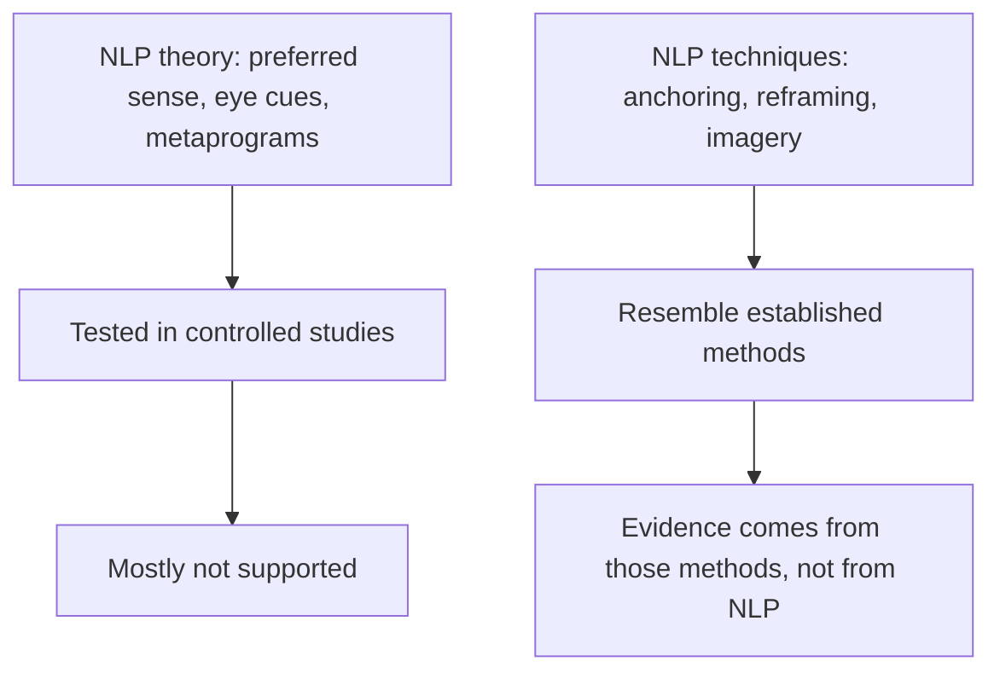

# Neuro-linguistic programming

## Summary

Neuro-linguistic programming (NLP) is a set of communication and self-change techniques that Richard Bandler and John Grinder started to promote in the 1970s. The name points to a claimed link between neurological processes (neuro), language (linguistic) and learned patterns of behavior (programming). It is taught in coaching, sales and personal development courses. Reviews of the research find that the main theoretical claims are not supported and that evidence of benefit is weak, and reviewers have described it as pseudoscientific. Some individual techniques are renamed versions of methods that have their own evidence.

*This note is educational. It is not a recommendation of NLP and it is not medical or psychological advice.*

## Prerequisites

No prior notes are needed. [Neuro-linguistic programming metaprograms](nlp-metaprograms.md) covers the best-known NLP typology in detail.

## Core concepts

### Definition

*NLP* is a collection of techniques and beliefs about how people represent experience, how language shapes this representation and how patterns of thinking can be changed. It began with the observation of therapists whose work Bandler and Grinder wanted to copy, and the first book is Bandler and Grinder (1975). NLP presents itself as a method of modeling excellent performance, and it was sold first as a fast form of therapy.

### Analogy

NLP is like a toolbox sold with a manual that explains the tools with a theory of the mind. Some tools in the box may work, because they are old tools with another label. The manual's theory is the part that has not stood up to tests. The limit of the analogy is that a toolbox can be inspected, while the claims of NLP are often stated in ways that are hard to test.

### Main techniques

| Technique | Claim | Closest researched idea |
| --- | --- | --- |
| Modeling | Copy the beliefs and behaviors of an expert to gain the skill | Observational learning, with no evidence for NLP-style modeling |
| Anchoring | Link an emotional state to a touch, image or sound so it can be recalled | Classical conditioning |
| Rapport | Match another person's posture, tone and words to build trust | Behavioral mimicry and the study of interaction |
| Reframing | Change the context of a statement so that its meaning changes | Cognitive reappraisal and cognitive restructuring in therapy |
| Representational systems | People have a preferred sense (visual, auditory, kinesthetic) in thinking, shown in word choice | Not supported (see below) |
| Eye-accessing cues | Eye movements show which sense a person is using, and whether they lie | Not supported (see below) |
| Swish pattern | Rapidly replace the image of an unwanted cue with an image of a desired outcome | Related to imagery rehearsal |
| Timeline | Organize past and future along an imagined line and change the memory or expectation | Related to mental time travel and imagery |
| Trance | A state close to hypnosis | Hypnosis research |
| Fast phobia technique | Separate oneself from the memory by watching oneself watch it | Exposure-based methods |

### Evidence

The diagram separates the two parts of NLP. The theory has been tested and mostly not supported. The techniques often resemble methods with their own evidence, and that evidence belongs to the methods.

- **Preferred representational system.** Sharpley (1987) reviewed tests of the claim that matching a person's preferred sense improves counseling and found them non-supportive.
- **Eye-accessing cues.** Wiseman and colleagues (2012) tested the claim that eye movements reveal lying and found no support.
- **Overall research.** Witkowski (2010) reviewed 63 studies and analyzed 33 empirical ones: 18.2% supported the tenets of NLP, 54.5% did not and 27.3% were unclear. He concluded that the research does not support the claims.
- **Health outcomes.** Sturt and colleagues (2012) systematically reviewed 10 studies (5 randomized trials and 5 before-and-after studies) and found little evidence that NLP improves health outcomes, with high or uncertain risk of bias. The authors stressed that this reflects the small amount and weak quality of research and is not proof of no effect.

The status: the theoretical claims are contradicted or unsupported, evidence of therapeutic benefit is weak, and some techniques are old methods under new names.

## Worked example

A team lead reads that people differ in a "preferred sense" and adapts a briefing: diagrams for the "visual" colleague and a talk for the "auditory" one. The result can be judged by asking what the lead actually changed.

| Change | Effect | Supported by |
| --- | --- | --- |
| Added a diagram and a spoken explanation for everyone | A clearer briefing for all | Research on multimedia learning and on learning styles reviews: varied representations help, matching to a type does not (Pashler et al., 2008) |
| Sorted colleagues by "preferred sense" and gave each only one form | No evidence of gain | No support for matching to a preferred representational system (Sharpley, 1987) |

The sound parts of the lead's practice are old: use clear structure, check understanding, give more than one representation. They do not rely on NLP's theory of types.

## Trade offs and when to use it

NLP can be a pleasant way to practice listening, rapport and clear goals, and workshops can raise confidence. The risk is paying for claims that are not supported, and the use of therapy-like methods by people with no clinical training for serious conditions such as trauma or phobias. For such conditions, methods with evidence from randomized trials, offered by qualified clinicians, are the standard choice. If a technique has a better-studied relative (for example, cognitive reappraisal), prefer to learn it from that source.

## Common mistakes

- **Treating NLP as established psychology.** Reviews do not support its theory.
- **Judging the whole by one technique.** Some techniques are old methods, and others are unsupported.
- **Using eye movements to detect lying.** They do not work as a lie detector (Wiseman et al., 2012).
- **Substituting NLP for treatment.** Serious conditions call for qualified clinical help.

## Practice

1. Where do the letters N, L and P come from?
2. Which parts of NLP are best described as renamed established methods?
3. What did Sturt and colleagues (2012) conclude?

### Answers

1. Neuro (neurological processes), linguistic (language) and programming (learned behavior patterns).
2. Anchoring (classical conditioning) and reframing (cognitive reappraisal) are examples.
3. There is little evidence that NLP improves health outcomes, because the research is small and of weak quality, and this is not proof of no effect.

## Further reading

- Bandler, R. and Grinder, J. (1975). *The Structure of Magic I*. Science and Behavior Books. The first book of the NLP founders.
- Witkowski, T. (2010). Thirty-five years of research on neuro-linguistic programming. NLP research data base. State of the art or pseudoscientific decoration?. *Polish Psychological Bulletin*, 41(2). [DOI](https://doi.org/10.2478/v10059-010-0008-0). Reviews 63 NLP studies; of 33 empirical ones, 18.2% supported NLP tenets, 54.5% did not and 27.3% were unclear.
- Sturt, J., Ali, S., Robertson, W. et al. (2012). Neurolinguistic programming: a systematic review of the effects on health outcomes. *British Journal of General Practice*, 62(604), e757-e764. [DOI](https://doi.org/10.3399/bjgp12X658287). A systematic review of 10 studies of NLP and health outcomes, with high or uncertain risk of bias, that found little evidence of benefit.
- Sharpley, C. F. (1987). Research findings on neurolinguistic programming: nonsupportive data or an untestable theory?. *Journal of Counseling Psychology*, 34(1), 103-107. [DOI](https://doi.org/10.1037/0022-0167.34.1.103). A review of tests of the preferred representational system claim.
- Wiseman, R., Watt, C. and ten Brinke, L. (2012). The eyes don't have it: lie detection and neuro-linguistic programming. *PLoS ONE*, 7(7), e40259. [DOI](https://doi.org/10.1371/journal.pone.0040259). Tests the NLP claim that eye movements reveal lying and finds no support.
- Pashler, H., McDaniel, M., Rohrer, D. et al. (2008). Learning styles: concepts and evidence. *Psychological Science in the Public Interest*, 9(3), 105-119. [DOI](https://doi.org/10.1111/j.1539-6053.2009.01038.x). Finds no adequate evidence that matching teaching to a learning style improves learning.
