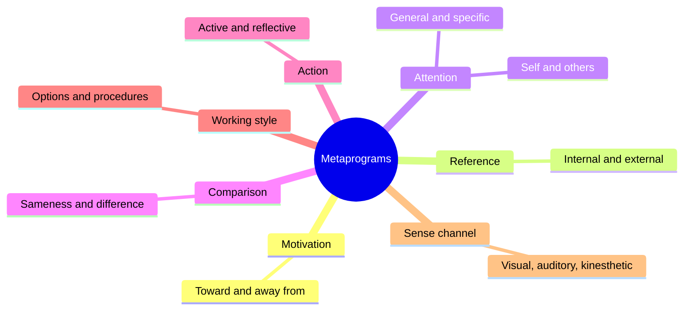

# NLP metaprograms

## Summary

In neuro-linguistic programming, a metaprogram is a habitual filter that is said to steer what a person pays attention to, how they decide and what motivates them. Practitioners list pairs such as "toward" and "away from" motivation or "general" and "specific" focus, and advise adapting a message to the listener's filter. The typology as a whole has no scientific support. Several of the dimensions do resemble constructs that psychology has measured, such as locus of control and regulatory focus, and those constructs are the better basis for the same ideas.

*This note is educational. It is not a way to type or judge a person.*

## Prerequisites

- [Neuro-linguistic programming](neuro-linguistic-programming.md), for the origin and the evidence on the wider method.

## Core concepts

### Definition

A *metaprogram* in NLP is a generalization about how a person tends to process information in a particular context. The list is a set of contrasts, and each person is said to lean to one pole or the other, depending on the situation. Practitioners use the list to adapt wording and arguments. The best-known version is the list in Charvet (1997), which comes from the "LAB profile" of Rodger Bailey. The lists differ between authors.

### Analogy

Metaprograms are like the settings on a car radio: volume, bass, station. A listener would adjust the sound to the person. The limit of the analogy is that a radio has real, separate controls, while the filters are inferred from speech, and no one has shown that they exist as stable controls.

### The common dimensions

The map shows the dimensions. The table gives, for each, what practitioners claim and the researched construct that comes closest. A match in meaning is not a match in evidence: the research is about the construct and not about the NLP label.

| Dimension | Pole A | Pole B | Closest researched construct |
| --- | --- | --- | --- |
| Motivation | Toward a goal or reward | Away from a problem or loss | Promotion and prevention focus (Higgins, 1997) |
| Reference | Internal: decides by own judgment | External: decides by others' views and data | Locus of control (Rotter, 1966) is related but not identical |
| Chunk size | General: big picture first | Specific: details and steps first | Global versus local processing (Navon, 1977) |
| Comparison | Sameness: notes what matches | Difference: notes what changes | No close equivalent |
| Initiative | Active: acts at once | Reactive or reflective: waits and analyzes | Related to action orientation and impulsivity |
| Working style | Options: wants choice and freedom | Procedures: wants a defined sequence | Related to need for structure |
| Focus | Self: own needs first | Others: others' needs first | Related to self-construal and agreeableness |
| Agreement | Agrees by default | Objects by default | Related to agreeableness |
| Sense channel | Visual, auditory or kinesthetic words | | Not supported (Sharpley, 1987; Pashler et al., 2008) |

### How practitioners match the style

- Toward: describe goals and gains. Away from: describe risks and how to avoid them.
- External: give data, examples and other people's opinions. Internal: ask what they think and leave the decision to them.
- General: start with the big picture. Specific: present steps in order.
- Options: offer choices. Procedures: give a clear sequence.

### Evidence

No study supports the metaprogram typology as a whole. Reviews of NLP research (Witkowski, 2010) and of the sensory-channel claim (Sharpley, 1987) are negative. The idea that a message works better when it fits the listener's motivation does have evidence in another form. Cesario, Higgins and Scholer (2008) reviewed research on *regulatory fit*: messages framed to fit a person's promotion or prevention focus tend to persuade better. The effect is measured with validated scales for the focus, and not with the NLP label.

## Worked example

A manager wants a colleague to adopt a new expense tool. Two versions of the message are shown.

| Version | Message | Rationale |
| --- | --- | --- |
| Promotion framing | "The tool cuts reporting time from two hours to twenty minutes, so you get your afternoons back" | Fits a person focused on gains |
| Prevention framing | "The tool catches missing receipts before audits, so you avoid rejected claims" | Fits a person focused on avoiding problems |

Instead of guessing the type from a few words, the manager can ask: "What matters most to you in how we handle expenses?" The answer says what frame to use, and it is more reliable than inferring a filter from word choice. This mirrors the research on regulatory fit, where the focus is measured or asked about.

## Trade offs and when to use it

The list is a handy prompt for thinking about an audience: do they want the big picture or the steps, goals or risks, choice or procedure? Use it as a set of questions to ask, not as a label to apply. Typing people from a few words is unreliable, and the same person changes pole between situations (NLP itself says that metaprograms are context dependent). Never use the labels for hiring, selection or diagnosis.

## Common mistakes

- **Treating metaprograms as personality types.** Even NLP authors describe them as context dependent.
- **Typing a person from a short conversation.** There is no validated test.
- **Mistaking a similar name for the same construct.** "Internal reference" is not the same as locus of control.
- **Quoting eye-movement or word-choice rules as facts.** They have been tested and not supported.

## Practice

1. What is a metaprogram, in NLP terms?
2. Which researched construct is closest to "toward" and "away from" motivation?
3. Why is it better to ask a person what matters to them than to infer their metaprogram?

### Answers

1. A habitual filter that guides what a person attends to and how they decide, in a given context.
2. Promotion and prevention focus (regulatory focus theory).
3. Inference from words is unreliable and the typology is unvalidated, while a direct question gives the information at once.

## Further reading

- Charvet, S. R. (1997). *Words That Change Minds: Mastering the Language of Influence (2nd ed.)*. Kendall Hunt. The practitioner source for the metaprogram list of the LAB profile.
- Higgins, E. T. (1997). Beyond pleasure and pain. *American Psychologist*, 52(12), 1280-1300. [DOI](https://doi.org/10.1037/0003-066X.52.12.1280). Regulatory focus theory: promotion versus prevention motivation.
- Cesario, J., Higgins, E. T. and Scholer, A. A. (2008). Regulatory fit and persuasion: basic principles and remaining questions. *Social and Personality Psychology Compass*, 2(1), 444-463. [DOI](https://doi.org/10.1111/j.1751-9004.2007.00055.x). Reviews evidence that messages that fit a person's regulatory focus persuade better.
- Rotter, J. B. (1966). Generalized expectancies for internal versus external control of reinforcement. *Psychological Monographs*, 80(1), 1-28. [DOI](https://doi.org/10.1037/h0092976). The paper that defined locus of control.
- Navon, D. (1977). Forest before trees: the precedence of global features in visual perception. *Cognitive Psychology*, 9(3), 353-383. [DOI](https://doi.org/10.1016/0010-0285(77)90012-3). The classic study of global versus local processing.
- Sharpley, C. F. (1987). Research findings on neurolinguistic programming: nonsupportive data or an untestable theory?. *Journal of Counseling Psychology*, 34(1), 103-107. [DOI](https://doi.org/10.1037/0022-0167.34.1.103). A review of tests of the preferred representational system claim.
- Witkowski, T. (2010). Thirty-five years of research on neuro-linguistic programming. NLP research data base. State of the art or pseudoscientific decoration?. *Polish Psychological Bulletin*, 41(2). [DOI](https://doi.org/10.2478/v10059-010-0008-0). Reviews 63 NLP studies; of 33 empirical ones, 18.2% supported NLP tenets, 54.5% did not and 27.3% were unclear.
- Pashler, H., McDaniel, M., Rohrer, D. et al. (2008). Learning styles: concepts and evidence. *Psychological Science in the Public Interest*, 9(3), 105-119. [DOI](https://doi.org/10.1111/j.1539-6053.2009.01038.x). Finds no adequate evidence that matching teaching to a learning style improves learning.
