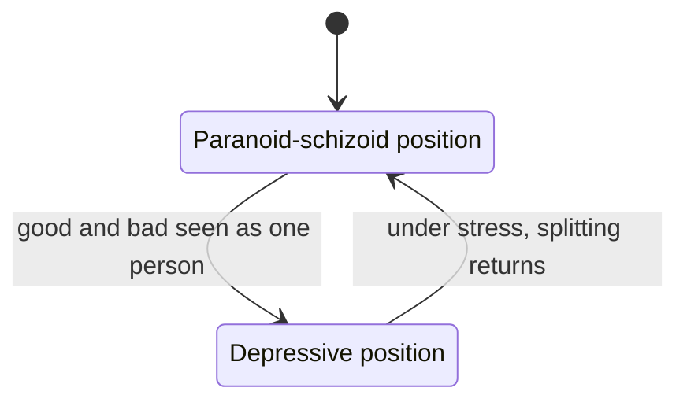

# Object relations theory

## Summary

Object relations theory is a family of psychoanalytic theories which hold that the human mind is built mainly from relationships, beginning with the infant and its caregivers. Early experiences are stored as mental representations of self and other, called internal objects, and these shape expectations, feelings and behavior in later relationships. The theory is influential in psychotherapy and in the understanding of personality. Many of its concepts come from clinical observation and are hard to test, although some treatments built on it have been tested in trials.

*This note is educational. It is not clinical advice, and it cannot be used to diagnose anyone.*

## Prerequisites

No prior notes are needed. [Self-verification theory](../social-psychology/self-verification-theory.md) deals with a related idea: stable expectations about how others see the self.

## Core concepts

### Definition

In this theory an *object* is not a thing. It is a person (or part of a person) who matters emotionally to someone, such as a parent, a sibling or a partner. An *internal object* is the mental representation of that person together with the feelings tied to the relationship. The central claim is that people are driven mainly by the need for relationships, in contrast to classical Freudian theory, which stressed drives such as libido and aggression.

### Main authors

| Author | Idea |
| --- | --- |
| Melanie Klein | Early inner fantasy about the caregiver and the "positions" of the mind (Klein, 1946) |
| W. R. D. Fairbairn | People seek relationships and not only the discharge of drives (Fairbairn, 1952) |
| Donald Winnicott | The "good enough" caregiver, the transitional object, the true and false self (Winnicott, 1953) |
| Margaret Mahler | Separation-individuation: how the child develops a separate identity |

Greenberg and Mitchell (1983) compare these authors and show how they differ from drive theory.

### Analogy

Internal objects are like a set of templates for a word processor. A person who was met with warmth builds a template for relationships that includes trust, and later relationships are laid out on it. A person who was met with unpredictability builds a template that expects it. The limit of the analogy is that templates are chosen by the user, while internal objects form early, outside awareness, and change slowly with new experience.

### Core ideas

- **Internal objects and working models.** Repeated experiences with caregivers become expectations about how others will treat me and whether I am worth care. These expectations mostly act without awareness.
- **Splitting.** An infant cannot yet combine the satisfying and the frustrating caregiver into one person, so the two are felt as a "good" and a "bad" object. In adults, a return to splitting means seeing a person as all good or all bad.
- **Positions.** Klein described two modes of experience. In the *paranoid-schizoid position* the world is split, and anxiety is about attack. In the *depressive position* good and bad are seen in the same person, which brings guilt, concern and the wish to repair. Klein treated these as modes that people move between during life and not as stages that end.
- **Object constancy.** The ability to keep a stable emotional bond with a person during frustration, absence or conflict. Mahler's idea of the child's step toward this stability is central to the model of separation-individuation.
- **Transference.** Patterns from early relationships are carried into later ones, including the relationship with a therapist.

The diagram shows Klein's two positions as modes that a person can move between in both directions.

### Relation to attachment theory

Bowlby's attachment theory (1969) also holds that early relationships form internal working models. The two traditions differ in method.

| Aspect | Object relations | Attachment theory |
| --- | --- | --- |
| Origin | Psychoanalysis | Developmental psychology and ethology |
| Focus | Inner representations and fantasy | Observable attachment behavior |
| Evidence | Clinical observation, some trials | Observation, longitudinal and experimental studies |

The two are often seen as complementary, and attachment research supplies the stronger empirical base.

### Evidence

- Many concepts are hard to define in measurable terms, and many originated in case studies. The theories were also formed in mostly Western settings.
- Some of the developmental claims, such as the fixed early timing of the stages, have been questioned by later infant research.
- Treatments that draw on the theory have been tested. Doering and colleagues (2010) randomized 104 women with borderline personality disorder to transference-focused psychotherapy or to experienced community psychotherapists for one year. Dropout was lower with transference-focused therapy (38.5% against 67.3%), and it was superior on borderline symptoms and psychosocial functioning. Shedler (2010) reviewed meta-analyses of psychodynamic therapy and concluded that it is effective, while the meta-analysis by Leichsenring and Rabung (2008) of long-term therapy was debated in later comments. A single trial does not validate the theory behind the therapy.

## Worked example

Three caregiving patterns and the expectations they might produce are shown below. They are illustrations of how the theory reasons and not predictions for any one person.

| Early pattern | Internal object (in theory) | Possible expectation in adult relationships |
| --- | --- | --- |
| Responsive and consistent | Safety, trust | Closeness is safe, conflict can be survived |
| Warm at times and unpredictable at others | Anxiety, uncertainty | Fear of abandonment, need for reassurance |
| Emotionally absent | Rejection, emptiness | Distrust, avoidance of closeness |

A clinician working with this theory would look for how the expectation appears in the present: for example, a client who reads a late reply as rejection. The aim is to make the pattern visible and to test it against the actual behavior of the other person. The same case could be explained in attachment terms as an anxious attachment style, which is the more researched description.

## Trade offs and when to use it

The theory gives a rich vocabulary for relational patterns, and it influenced therapy, social work and the study of personality disorders. Its limits are weak testability, a strong dependence on interpretation and a risk of explaining everything after the fact. For research questions about early relationships, attachment theory has the stronger empirical base. For a person seeking help, the choice of therapy should rest on the evidence for the specific condition and on a qualified professional, not on the theory alone.

## Common mistakes

- **Taking "object" to mean a thing.** It means a significant person.
- **Treating the positions as childhood stages that end.** Klein described modes that persist.
- **Deterministic reading.** Early experience shapes expectations but does not fix them.
- **Blaming parents.** The theory describes patterns in relationships and not guilt.

## Practice

1. What does "object" mean in object relations theory?
2. What is splitting?
3. How do object relations theory and attachment theory differ in method?

### Answers

1. A person who is emotionally significant to the individual.
2. Experiencing a person, or a caregiver, as all good or all bad because the good and bad experiences are kept apart.
3. Object relations relies on clinical observation of inner representations, while attachment theory relies on observation and empirical study of attachment behavior.

## Further reading

- Greenberg, J. R. and Mitchell, S. A. (1983). *Object Relations in Psychoanalytic Theory*. Harvard University Press. The standard comparison of the object relations authors and of drive theory.
- Klein, M. (1946). Notes on some schizoid mechanisms. *International Journal of Psycho-Analysis*, 27, 99-110. Introduces the paranoid-schizoid position and splitting.
- Winnicott, D. W. (1953). Transitional objects and transitional phenomena. *International Journal of Psycho-Analysis*, 34, 89-97. Introduces the transitional object.
- Fairbairn, W. R. D. (1952). *Psychoanalytic Studies of the Personality*. Tavistock. Argues that the infant seeks relationships and not only drive discharge.
- Bowlby, J. (1969). *Attachment and Loss, Vol. 1: Attachment*. Basic Books. The founding work of attachment theory.
- Doering, S., Hoerz, S. and Rentrop, M. (2010). Transference-focused psychotherapy v. treatment by community psychotherapists for borderline personality disorder: randomised controlled trial. *British Journal of Psychiatry*, 196(5), 389-395. [DOI](https://doi.org/10.1192/bjp.bp.109.070177). A randomized trial of a therapy built on object relations ideas, with 104 patients.
- Shedler, J. (2010). The efficacy of psychodynamic psychotherapy. *American Psychologist*, 65(2), 98-109. [DOI](https://doi.org/10.1037/a0018378). Reviews meta-analyses of psychodynamic therapy outcomes.
- Leichsenring, F. and Rabung, S. (2008). Effectiveness of long-term psychodynamic psychotherapy: a meta-analysis. *JAMA*, 300(13), 1551-1565. [DOI](https://doi.org/10.1001/jama.300.13.1551). A meta-analysis whose methods were debated in later comments.
