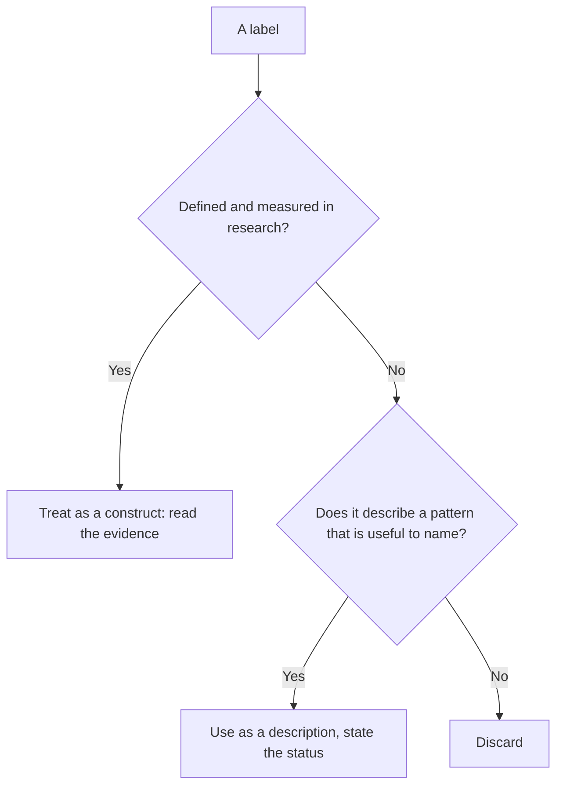

# Popular psychology labels and their status

## Summary

Many terms in popular psychology sound clinical but are not formal diagnoses or tested constructs: the Atlas complex, the Cassandra complex, the Kafka trap, the "coddled mind", the "curse of competence" and the "antifragile ego". They describe real patterns, such as chronic over-responsibility or being disbelieved, and each has a different origin. This note gives the origin and the evidence status of each, so that the label is not mistaken for a finding.

*This note is educational. These labels are not diagnoses and should not be used to label a person.*

## Prerequisites

- [Cognitive behavioral therapy and cognitive distortions](cognitive-behavioral-therapy.md).

## Core concepts

### Definition

A *popular label* is a named pattern that circulates in books, media and social networks and has no agreed definition in the research literature. A label can still be a useful description. It becomes a problem when it is treated as a diagnosis, a cause or a proven theory.

### The labels

| Label | What it describes | Origin and status |
| --- | --- | --- |
| Atlas complex | Carrying the weight of the world: chronic over-responsibility, difficulty delegating and resting | Popular term, no formal definition or research base. Related researched ideas are perfectionism and burnout |
| Cassandra complex | Being right but not believed | Named after the myth of Cassandra. A popular term, with no formal construct. A related research area is credibility judgments and epistemic injustice |
| Kafka trap | A style of argument in which denial of an accusation is treated as proof of it | A term from online debate named after Kafka's *The Trial*. It describes a logical trap that is unfalsifiable, and it is not a psychological construct |
| Coddled mind | Overprotection of young people that is claimed to reduce resilience | Argued by Lukianoff and Haidt (2018). Contested: the claims about causes and size are debated |
| Curse of competence | Competent people get more work and are less likely to be helped | Popular term from workplace discussion, without a research base |
| Antifragile ego | An identity that gets stronger under stress | An application of the idea of antifragility from Taleb (2012). The idea comes from risk theory, and its application to ego is a metaphor |
| Parental attribution error | Parents explaining a child's behavior by the child's character | A popular term. The researched topic is parental attributions of child behavior |

### Analogy

A popular label is like a nickname for a weather pattern. It helps people talk about something that they recognize, and it does not tell the forecaster what causes it. The limit of the analogy is that labels about people can change how the person is treated.

### How to evaluate a label

## Worked example

A person says: "I have an Atlas complex: I take on everything and cannot rest." The label can be replaced by a plan.

| Step | Action |
| --- | --- |
| 1 | State the pattern in behavior: "I do not delegate tasks and I work evenings" |
| 2 | Find the researched concept: perfectionism, workload and burnout risk |
| 3 | Test one change: delegate one task per week |
| 4 | Seek help if exhaustion or low mood is persistent |

The behavioral description allows a plan, and the label by itself does not.

## Trade offs and when to use it

Labels give language and the feeling of being understood. The risks: self-diagnosis, the sense that the pattern is fixed and the dismissal of a person ("you have a complex"). Prefer descriptions of behavior and, where they exist, researched constructs.

## Common mistakes

- **Treating a label as a diagnosis.** None of these are in the diagnostic manuals.
- **Using a label to explain a cause.** It names a pattern.
- **Applying labels to other people.** It tends to end discussion.

## Practice

1. Which label is based on a type of argument and not on a psychological trait?
2. Who argued the case for the "coddled mind", and is it settled?
3. What is a better replacement for a label?

### Answers

1. The Kafka trap.
2. Lukianoff and Haidt (2018), and it is contested.
3. A description of the behavior and, where one exists, a researched construct.

## Further reading

- Lukianoff, G. and Haidt, J. (2018). *The Coddling of the American Mind*. Penguin Press. Argues that overprotection harms young people; its claims are debated.
- Taleb, N. N. (2012). *Antifragile: Things That Gain from Disorder*. Random House. Defines antifragility and the Lindy effect.
