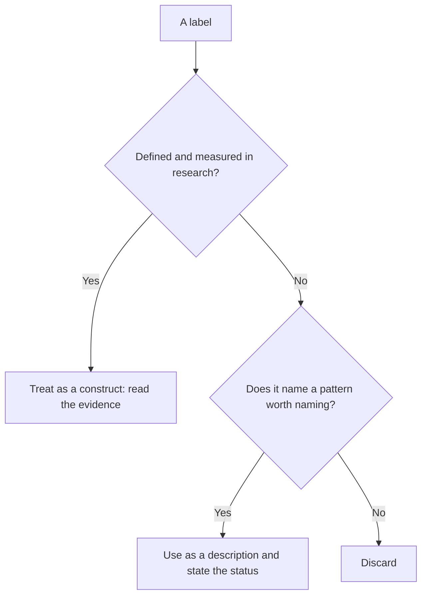
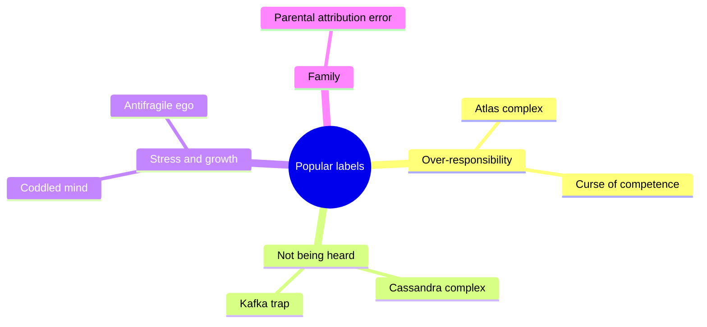

# Popular psychology labels

Named patterns that circulate in books, media and social networks and sound clinical, but are not diagnoses and have no agreed definition in the research literature. This subfield belongs to [Clinical and counseling psychology](../README.md). Each note traces where one label comes from, which researched concepts sit behind it and how strong the evidence is. The notes are educational. The labels are not diagnoses and should not be used to label a person.

## Evaluating a label

A *popular label* is a named pattern with no agreed definition in the research literature. A label can still be a useful description. It becomes a problem when it is treated as a diagnosis, a cause or a proven theory.

The diagram is the test used in every note of this subfield. Each note asks the same four questions: where the term comes from, which researched concepts overlap with it, what the evidence says and what to do instead of using the bare label.

## Map of the subfield

## Notes in reading order

1. [Atlas complex](atlas-complex.md): chronic over-responsibility, and the researched ideas of inflated responsibility, perfectionism and burnout.
2. [Curse of competence](curse-of-competence.md): why capable people collect extra work, with evidence from task allocation and promotion studies.
3. [Cassandra complex](cassandra-complex.md): being right and not believed, and what credibility research says about it.
4. [Kafka trap](kafka-trap.md): an argument form that treats denial as proof, and its link to unfalsifiability and confirmation bias.
5. [Coddled mind](coddled-mind.md): the claim that overprotection weakens young people, and which parts of it the evidence supports.
6. [Antifragile ego](antifragile-ego.md): the idea of gaining from stress, set against research on resilience, posttraumatic growth and fragile self-esteem.
7. [Parental attribution error](parental-attribution-error.md): how parents explain a child's behavior, and how observers explain the child by the parents.

## Related notes

- [Cognitive behavioral therapy and cognitive distortions](../cognitive-behavioral-therapy.md)
- [Neuro-linguistic programming](../neuro-linguistic-programming.md) is another example of a popular framework with weak evidence.
