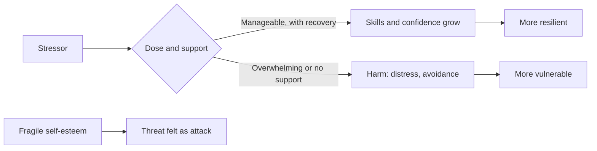
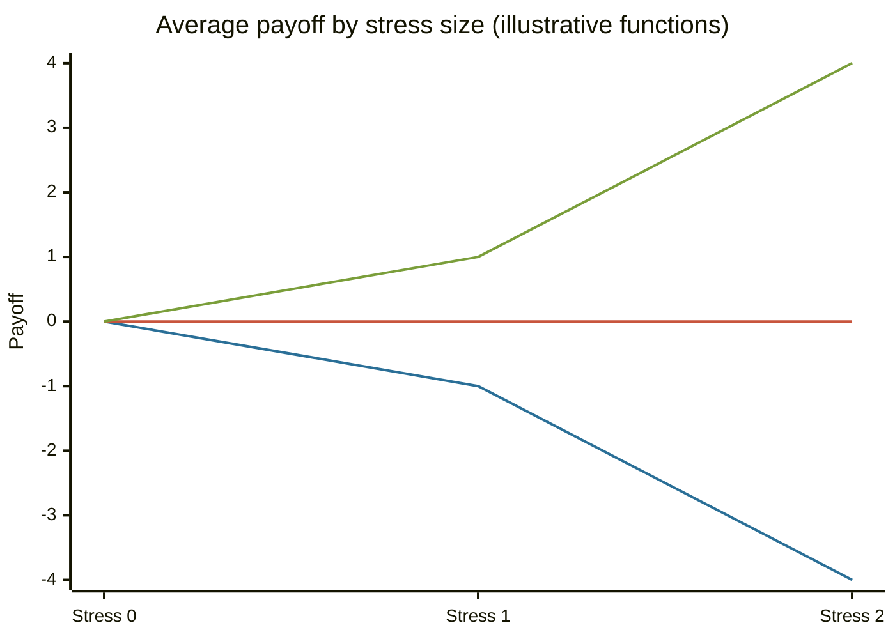

# Antifragile ego

## Summary

The "antifragile ego" applies Nassim Taleb's idea of antifragility, systems that gain from stress, to a person's sense of self. As a metaphor it points at something real: moderate challenges can build resilience, and a self that depends on constant approval is brittle. As a theory it goes too far. Research finds that resilience is common, that moderate adversity can help and large adversity usually does not, and that posttraumatic growth is real for some people and often overstated.

*This note is educational. It is not a statement that suffering is good for you or a substitute for care after trauma.*

## Prerequisites

- [Stress and resilience](../../../../personal-development/personal-growth/stress-and-resilience.md).
- [Self-esteem and self-acceptance](../../../../personal-development/personal-growth/self-esteem-and-self-acceptance.md).

## Core concepts

### Definition

In Taleb (2012), a thing is *fragile* if it is harmed by volatility, *robust* if it is unaffected and *antifragile* if it gains from it. The formal core is convexity: when the payoff curve bends upward, random variation raises the average outcome. An *antifragile ego* is the loose analogy for an identity that grows under stress, and neither a measure nor a clinical concept exists for it.

### Origin

Taleb introduced antifragility in his 2012 book, as a third category that English lacked a word for. The sources he draws on are risk theory, evolution and the medical idea of *hormesis*, in which a small dose of a stressor stimulates and a large dose harms (Calabrese and Baldwin, 2003). Applying the term to the self is a move by popular writers, not by Taleb's formal argument.

### Analogy

Muscle is the standard example. Lifting a load creates small damage, and the repair makes the muscle stronger than before. The analogy holds for dose and recovery. It breaks because some stress does not strengthen: a torn tendon or a severe trauma leaves a person worse off, and rest is part of the mechanism.

### Psychological aspects

**Fragile versus secure self-esteem.** Kernis (2003) separates high self-esteem that is secure, stable and not dependent on outcomes, from high self-esteem that is fragile, dependent on approval and defended against threats. This is the closest researched cousin of the label: a self that needs constant validation is, in the metaphor, fragile.

**Resilience is common.** Bonanno (2004) shows that most people who face loss or a potentially traumatic event keep a stable level of functioning. A strong response is not required, and recovery is not rare.

**Moderate adversity may help.** Seery et al. (2010) followed a national sample and found that people with a moderate number of lifetime adverse events had better mental health and life satisfaction than people with none or with many. This supports a hormetic picture but is a correlation, not an experiment. Rutter (2006) describes a related "steeling effect" in which manageable stress, handled well, can protect against later stress.

**Posttraumatic growth.** Tedeschi and Calhoun (2004) describe reported positive change after a struggle with a crisis, in five areas: appreciation of life, relationships, personal strength, new possibilities and spiritual change. Jayawickreme and Blackie (2014) review the evidence and point out serious methodological limits: much of the growth is perceived and not shown by change measured over time, and growth and distress can occur together.

**What makes stress useful.** The studies suggest conditions: a manageable dose, enough support, recovery time and a sense of control. When these are missing, stress is more likely to harm.

### Evidence status

| Claim | Status |
| --- | --- |
| Resilience is the common response to adversity | Well supported |
| Moderate adversity is linked to better outcomes than none or much | Supported, correlational |
| People report growth after trauma | Supported as a report. Real change is less certain |
| Stress strengthens the ego in general | Not supported as a general rule |



The diagram shows that the outcome depends on dose and support, and that fragile self-esteem changes how a threat is perceived.

## Worked example

Taleb's formal idea can be shown with a payoff and random stress. A stress of size s is either +s or -s with equal chance. A fragile payoff is concave (-x squared), a robust payoff is flat (zero) and an antifragile payoff is convex (x squared).

```python
# Python 3.12. Average payoff of a stress of size s that is +s or -s with equal chance.
payoffs = {"fragile (concave)": lambda x: -x * x,
           "robust (flat)": lambda x: x * 0,
           "antifragile (convex)": lambda x: x * x}
for s in (0, 1, 2):
    row = {k: (f(s) + f(-s)) / 2 for k, f in payoffs.items()}
    print("stress", s, row)
```

Output:

```text
stress 0 {'fragile (concave)': 0.0, 'robust (flat)': 0.0, 'antifragile (convex)': 0.0}
stress 1 {'fragile (concave)': -1.0, 'robust (flat)': 0.0, 'antifragile (convex)': 1.0}
stress 2 {'fragile (concave)': -4.0, 'robust (flat)': 0.0, 'antifragile (convex)': 4.0}
```

The fragile payoff loses more as the stress grows and the convex payoff gains more. The functions are chosen to show the idea. Real human responses are not known to follow either curve, and Seery et al. (2010) describe an inverted U, which means benefit at moderate levels and harm at high ones. That is evidence against a simple convex payoff for people.



The lines are fragile, robust and antifragile, in that order.

## Trade offs and when to use it

The metaphor encourages taking on manageable challenges and building self-worth that does not depend on every outcome, which fits the research on secure self-esteem and on resilience. It becomes harmful when it justifies hardship ("it will make you stronger"), blames people who are hurt, or ignores the need for recovery and support. Aim for a dose that stretches without overwhelming.

## Common mistakes

- **Believing that suffering always strengthens.** The data show benefit at moderate levels only.
- **Treating the absence of growth as failure.** Most people are resilient without reporting growth.
- **Confusing robust with antifragile.** Robust means unharmed, and antifragile means improved.
- **Skipping recovery.** Rest is part of how stress turns into strength.

## Practice

1. Define fragile, robust and antifragile in Taleb's sense.
2. What did Seery et al. (2010) find about lifetime adversity?
3. Why is posttraumatic growth research criticized?

### Answers

1. Harmed by volatility, unaffected by it, and improved by it.
2. People with a moderate number of adverse events had better outcomes than people with none or many.
3. Much of the growth is perceived and self-reported, and few studies show real change over time.

## Further reading

- Taleb, N. N. (2012). *Antifragile: Things That Gain from Disorder*. Random House. Defines antifragility and the Lindy effect.
- Kernis, M. H. (2003). Toward a Conceptualization of Optimal Self-Esteem. *Psychological Inquiry*, 14(1), 1-26. [DOI](https://doi.org/10.1207/S15327965PLI1401_01). Separates secure self-esteem from fragile self-esteem that depends on outcomes and approval.
- Seery, M. D., Holman, E. A. and Silver, R. C. (2010). Whatever does not kill us: Cumulative lifetime adversity, vulnerability, and resilience. *Journal of Personality and Social Psychology*, 99(6), 1025-1041. [DOI](https://doi.org/10.1037/a0021344). Finds that a moderate history of adversity predicts better mental health than none or a lot.
- Bonanno, G. A. (2004). Loss, Trauma, and Human Resilience: Have We Underestimated the Human Capacity to Thrive After Extremely Aversive Events?. *American Psychologist*, 59(1), 20-28. [DOI](https://doi.org/10.1037/0003-066X.59.1.20). Shows that resilience after loss is common and is not rare or pathological.
- Rutter, M. (2006). Implications of Resilience Concepts for Scientific Understanding. *Annals of the New York Academy of Sciences*, 1094(1), 1-12. [DOI](https://doi.org/10.1196/annals.1376.002). Discusses resilience as a process and the steeling effect of manageable stress.
- Tedeschi, R. G. and Calhoun, L. G. (2004). Posttraumatic growth: conceptual foundations and empirical evidence. *Psychological Inquiry*, 15(1), 1-18. [DOI](https://doi.org/10.1207/s15327965pli1501_01). The standard statement of posttraumatic growth and its five domains.
- Jayawickreme, E. and Blackie, L. E. R. (2014). Post-traumatic Growth as Positive Personality Change: Evidence, Controversies and Future Directions. *European Journal of Personality*, 28(4), 312-331. [DOI](https://doi.org/10.1002/per.1963). Reviews the evidence and argues that reported growth is often perceived and not always real change.
- Calabrese, E. J. and Baldwin, L. A. (2003). Hormesis: The Dose-Response Revolution. *Annual Review of Pharmacology and Toxicology*, 43(1), 175-197. [DOI](https://doi.org/10.1146/annurev.pharmtox.43.100901.140223). Reviews hormesis, the biphasic dose response in which low doses stimulate and high doses harm.
