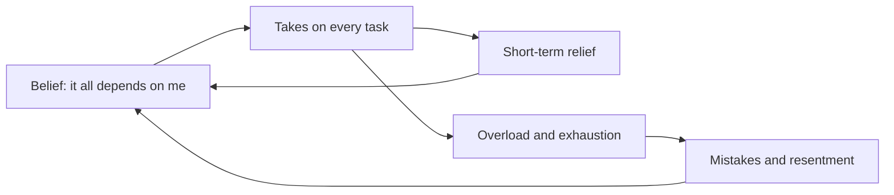
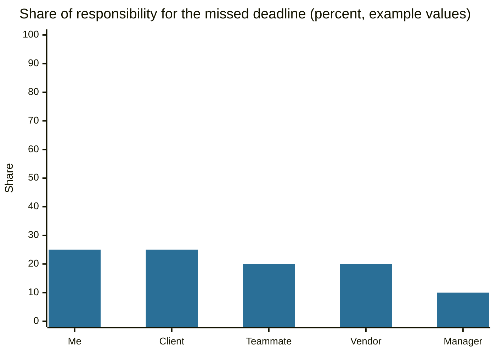

# Atlas complex

## Summary

The Atlas complex is a popular name for chronic over-responsibility: the feeling that everything depends on you, that delegating is risky and that resting is a failure. It is not a diagnosis and has no research definition. The pattern it describes overlaps with well-studied ideas: inflated responsibility, perfectionism, unmitigated communion and burnout. Those give a clearer picture of what drives the pattern and what helps.

*This note is educational. It is not a diagnosis or treatment advice. Persistent exhaustion, low mood or anxiety are reasons to talk to a health professional.*

## Prerequisites

- [Cognitive behavioral therapy and cognitive distortions](../cognitive-behavioral-therapy.md) for the idea that beliefs shape feelings and behavior.

## Core concepts

### Definition

The *Atlas complex* is a label for a person who takes on the weight of other people's problems and tasks beyond what is reasonable, and who feels guilty or anxious when they let any of it go. Neither the DSM-5-TR nor the ICD-11 contains it, and no validated questionnaire measures it under this name. Treat it as a description of a pattern, not as a condition.

### Origin

In Greek myth, Atlas is a Titan who holds up the sky at the western edge of the world. Hesiod's *Theogony* presents this as a punishment imposed by Zeus, so Atlas carries the burden under compulsion. The modern label drops that detail and treats the burden as a personal trait. In the twentieth century the image spread through art and through Ayn Rand's novel *Atlas Shrugged* (1957), where the people who carry the world stop doing so. The psychological use of the name appears in popular books and online writing, and I could not trace a single academic origin.

### Analogy

Think of a person who is the only one holding the ladder for everyone on a building site. If they step away, someone might fall, so they never leave. The analogy shows why the burden feels real. It breaks in two places: other people can usually hold the ladder, and the ladder-holder often cannot judge how much of the risk is theirs.

### Psychological aspects

Several researched concepts cover parts of the pattern. None of them is the same as the label.

| Concept | What it says | Link to the pattern |
| --- | --- | --- |
| Inflated responsibility | The belief that one has power to cause or prevent harm and a duty to do so. Salkovskis (1985) made it central to a cognitive model of obsessional problems | Explains why small risks feel like personal duties |
| Perfectionism | Hewitt and Flett (1991) separate self-oriented, other-oriented and socially prescribed perfectionism | Standards that nobody else can meet make delegation feel unsafe |
| Unmitigated communion | Helgeson and Fritz (1998): a strong focus on others combined with neglect of one's own needs | Linked in their work to distress and not to better care of others |
| Burnout | Maslach and Leiter (2016) describe exhaustion, cynicism and reduced efficacy, driven mostly by workload, control and fit | The likely cost of never putting the load down |
| Superwoman schema | Woods-Giscombé (2010) describes a role of obligation to manage everything and to hide vulnerability, with health costs, among African American women | A researched, culturally specific case of the same theme |

The common mechanism in a cognitive view is a rule such as "if I do not do it, it will go wrong, and it will be my fault". The rule is kept alive because each time the person does everything, the bad outcome is avoided and the rule is never tested. This is the same loop as in [intolerance of uncertainty](../../cognitive-psychology/intolerance-of-uncertainty.md): relief now, no learning later.



The diagram shows two loops. The left one feeds the belief through relief, and the right one adds a cost that seems to confirm the belief.

### Evidence status

The label is unresearched. The components are well supported: inflated responsibility, perfectionism and burnout all have validated measures and a large literature. The claim that they come together as a single "complex" has no test behind it.

## Worked example

A project missed its deadline and the person blames themselves for all of it. A *responsibility pie chart*, a standard exercise in cognitive therapy workbooks such as Greenberger and Padesky (2015), asks them to list every contributing cause and to share out 100% among them, with their own share last.

```python
# Python 3.12. Responsibility pie chart: share the blame for a missed deadline across causes.
causes = {
    "Me (late start on testing)": 25,
    "Teammate (late handover)": 20,
    "Client (unclear brief)": 25,
    "Vendor (delivery delay)": 20,
    "Manager (tight schedule)": 10,
}
assert sum(causes.values()) == 100
for name, share in sorted(causes.items(), key=lambda kv: -kv[1]):
    print(f"{share:>3}%  {name}")
print("Own share fell from 100% to", causes["Me (late start on testing)"], "%")
```

Output:

```text
 25%  Me (late start on testing)
 25%  Client (unclear brief)
 20%  Teammate (late handover)
 20%  Vendor (delivery delay)
 10%  Manager (tight schedule)
Own share fell from 100% to 25 %
```

The shares are an example, not data. The point is the method: the person writes the other causes first, so their own share is judged against evidence and not against the feeling. The chart shows the result.



The next steps are small behavioral tests of the belief: hand over one task for a week and record what actually happens, then compare it with the predicted outcome.

## Trade offs and when to use it

Taking responsibility is a virtue in moderation, and in some roles (a parent, a carer, an on-call engineer) it is part of the job. The label is useful when it helps someone see that the burden has become a habit and not a duty. It is harmful when it becomes an identity ("I am like this") or a reason to stop looking at the real workload. Structural causes, such as understaffing, are not solved by changing beliefs.

## Common mistakes

- **Treating the label as a diagnosis.** It is a description. Low mood or anxiety that lasts needs an assessment by a professional.
- **Assuming it is purely internal.** Workload, a lack of control and unfair norms at work or in the family are major causes of burnout.
- **Reading it as a virtue only.** Overload lowers the quality of the help given and can lead to resentment.
- **Trying to drop all responsibility at once.** Small, tested changes work better than a sweeping rule.

## Practice

1. Which myth does the name come from, and what detail does the modern label leave out?
2. Name two researched concepts that overlap with the Atlas complex.
3. Why does doing everything yourself keep the belief "it all depends on me" alive?

### Answers

1. The myth of Atlas, who holds up the sky. The label leaves out that he does it under compulsion, as a punishment.
2. For example inflated responsibility, perfectionism, unmitigated communion or burnout.
3. The feared outcome never happens, so the belief is never tested, and the relief rewards the behavior.

## Further reading

- Salkovskis, P. M. (1985). Obsessional-compulsive problems: A cognitive-behavioural analysis. *Behaviour Research and Therapy*, 23(5), 571-583. [DOI](https://doi.org/10.1016/0005-7967(85)90105-6). Describes inflated responsibility as a cognitive factor in obsessional problems.
- Hewitt, P. L. and Flett, G. L. (1991). Perfectionism in the self and social contexts: Conceptualization, assessment, and association with psychopathology. *Journal of Personality and Social Psychology*, 60(3), 456-470. [DOI](https://doi.org/10.1037/0022-3514.60.3.456). Introduces the multidimensional view of perfectionism, including self-oriented, other-oriented and socially prescribed forms.
- Helgeson, V. S. and Fritz, H. L. (1998). A Theory of Unmitigated Communion. *Personality and Social Psychology Review*, 2(3), 173-183. [DOI](https://doi.org/10.1207/s15327957pspr0203_2). Defines unmitigated communion, a focus on others combined with neglect of the self, and links it to distress.
- Maslach, C. and Leiter, M. P. (2016). Understanding the burnout experience: recent research and its implications for psychiatry. *World Psychiatry*, 15(2), 103-111. [DOI](https://doi.org/10.1002/wps.20311). Review of burnout as exhaustion, cynicism and reduced efficacy, and of its link to workload and fit between person and job.
- Woods-Giscombé, C. L. (2010). Superwoman Schema: African American Women’s Views on Stress, Strength, and Health. *Qualitative Health Research*, 20(5), 668-683. [DOI](https://doi.org/10.1177/1049732310361892). Qualitative study that describes the Superwoman schema, a pattern of obligation to manage everything and to show strength, and its health costs.
- Greenberger, D. and Padesky, C. A. (2015). *Mind Over Mood: Change How You Feel by Changing the Way You Think (2nd ed.)*. Guilford Press. A CBT workbook that includes the responsibility pie chart exercise.
- Hesiod. *Theogony*. c. 700 BCE, many editions. The early source for Atlas as the Titan who holds up the sky under compulsion.
