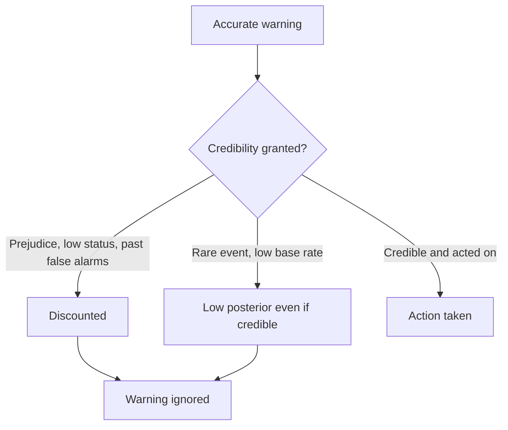
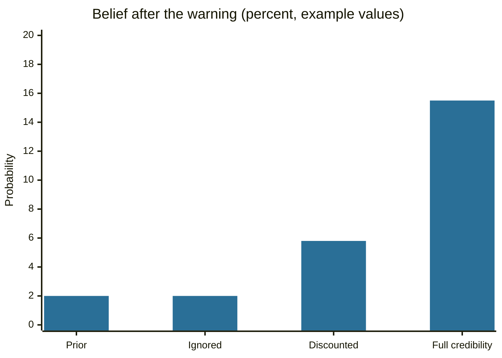

# Cassandra complex

## Summary

The Cassandra complex is a popular name for the experience of being right about a danger and not being believed. It comes from the Greek myth of Cassandra and is not a diagnosis. The research behind the experience is about credibility: how listeners decide whom to believe, how prejudice lowers credibility (testimonial injustice) and why warnings about rare events are hard to act on even when they are correct.

*This note is educational. It is not a diagnosis.*

## Prerequisites

- [Hindsight bias](../../cognitive-psychology/hindsight-bias.md), which explains why past warnings look obvious afterwards.
- [Stereotypes](../../social-psychology/stereotypes.md), for how group prejudice enters judgments of credibility.

## Core concepts

### Definition

The *Cassandra complex* names a pattern in which a person gives accurate warnings or accurate accounts and is dismissed. Several meanings of the term circulate: a warning-giver whose forecasts are ignored, a person whose report of mistreatment is disbelieved and, in some popular writing, a partner who feels unheard. The meanings share the structure *accurate message, low credibility*. The term has no validated measure. Attributions of who coined it differ between sources, and I could not verify any of them.

### Origin

Cassandra is a Trojan princess. In Aeschylus's *Agamemnon* (5th century BCE) she foresees her own death and the murder of Agamemnon, and no one believes her. In the tradition, Apollo gave her the gift of prophecy and cursed it with disbelief when she refused him. The myth already contains the main point of later research: the failure lies in the audience as much as in the speaker. The label then moved into psychology, medicine, risk communication and climate debate as a figure of speech for ignored experts.

### Analogy

Cassandra is a smoke alarm that no one trusts because it has sounded in the past, or because they dislike where it is installed. The analogy fits the credibility problem. It breaks because a smoke alarm has no reasons or biography, and a human warner is judged by status, group membership and tone as well as by the content.

### Psychological aspects

**Credibility is a judgment, and it can be biased.** Fricker (2007) calls the unfair lowering of a speaker's credibility because of prejudice *testimonial injustice*. The listener's prejudice, not the quality of the evidence, reduces the weight given to the speaker. This is the best researched sense of the Cassandra story. It also gives a test: would the same message from a different speaker be believed?

**A correct warning about a rare event does not move belief far.** Even a good signal gives a low probability when the event is rare. The next section works through the numbers. Many ignored warnings are ignored for this reason and not for prejudice, and this is a point the myth hides.

**Hindsight makes Cassandras of everyone.** After an event, people remember that warnings existed and forget the false alarms ([hindsight bias](../../cognitive-psychology/hindsight-bias.md)). We then picture the warner as always right. Selection also works: the warners who were wrong are forgotten, so the surviving "Cassandras" look more reliable than warners as a group are.

**Costs for the warner.** Not being heard can lead to frustration, withdrawal or louder and more alarming messages, which then lower credibility further. This is an interpretation from the credibility literature and not a measured syndrome.

### Evidence status

The credibility and testimonial injustice literature is well developed in philosophy and growing in empirical work. The "Cassandra complex" as a trait or syndrome is not an established concept.



The diagram shows that a warning can fail at two points, through credibility and through the base rate, and only the first is about the speaker.

## Worked example

A warning system raises an alarm 90% of the time when the event happens and 10% of the time when it does not (a likelihood ratio of 9). The event has a base rate of 2%. The question is how much belief an alarm should create when listeners trust it fully, partly or not at all.

```python
# Python 3.12. How much does a correct warning move belief when the event is rare?
def posterior(prior, lr):
    odds = prior / (1 - prior) * lr
    return odds / (1 + odds)

prior = 0.02   # base rate of the event (example value)
for label, lr in [("full credibility, LR 9", 9), ("discounted, LR 3", 3), ("ignored, LR 1", 1)]:
    print(f"{label:<24} -> {posterior(prior, lr):.3f}")
```

Output:

```text
full credibility, LR 9   -> 0.155
discounted, LR 3         -> 0.058
ignored, LR 1            -> 0.020
```

Even full credibility lifts the probability only from 2% to 15.5%. Discounting the warner cuts it to 5.8%. A decision maker who needs 50% before acting does not act in either case, so the warning fails without any prejudice. The values are an example. The lesson is that a warner should state the cost of being wrong and the base rate, and not only the signal.



## Trade offs and when to use it

The label gives a name to a painful experience and can help someone see that being ignored is not proof of being wrong. It also lets any unheeded person claim to be a Cassandra, and it is unfalsifiable if "they did not believe me" is taken as evidence of being right. Use the credibility questions instead: What is the evidence? Who has checked it? Would the message be treated the same from another speaker?

## Common mistakes

- **Assuming that being ignored means being right.** Most ignored warnings are false alarms.
- **Overlooking the base rate.** A correct signal on a rare event still gives a small probability.
- **Blaming only the audience.** Clarity, evidence and a track record also affect credibility.
- **Dismissing credibility injustice as imaginary.** Prejudice measurably affects whom people believe, so a claim that one was disbelieved unfairly can be true.

## Practice

1. Which ancient work is the main source of the Cassandra myth?
2. What is testimonial injustice?
3. A warning has a likelihood ratio of 9 and the event has a base rate of 2%. Why is belief only 15.5% after the alarm?

### Answers

1. Aeschylus, *Agamemnon*.
2. Giving a speaker less credibility than the evidence deserves because of prejudice about the speaker.
3. The event is rare, so the prior odds are low, and multiplying them by 9 still gives a small probability.

## Further reading

- Aeschylus. *Agamemnon (in the Oresteia)*. 5th century BCE, many editions. The earliest surviving dramatic treatment of Cassandra, who foresees the murder at the palace and is not believed.
- Fricker, M. (2007). *Epistemic Injustice: Power and the Ethics of Knowing*. Oxford University Press. Defines testimonial injustice, in which prejudice lowers the credibility given to a speaker.
