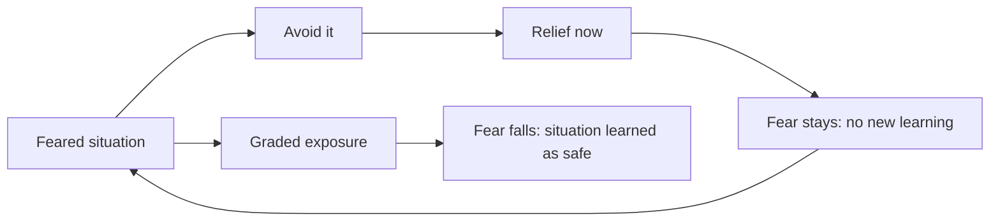
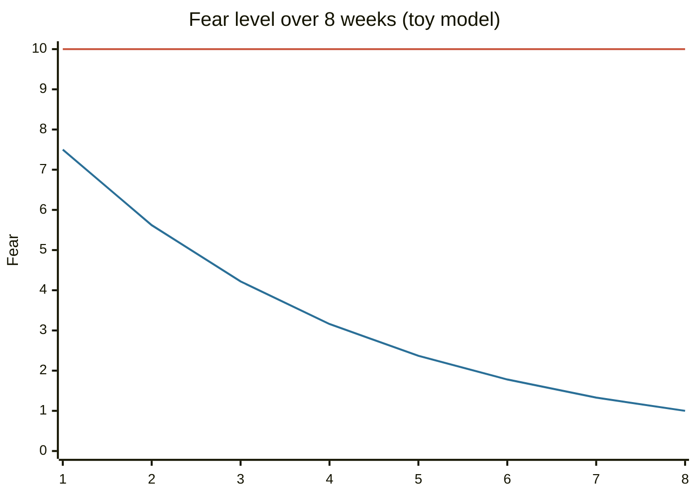

# Coddled mind

## Summary

The "coddled mind" is the claim that protecting young people from discomfort, risk and disagreement makes them more fragile. It was set out by Greg Lukianoff and Jonathan Haidt in a 2015 article and a 2018 book. The idea draws on solid findings about avoidance and anxiety, about early exposure and about overprotective parenting. Other parts, such as the size of the effect, the main cause and the harm of trigger warnings, are contested, and some are contradicted by studies.

*This note is educational and does not give parenting or clinical advice. It covers the evidence on a debated claim.*

## Prerequisites

- [Cognitive behavioral therapy and cognitive distortions](../cognitive-behavioral-therapy.md), since the book borrows its list of distortions.
- [Intolerance of uncertainty](../../cognitive-psychology/intolerance-of-uncertainty.md) for how avoidance keeps anxiety going.

## Core concepts

### Definition

The *coddled mind* thesis says that a culture of "safetyism", in which safety is treated as a sacred value and discomfort as harm, deprives young people of the challenges that build resilience. Lukianoff and Haidt (2018) name three "Great Untruths" that they say are spreading: what does not kill you makes you weaker (fragility), always trust your feelings (emotional reasoning) and life is a battle between good people and evil people (us versus them).

### Origin

Lukianoff, president of the Foundation for Individual Rights in Education, saw in the 2010s a rise in demands for protection from speech on US campuses and an increase in anxiety among students. With Haidt, a social psychologist, he published the article "The Coddling of the American Mind" in *The Atlantic* in 2015 and the book in 2018. The thesis uses an old analogy from immunology and developmental psychology: a child's immune system and mind both need exposure to develop. The authors also tie it to changes in parenting, less unsupervised play and, in Haidt's later work, to smartphones.

### Analogy

The argument compares the mind with the immune system. An immune system raised in a sterile environment may react badly to harmless things. The analogy has some support: the LEAP trial (Du Toit et al., 2015) showed that giving peanut protein early to high-risk infants cut peanut allergy sharply. It breaks because the mind is not an immune system. Some stress builds skills and some damages, and a trial about peanuts says nothing about speech or trigger warnings.

### Psychological aspects

**Avoidance maintains anxiety.** This is the best established part. In anxiety disorders, avoiding a feared situation gives relief now and prevents learning that the situation is safe. Exposure therapy reverses that, so graded exposure is a first-line method. The mechanism is solid and applies to individuals with anxiety.

**Overprotective parenting is associated with worse outcomes.** Schiffrin et al. (2014) found that "helicopter parenting" of college students was linked to lower well-being, through unmet needs for autonomy and competence. This is a correlation from self-reports, and it does not show which direction the effect runs.

**Concept creep.** Haslam (2016) argues that concepts of harm such as abuse, trauma and bullying have widened over decades. This is a descriptive claim about psychology and about culture, and it supports one part of the thesis, that "harm" is now defined more broadly.

**Trigger warnings.** The study evidence does not support the claim that they help. Bellet et al. (2018) review the literature and find no benefit, and Jones et al. (2020) ran a preregistered study of 451 trauma survivors and found no benefit, with some increase in seeing the trauma as central to identity. The effects found are small, and these are short laboratory studies with written material, not classrooms.

**Mental health trends and their cause.** The thesis, and Haidt's later book on smartphones, say that the rise in adolescent distress has social-media causes. Critics, such as Odgers (2024), argue that the data are mixed and the causal evidence is weak. The strength of the evidence here is debated.

### Evidence status

| Claim | Status |
| --- | --- |
| Avoidance maintains anxiety, and exposure helps | Established in clinical research |
| Overprotective parenting is linked to worse outcomes in young adults | Supported by correlational studies |
| Trigger warnings do not help | Supported by several experiments, short term |
| Harm concepts have broadened | Supported by Haslam's analysis |
| Safetyism is the main cause of rising youth distress | Contested |
| Social media is the main cause | Contested |



The diagram contrasts the avoidance loop with the exposure path.

## Worked example

A toy model makes the avoidance mechanism concrete. Fear starts at 10 on a scale of 0 to 10. Each weekly exposure to the feared situation removes 25% of the remaining fear (an assumed rate). Avoidance leaves the fear unchanged.

```python
# Python 3.12. Toy habituation model: fear after each weekly exposure or avoidance.
fear_exposure = fear_avoid = 10.0   # starting fear on a 0-10 scale (example value)
for week in range(1, 9):
    fear_exposure *= 0.75           # each exposure removes 25% of the remaining fear (assumed)
    # avoidance gives relief now and leaves the fear where it was
    print(week, round(fear_exposure, 2), round(fear_avoid, 2))
```

Output (week, fear with exposure, fear with avoidance):

```text
1 7.5 10.0
2 5.62 10.0
3 4.22 10.0
4 3.16 10.0
5 2.37 10.0
6 1.78 10.0
7 1.33 10.0
8 1.0 10.0
```

The model is an illustration, not a result. Real exposure is gradual, supported and chosen by the person, and it does not follow a fixed rate. The chart shows the shape of the two curves.



The first line is exposure and the second is avoidance.

## Trade offs and when to use it

The thesis is a reasonable prompt to ask whether protection has become too wide, and that question is worth asking about a given child or school. It does not follow that all protection is harmful. Children with trauma, disabilities or real danger need support, and exposure only works when it is graded and the person is not overwhelmed. Policy conclusions need evidence about the specific policy, not the general thesis.

## Common mistakes

- **Equating exposure with hardship.** Graded exposure is planned and supported, and a harsh experience is not therapy.
- **Using the thesis to dismiss real distress.** A rise in distress can have real causes, and the argument should not be a reason to ignore a person.
- **Treating the book as settled science.** Parts are well supported and parts are contested.
- **Taking the immune analogy literally.** Peanut allergy is a specific case.

## Practice

1. Name the three "Great Untruths".
2. Why does avoidance maintain anxiety?
3. What did Jones et al. (2020) find about trigger warnings?

### Answers

1. Fragility, emotional reasoning and us versus them.
2. It gives relief now and prevents learning that the feared situation is safe.
3. No benefit for trauma survivors, and some reinforcement of the trauma as central to their identity.

## Further reading

- Lukianoff, G. and Haidt, J. (2018). *The Coddling of the American Mind*. Penguin Press. Argues that overprotection harms young people; its claims are debated.
- Lukianoff, G. and Haidt, J. (2015). The Coddling of the American Mind. The Atlantic, September 2015. The article from which the book grew; the page could not be opened for a check.
- Haslam, N. (2016). Concept Creep: Psychology's Expanding Concepts of Harm and Pathology. *Psychological Inquiry*, 27(1), 1-17. [DOI](https://doi.org/10.1080/1047840X.2016.1082418). Argues that the meaning of harm-related concepts such as trauma and abuse has widened over time.
- Schiffrin, H. H., Liss, M., Miles-McLean, H. et al. (2013). Helping or Hovering? The Effects of Helicopter Parenting on College Students’ Well-Being. *Journal of Child and Family Studies*, 23(3), 548-557. [DOI](https://doi.org/10.1007/s10826-013-9716-3). Links helicopter parenting of college students to lower well-being, through unmet needs for autonomy and competence.
- Bellet, B. W., Jones, P. J. and McNally, R. J. (2018). Trigger warning: Empirical evidence ahead. *Journal of Behavior Therapy and Experimental Psychiatry*, 61, 134-141. [DOI](https://doi.org/10.1016/j.jbtep.2018.07.002). Reviews trigger warning studies and concludes that they are not shown to help.
- Jones, P. J., Bellet, B. W. and McNally, R. J. (2020). Helping or Harming? The Effect of Trigger Warnings on Individuals With Trauma Histories. *Clinical Psychological Science*, 8(5), 905-917. [DOI](https://doi.org/10.1177/2167702620921341). A preregistered study of 451 trauma survivors that found no benefit of trigger warnings and some reinforcement of trauma as central to identity.
- Du Toit, G., Roberts, G., Sayre, P. H. et al. (2015). Randomized Trial of Peanut Consumption in Infants at Risk for Peanut Allergy. *New England Journal of Medicine*, 372(9), 803-813. [DOI](https://doi.org/10.1056/NEJMoa1414850). The LEAP trial: early introduction of peanut protein cut peanut allergy in high-risk infants, a case of early exposure helping.
- Odgers, C. L. (2024). The great rewiring: is social media really behind an epidemic of teenage mental illness?. *Nature*, 628(8006), 29-30. [DOI](https://doi.org/10.1038/d41586-024-00902-2). A critical review of the claim that social media drives a rise in teenage mental illness.
