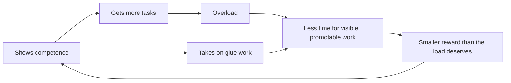

# Curse of competence

## Summary

The "curse of competence" is a popular phrase for the experience that capable people receive more work, more responsibility and less help than their colleagues. It is not a research term. Behind it stand several findings: tasks nobody wants go to the people who say yes, high performers are promoted for current performance, unrecognized coordination work piles up, and citizenship behavior at work is linked to overload and stress. The phrase is also confused with two different effects, the Dunning-Kruger effect and the curse of knowledge.

*This note is educational. It is not career or clinical advice.*

## Prerequisites

- [Dunning-Kruger effect](../../cognitive-psychology/dunning-kruger-effect.md), to separate it from the phrase in this note.
- [Prioritization](../../../../personal-development/skills/soft-skills/intrapersonal/prioritization.md) for how to decide what to decline.

## Core concepts

### Definition

The *curse of competence* is the pattern in which being good at a task leads to being given more of it, and often more of the tasks nobody wants, without matching reward. A person caught in it works more, is less able to refuse, and may have little time left for the work that would advance their career.

### Origin

The phrase circulates in workplace writing and online discussion, and I could not trace a single source. The ideas behind it are older. Peter and Hull (1969) joked that employees rise to their "level of incompetence": competent people are promoted until they reach a job they cannot do. In software, Reilly describes "glue work": coordination, onboarding, documentation and unblocking others that holds a team together, is often done by the most capable people and is rarely recognized in promotion.

### Analogy

The most reliable runner on a relay team ends up running every leg. The team wins the heat, and the runner is exhausted for the final. The analogy shows the short-term gain and the long-term cost. It breaks because organizations can change the rules, while a relay team cannot.

### Psychological and organizational aspects

**Task allocation.** Babcock et al. (2017) studied tasks that everyone prefers be done by someone else, such as writing a report or serving on a committee. Women volunteered more, were asked more and said yes more often than men, and beliefs that women would say yes drove part of the difference. The finding is about gender and low-promotability work, and it shows that who gets the extra work is shaped by expectations as well as by skill.

**Citizenship behavior has a price.** Bolino and Turnley (2005) found that frequent "individual initiative" at work was linked to role overload, job stress and work-family conflict. Helping is valued, and when it is unlimited it is costly.

**Promotion for current performance.** Benson et al. (2019) studied sales workers at 131 firms and found evidence consistent with the Peter principle: firms promote the best current performer even when other traits better predict management skill. This is one way competence leads to a job that does not fit.

**Impostor feelings and self-assessment.** Competent people often underrate themselves. Kruger and Dunning (1999) found that high performers tended to underestimate how they compare with others. Clance and Imes (1978) described the impostor phenomenon in high-achieving women. Doubt about one's worth makes it harder to refuse or to ask for credit.

**Names that are confused with this one.** The *curse of knowledge* (Camerer et al., 1989) is the difficulty of imagining not knowing something once you know it, and it makes experts poor teachers. The *Dunning-Kruger effect* is about self-assessment. Neither is about being overloaded.

### Evidence status

The phrase is informal. Each strand of evidence above is real, but the findings come from different settings and do not add up to a single tested theory.



The diagram shows a reinforcing loop in which competence brings work, and the work crowds out the activity that earns reward.

## Worked example

A team of three has 12 tasks per week at 5 hours each. A skill value is the chance a task is done well. Person A has 0.9, B 0.7 and C 0.5. One policy sends each task to the best person with spare capacity (a person is full at 8 tasks). The other rotates tasks evenly.

```python
# Python 3.12. Two ways to assign 12 weekly tasks to three people.
skill = {"A": 0.9, "B": 0.7, "C": 0.5}   # chance a task is done well (example values)
HOURS, CAP, TASKS = 5, 8, 12

best_first = {p: 0 for p in skill}
for _ in range(TASKS):
    free = [p for p in sorted(skill, key=skill.get, reverse=True) if best_first[p] < CAP]
    best_first[free[0]] += 1
rotation = {p: TASKS // len(skill) for p in skill}

for name, plan in [("best first", best_first), ("rotation", rotation)]:
    done_well = sum(n * skill[p] for p, n in plan.items())
    print(name, plan, "hours:", {p: n * HOURS for p, n in plan.items()}, "expected well done:", round(done_well, 1))
```

Output:

```text
best first {'A': 8, 'B': 4, 'C': 0} hours: {'A': 40, 'B': 20, 'C': 0} expected well done: 10.0
rotation {'A': 4, 'B': 4, 'C': 4} hours: {'A': 20, 'B': 20, 'C': 20} expected well done: 8.4
```

The best-first policy gets 10.0 of 12 tasks done well against 8.4 for rotation, so it is rational for the team. It also gives A 40 hours and C none. The cost falls on one person, and C never develops. The chart shows the weekly hours.

```mermaid
---
config:
  themeVariables:
    xyChart:
      plotColorPalette: "#2a6f97, #c8553d, #7a9e3a"
---
xychart-beta
  title "Weekly hours by person (example values)"
  x-axis ["A", "B", "C"]
  y-axis "Hours" 0 --> 40
  bar [40, 20, 0]
  bar [20, 20, 20]
```



The first series is the best-first policy and the second is rotation. The values are examples, and the model leaves out the drop in quality under overload and the learning gain from rotation. Both would favor rotation.

## Trade offs and when to use it

The best response combines individual and team measures. For the individual: decline or trade tasks explicitly, make hidden work visible in reports and reviews, and ask what will be dropped when something is added. For the team: rotate unpopular work, count coordination work in performance reviews, and develop others so that skill is not concentrated. A manager who sees the pattern should treat it as a design problem, not a personal weakness.

## Common mistakes

- **Treating it as a personality flaw.** Allocation rules and expectations drive much of it.
- **Saying yes to protect an image of reliability.** Unlimited yes lowers the quality of everything.
- **Calling every high workload a curse.** Some stretch work is how skill grows.
- **Mixing it up with the curse of knowledge or Dunning-Kruger.** They are different effects.

## Practice

1. What does Babcock et al. (2017) show about low-promotability tasks?
2. How does the Peter principle relate to the phrase?
3. Why is "best first" assignment rational for the team but costly for A?

### Answers

1. Women are asked to volunteer for them, and say yes, more often than men.
2. Competent people are promoted for current performance and may be placed in roles that do not fit their skills.
3. It raises the expected quality (10.0 against 8.4) but concentrates 40 hours on one person and gives none to others.

## Further reading

- Babcock, L., Recalde, M. P., Vesterlund, L. et al. (2017). Gender Differences in Accepting and Receiving Requests for Tasks with Low Promotability. *American Economic Review*, 107(3), 714-747. [DOI](https://doi.org/10.1257/aer.20141734). Shows with experiments that women are asked for, and accept, low-promotability tasks more often than men.
- Bolino, M. C. and Turnley, W. H. (2005). The Personal Costs of Citizenship Behavior: The Relationship Between Individual Initiative and Role Overload, Job Stress, and Work-Family Conflict. *Journal of Applied Psychology*, 90(4), 740-748. [DOI](https://doi.org/10.1037/0021-9010.90.4.740). Finds that frequent citizenship behavior at work is linked to role overload, job stress and work-family conflict.
- Benson, A., Li, D. and Shue, K. (2019). Promotions and the Peter Principle. *The Quarterly Journal of Economics*, 134(4), 2085-2134. [DOI](https://doi.org/10.1093/qje/qjz022). Finds evidence consistent with the Peter principle: firms promote the best current performer even when other traits better predict managerial skill.
- Peter, L. J. and Hull, R. (1969). *The Peter Principle*. William Morrow. The popular book that proposed that people rise to their level of incompetence.
- Reilly, T. Being Glue. No Idea Blog. [Link](https://www.noidea.dog/glue). Describes unrecognized coordination work in technical teams, often done by the most capable people.
- Clance, P. R. and Imes, S. A. (1978). The impostor phenomenon in high achieving women: Dynamics and therapeutic intervention. *Psychotherapy: Theory*, Research & Practice, 15(3), 241-247. [DOI](https://doi.org/10.1037/h0086006). The original description of the impostor phenomenon among high-achieving women.
- Camerer, C., Loewenstein, G. and Weber, M. (1989). The Curse of Knowledge in Economic Settings: An Experimental Analysis. *Journal of Political Economy*, 97(5), 1232-1254. [DOI](https://doi.org/10.1086/261651). Introduces the curse of knowledge: informed people cannot easily imagine not knowing.
- Kruger, J. and Dunning, D. (1999). Unskilled and unaware of it: How difficulties in recognizing one's own incompetence lead to inflated self-assessments. *Journal of Personality and Social Psychology*, 77(6), 1121-1134. [DOI](https://doi.org/10.1037/0022-3514.77.6.1121). The original Dunning-Kruger studies of poor performers overestimating their skill.
